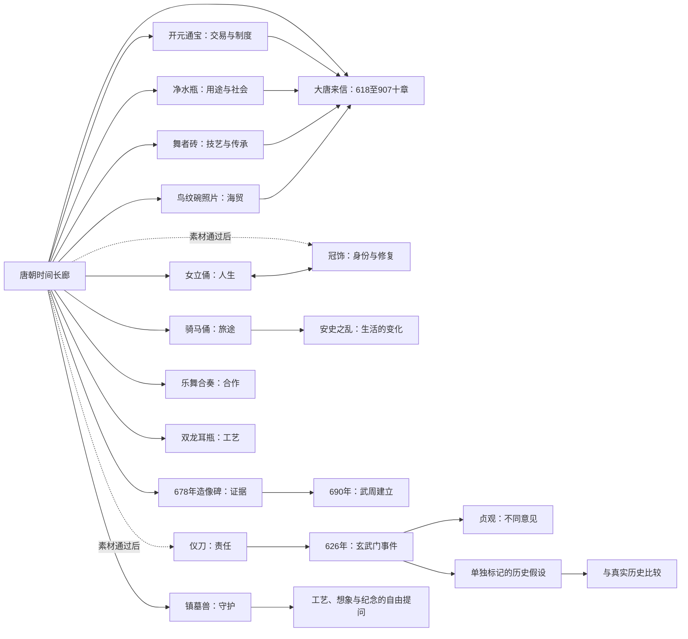

# 时空博物馆：唐朝首版文物与情节设计

版本：0.3｜日期：2026-10-23｜阶段：选品与编剧依据

配套文档：[《大唐来信》贯穿主线](./时空博物馆-大唐来信贯穿主线.md)、[新增素材验收](./时空博物馆-新增文物与素材验收.md)、[架构设计](./时空博物馆-架构设计.md)。十章主线的节点、对白与转场以《大唐来信》为准，本篇保留展台支线及文物总账。本文是可供后续写分镜、对白和资料卡的内容底稿，不是已经审定的完整历史教材，也不是已完成的游戏剧本。尚待原报告核对或素材授权的内容逐项标出。

## 1. 首版策展决定

**少放物件，每件打开不同的一角。** 目前九个主体主题已有三维资源（乐舞含两个模型），另有后备与海外比较模型，合计19个模型文件；其中18个属唐代中国、1个属伊拉克比较器。晚唐鸟纹碗仍为两张实物照片。最新下载、缺口与用途见[全馆盘点](./时空博物馆-唐朝全馆素材盘点与下载.md)。用这些资源组织618—907的完整主线，再逐件深化支线；冠饰和兵器按素材条件后补，不用同类佛像凑数量。

| 首版 ID | 类别与代表 | 唯一承担的故事主题 | 当前数字素材状态 | 首版安排 |
| --- | --- | --- | --- | --- |
| A01 | 人物陶俑：唐代女立俑 | 一个普通人的成长与选择 | 已下载并验证三维显示 | 主体展品 |
| A02 | 出行：唐代骑马俑组合 | 一段旅途、信息与人与人的连接 | 已下载并验证三维显示 | 主体展品；一组视为一个主题入口 |
| A03 | 镇墓兽：唐代镇墓兽 | 人如何用形象表达守护与思念 | 已下载；兼容材质版已验证 | 主体展品 |
| A04 | 纪年与政治：678年一佛二菩萨造像碑 | 从实物证据认识武后与时代变化 | 已下载并验证三维显示 | 主体展品；不再并列另一尊佛像讲相同主题 |
| A05 | 冠饰：李倕墓出土复原冠饰 | 身份、工艺与考古修复如何建立认识 | 史料线索已核查；未取得可发布三维文件或图片授权 | 重点补齐位，资源通过后发布 |
| A06 | 兵器：唐代窦皦墓出土仪刀 | 武器、身份与权力选择的责任 | 学术文献确认出土仪刀线索；正式定名与数字素材待核 | 重点补齐位，证据和资源通过后发布 |
| A07 | 钱币：开元通宝 MH2012.20.39 | 交易、信任、制度与负担 | 已下载并验证三维显示 | 主线T01／T04／T06 |
| A08 | 仪式器物：白釉陶净水瓶 MG138 | 用途、信仰与社会变化 | 已下载并验证三维显示；中文工作名暂译 | 主线T08 |
| A09 | 建筑构件：修定寺舞者浮雕砖1921.263 | 技艺、交流与危机中的传承 | 已下载；兼容材质版已验证 | 主线T09；非880事件遗物 |
| A10 | 海贸比较器：长沙窑鸟纹碗1986.97.3 | 安史之乱后仍在发展的生产与贸易 | 两张馆方开放照片已下载，无三维 | 主线T07；不冒称黑石号船货 |
| A11 | 乐舞：Mia弹拨乐俑与吹笛乐俑 | 演出前的合作、听见彼此 | 两个模型已下载并实测，CC0；合并一个故事展台 | T04《演出开始前，谁先听见谁》 |
| A12 | 三彩器形：双龙耳瓶 | 器形、釉色与工艺交流 | 原始GLB与ZIP已取得；正立展示版已实测，CC BY 4.0 | T04工艺支线；不冒称T07船货 |

“王冠、皇冠”在本版合并为冠饰大类，不拆成两个相似展台。**李倕冠饰不能标为唐朝皇帝的皇冠**；它对应贵族女性，是否使用“公主”等正式封号必须另核，本文采用“皇室后裔”这一较稳妥称呼。

“刀、戈”属于兵器大类，本版优先找有唐代出土证据的仪刀。不能为凑一个“戈”把商周文物混进唐朝，也不能用现代商业唐刀模型冒充出土文物。

A05、A06 是首版内容目标，不是已经到位的展品。若制作冻结时仍未取得合格素材，首发采用九个已有主体三维主题及鸟纹碗照片，并以明确标注的历史事件场景承载相关主题；不发布空展台，不把未授权图片作为默认替代。

## 2. 内容真实性与史书选择

### 2.1 每句话属于哪一层

| 标记 | 定义 | 可以怎样讲 | 不能怎样讲 |
| --- | --- | --- | --- |
| F 史实／可核实物信息 | 馆藏记录、考古资料或经过核对的历史记载支持 | “馆方将这件物品断代为唐代。” | 把一个馆方推测消去限定语后当定论 |
| R 合理复原 | 根据资料搭建的一般环境、工序、衣饰等 | “这一幕依据相关材料复原，细节仍有取舍。” | 声称漫画就是某个历史现场的真实照片 |
| C 创作人物与情节 | 为体验创作的人名、对白、人生与行动 | “阿禾是我们为这件陶俑创作的人物。” | 把虚构人物的一生冒充此文物真实主人的传记 |
| H 历史假设 | 玩家改变重大选择后的另一路可能 | “接下来是历史假设；真实历史的结果另列。” | 改完历史后继续在时间轴上显示为真实事件 |
| U 未知／有争议 | 尚无充分证据，或研究有不同解释 | “目前不能据此确定她的身份。” | 让 AI 即兴补全为确定答案 |

事实等级应挂在具体主张或片段上。一个故事可以同时包含 F、R、C，但界面需要让儿童看懂：物件是真的，环境有复原，人物经历可能是创作。

### 2.2 史书和资料分工

| 资料 | 在本产品的用途 | 使用边界 |
| --- | --- | --- |
| 《资治通鉴》中华书局点校本（胡三省注） | 事件时间线、人物行动与前后关系的主干 | 是后世编纂史书，有取舍和立场；不能把记载的每句对白当现场录音 |
| 《旧唐书》《新唐书》 | 交叉核对本纪、列传、制度与事件差异 | 不能仅用两书相同就认定独立证据充分；争议保留说明 |
| 《贞观政要》 | 纳谏、君臣讨论与政治观念的题材 | 按主题编排，具体故事要核卷篇；不能擅自安在某一天 |
| 《唐六典》及相关研究 | 官职、机构和制度背景 | 制度条文不等于整个唐代、每个地方、每个人都照此实践 |
| 馆藏目录、原始发掘报告、器物研究、文保记录 | 文物身份、年代、材质、出土关系、修复与流传 | 物件优先看这一层，不用通史替代器物证据 |
| 学术性的生活史、考古报告与图像材料 | 衣食、工艺、出行、城市生活的复原 | 单一贵族墓材料不能概括普通人的全部生活 |

正式编剧前锁定所用版次，事实卡记录“卷／篇／页／条目”。本轮已经核查部分公开古籍文本和馆方／学术线索，**未在没有实物书核对的情况下虚填中华书局版页码**。公开转录用于定位，正式审稿与引用仍回到底本和选定版本。

事件的首批定位：玄武门之变见《资治通鉴》卷191；武周建立见卷204；安史之乱起事与结束分见卷217、卷222；贞观纳谏主题主要查《贞观政要》卷二“求谏”“纳谏”等篇。相关公开定位链接列于第10节。

## 3. 已检索文物总账

“有下载标志”和“本机已经取得文件”分开记录。数字模型许可也不等同于文物原所有权或所有配图的许可。

| ID | 文物、机构与身份线索 | 已确认的年代／材料摘要 | 三维状态与许可 | 策展决定 |
| --- | --- | --- | --- | --- |
| A01 | [唐代女立俑][S01]；Mount Holyoke College Art Museum；MH 1991.4.40；摄影测量 Laura Shea | 馆方断代唐代；陶质，下部有釉 | 201.1 MB；约600万三角面；CC BY 4.0；已实测 | 取人物生活主题，不据此认定宫女身份 |
| A02 | [唐代骑马俑组合][S02]；同馆；MH 1964.5A-B.J.C；Laura Shea | 馆方断代唐代 | 329.8 MB；约1046万三角面；CC BY 4.0；已实测 | 取出行主题，不凭帽形认定族属、职业或本人姓名 |
| A03 | [唐代镇墓兽][S03]；同馆；MH 1960.5.J.OI；Laura Shea | 馆方断代唐代；带釉陶质，描述中有翼、脊刺与残存色彩 | 195.3 MB；约600万三角面；CC BY 4.0；兼容版已实测 | 取守护观念与造型主题 |
| A04 | [一佛二菩萨造像碑][S04]；Minneapolis Institute of Art；馆藏链接 art/140016 | 馆方说明为678年，题记涉及高宗及武后 | 4.9 MB；6.4万三角面；CC0；已实测 | 取题记证据与武后时间线主题 |
| A05 | [李倕墓出土冠饰的考古与修复][S09]；陕西省考古研究院相关项目，陕西考古博物馆展陈线索[S10] | 唐代；多种材料组成，经过考古提取与修复复原 | 未取得可用文件；馆内三维复原展示不等于开放下载 | 冠饰唯一目标，不冒称帝王冕冠 |
| A06 | [窦皦墓出土仪刀的学术线索][S11]；正式馆藏条目和发掘报告待核 | 唐代出土仪刀；个体详细数据本稿暂不采用 | 未取得模型、可发布图片或完整授权记录 | 兵器唯一目标，先核定身份再画细节 |
| A07 | [开元通宝][S18]；Mount Holyoke College Art Museum MH2012.20.39；Laura Shea | 个体718—732年；铜质；直径约25毫米 | 260.4 MB；5,999,979三角面；CC BY 4.0；已实测 | 与621始铸分开；可复访交易和制度主题 |
| A08 | [Ceramic Kundika or Ritual Ewer][S19]；The Hunt Museum MG138 | 唐代618—907宽断代；浅色釉陶质；用途解释保留限定 | 43.1 MB；558,308三角面；CC BY 4.0；已实测 | 不冒称普通茶壶、会昌被没收物或法门寺另一件净瓶 |
| A09 | [修定寺舞者浮雕砖模型][S20]；[Cleveland馆藏1921.263](https://www.clevelandart.org/art/1921.263) | 唐代、870年之前；模制红陶，表面施泥浆 | 85.4 MB原件；1,056,846三角面；4K贴图；模型CC BY 4.0；兼容版已实测 | 取建筑技艺和传承主题；非黄巢入长安现场遗物 |
| A10 | [长沙窑鸟纹碗][S21]；The Metropolitan Museum of Art 1986.97.3 | 9世纪；馆藏比较器 | 两张4000×3000实物照片已取得，馆方API标记Public Domain；未取得三维 | 取海贸主题；不是已核实的黑石号出水器 |
| R01 | [天龙山第21窟坐佛][S05]；Harvard Art Museums 1943.53.22；模型源于芝加哥大学 CAEA 项目 | 8世纪；砂岩；馆方用“可能为释迦牟尼” | 58.2 MB；约181万三角面；CC BY 4.0；兼容版已实测 | 已有后备，本版不重复讲佛教造像 |
| R02 | [鎏金铜卧牛][S06]；Cleveland Museum of Art 1985.74 | 8世纪；鎏金铜；馆方尺寸约3.5×7厘米 | CC0；用户手动下载已归档，33.94 MB、4K贴图；结构和解码通过，网页显示待验收 | 后备：小物件与尺度、铸造；不为凑数加入 |
| R03 | [唐代铜镜][S07]；St. Cloud State University Archives，William M. Lindgren Collection，Item 2037 | 发布方断代705—907年；纹饰描述含葡萄、狮与鸟 | CC BY-SA 4.0；用户手动下载已归档，44.63 MB、4K贴图；结构和解码通过，网页显示待验收 | 后备：观看与技术；复用时保留相应许可条件 |
| R04 | [莫高窟第328窟跪姿供养菩萨][S08]；Harvard Art Museums 1924.70 | 7世纪晚期；未烧制泥塑等；馆方记录1924年被移出莫高窟 | CC BY 4.0；用户手动下载已归档，52.52 MB、4K贴图；结构和解码通过，网页显示待验收 | 后备：遗址与流散，不重复当前造像故事 |
| A11a/b | [弹拨乐俑][S22]、[吹笛乐俑][S23]；Mia50.46.180／50.46.181 | 馆方618—906；陶质与彩绘 | 2.59／2.30 MB；63,762／56,788三角面；CC0；已实测 | 一个合奏主题、两个模型；不声称已知演奏曲目 |
| A12 | [双龙耳瓶][S24]；Art Institute of Chicago馆藏条目12229 | 8世纪前半叶；中国唐代三彩 | 264.59 MB；2,246,134面；4000贴图；CC BY 4.0；原件与朝向修正版已实测 | 工艺与器形；馆藏号另核，不把条目ID当馆藏号 |
| R05 | [女俑][S25]；Mia50.46.182 | 馆方618—906；人物身份不明 | 2.59 MB；64,000面；CC0；已实测 | A01同主题轻量候选；是另一件文物 |
| R06 | [佛陀抚顶浮雕][S26]；Mia99.174.3 | 8世纪晚期；砂岩 | 2.41 MB；63,999面；CC0；已实测 | 图像叙事后备，不能据此认定安史之乱或845个体经历 |
| R07 | [守门力士][S27]；Mia2006.79 | 8世纪；石质 | 3.63 MB；100,700面；CC0；已实测 | 建筑守护比较；不能当唐军士兵 |
| R08 | [天龙山第17窟守门力士头像][S28]；Harvard1943.53.40；CAEA项目 | 约735年；浅色石材并有底层／颜料痕迹 | 63.82 MB；1,995,621面；CC BY 4.0；兼容版已实测 | 原位置与流散后备；不与R07拼成同一尊 |
| C01 | [萨迈拉陶碗][S29]；Mia32.32.3 | 伊拉克9世纪；钴蓝彩绘陶器 | 3.75 MB；64,000面；CC0；已实测 | 国际交流比较器，单独计数；不是唐代中国文物 |

两件现代汉服设计模型不计入真实文物总账。它们至多作为另外审核的创作参考，不能据现代设计直接恢复唐代服饰制度。

首版已有模型的本机文件对应：

| ID | 素材目录 ID | 优先验收文件 |
| --- | --- | --- |
| A01 | `d2118efe2b8d4df28661e4ff0501b75e` | `original.glb` |
| A02 | `55e4c6ae757b455d970debc51a742e6c` | `original.glb` |
| A03 | `46a7591d54a443248d95a6fa394ac210` | `web-compatible.glb`；保留原文件及衍生说明 |
| A04 | `e97f95d5781a4359b5a744b0cf0328fa` | `original.glb` |
| A07 | `8949c4225c4b456488b0aae198cdfbb7` | `original.glb` |
| A08 | `8c27362570514399a03752d0964a39e4` | `original.glb` |
| A09 | `6c123dc391cc45858e4efa7ffddadbc1` | `web-compatible.glb`；保留原件和正式材质转换记录 |
| R01 | `047235675c0242bb90398a1f333042ed` | `web-compatible.glb`；保留原文件及衍生说明 |
| A11a | `f3708c86155245df909d095adacf8cfb` | `original.glb` |
| A11b | `9ba6732e48034c5f824a57989e6d3db3` | `original.glb` |
| A12 | `3cf1aa27d46a4ab9948527c6c57e4416` | `web-compatible.glb`；原件和下载ZIP均保留 |
| R05 | `e3eb229a400f4f21ac069c3ce947954c` | `original.glb`；待配初始朝向 |
| R06 | `6c53d79170bd4f37bf90a4e982dd80a3` | `original.glb`；待配正面镜头 |
| R07 | `9b2c5e718b714964afb8482cc702d386` | `original.glb` |
| R08 | `560ed9728cca419cbee18277a1c4fd36` | `web-compatible.glb`；原件保留 |
| C01 | `f58ae5d39a3647ff8a664d3f54ca3e09` | `original.glb`；海外比较器单列 |

目录根为 `D:/7/History/models/`，每件保留来源、授权、哈希和检查结果。正式工程应转换为逻辑资产 ID。上述许可来自逐件模型页面及数据集快照核对，不能扩张到馆站上所有图片。[数据集说明][S17]

## 4. 首批展台的独立支线设计

本节保留原六类展台的原创支线提案，其中A05、A06仍待素材。新增A07—A10的情节、对白与交互已写入《大唐来信》T01、T06—T09，不另复制成一套相同关卡。主线中的许阿禾为700年出生的创作人物；若与A01支线共享，应统一人物设定与年龄。表中的 R 与 C 均须在实际分镜中保留标记。没有写完的环境考证不能被美术自动补成“已经考证的真实场景”。

### A01 女立俑：《她没有留下名字，我们为她讲一个故事》

**核心体验：从一件无名陶俑，进入一位虚构女性“阿禾”的人生，理解普通人的选择也值得被记住。**

史实锚点：陶俑为馆藏唐代女性立像，馆藏号、材料和表面形态可以核对。她是谁、从事什么、是否入宫、生活多久，目前不能由此确定。[S01]

故事身份：阿禾及家庭、师傅、朋友全部为 C；环境为待审 R。她不是此陶俑已经证实的真人原型。初版选择工艺与家庭生活线，不同时再写一套相似的“宫女一生”。若未来找到身份明确的宫廷人物资料，可另做有不同主题的内容包。

| 节点 | 静态画面与情节 | 玩家可以发散什么 | 返回主线的条件 |
| --- | --- | --- | --- |
| A01.01 没有名字的她 | 先看真实三维陶俑，观察姿态与衣饰；讲解员说明哪些知道、哪些不知道 | “她是宫女吗”“怎么知道是唐朝”“她手里有什么” | 进入创作故事前明确 F/C 边界 |
| A01.02 小时候的疑问 | 漫画中，阿禾在家里看大人做一件手工物品，第一次提出想试试；具体工种与工具待考证后锁定 | 请求看工具、问家人做什么、选择先观察还是动手 | 形成一个自己想学的目标；不考唯一答案 |
| A01.03 长大的选择 | 阿禾面对学习手艺、帮助家里、与朋友一起做事等生活选择 | “我想换一种做法”“女孩都能这样吗”“去问问别人” | 根据已发布分支调整下一幅图，不将虚构选择推广为全部唐人处境 |
| A01.04 一次没有做好的尝试 | 她完成的东西不理想，需要找出原因并向别人求助 | 观察、求助、重新分配工作、先休息再做；允许解释自己的理由 | 选择影响角色反应与处理过程，不以答对题来通关 |
| A01.05 她把经验交给下一代 | 阿禾年长后，把当年学到的经验交给晚辈；回看玩家之前的选择 | 问她后悔过什么、比较年轻与年长视角、跳回一个片段 | 保存创作分支的回顾，不写入真实人物传记 |
| A01.06 回到无名陶俑 | 再次显示真实物件，列“我们观察到的”“我们创作的”“仍不知道的” | 自由追问、比较自己的生活、进入别的主题 | 自主离开或继续观察 |

讲解开场示意（原创）：“她的名字没有写在这件陶俑上。我们不能说自己知道她的一生。你愿不愿意从她的衣着和姿态出发，走进一个依据唐代生活材料创作的故事？”

乐趣来自人生回看、不同人物回应和随时停下来追问，不要求儿童按职业攻略获得最优结局。需要补查：具体工种、家庭物件、不同身份女性的生活限制与机会、选定年代的服饰细节。未经补查，不加入缠足、清代宫女制度、现代学校或一概而论的女性生活设定。

### A02 骑马俑：《一封家书，穿过一段旅途》

**核心体验：选择怎样走、向谁问、如何理解不同人的信息。与 A01 的人生线分开，重点是空间、交通与合作。**

史实锚点：真实模型是一组唐代骑马人物俑，馆藏号可核对。不能仅凭造型认定他们就是邮差、商人、某个族群或某段旅途中的具体人物。[S02]

故事身份：旅人阿宁、同伴和需要转交的家书为 C。故事地图是经过审稿的 R；若道路、关卡和旅店资料不足，只展示相对路线示意，不冒称精确古代导航。

| 节点 | 静态画面与情节 | 活的规则与发散 | 关键边界 |
| --- | --- | --- | --- |
| A02.01 两位骑者 | 真实模型旋转，观察马、人物和装束，先提出想知道的问题 | 看马具、看人物、比较步行与骑乘 | 观察能见部分，身份不明就保留未知 |
| A02.02 一封要交出去的信 | 阿宁答应替熟人转交一封家书，选择与谁同行 | 询问目的、改变同行安排、检查准备物 | 不把“替熟人带信”说成国家驿传制度 |
| A02.03 两条路和几种说法 | 示意图出现一条近路、一条易补给的路，不同旅人给出不同意见 | 问距离、水、马是否需要休息；可以先去核实 | 时间与补给是本剧情变量，不是实测唐代行程 |
| A02.04 别人也有难处 | 遇到需要帮助的旅人，在行程和互助之间作安排 | 共享信息、一起走、先求助；允许提出合理第三条路 | 不用牺牲别人换分数；不把异域人物画成固定善恶标签 |
| A02.05 信送到了，信息未必完整 | 收信人问路上情况，玩家区分亲眼见到与听说 | 可讲自己的过程，也可说明不知道 | 引出“消息为什么需要核实” |

讲解开场示意（原创）：“这两位骑者没有给我们留下出发地点。我们的旅途从一个小约定开始：把一封家书交到另一个人手里。你想先知道路怎么走，还是先问问这封信为什么重要？”

需要补查：马具名称、选定年代的出行条件、可公开使用的长安及周边地图。尤其不能默认普通旅人可以无条件使用官方驿站。与安史之乱的连接只能是“出行如何受到战争影响”的解释联系，不能说这组陶俑亲历该事件。

### A03 镇墓兽：《小匠人的守护兽》

**核心体验：看清一只幻想动物由哪些形象组合，理解过去的人用什么表达守护与送别。**

史实锚点：馆方将物件定为唐代镇墓兽，描述为带翼、脊刺等特征的兽形，保留釉与色彩线索。具体委托者、工匠、原墓主人和每一部位的唯一象征含义不能据现有模型确定。[S03]

故事身份：工匠学徒“小陶”和师傅是 C；工坊、制作方法、安放场景是需核材料后的 R。主题是工艺、想象与情感，不把鬼怪存在当事实，也不将逝者当闯关障碍。

| 节点 | 静态画面与情节 | 玩家可以怎样玩 | 规则与学习联系 |
| --- | --- | --- | --- |
| A03.01 先别急着害怕 | 真实模型与剪影，观察翼、背脊、神情 | “像哪种动物”“翻到背面”“它一定是坏的吗” | 不设唯一动物答案；把观察和猜测分开 |
| A03.02 一份关于守护的委托 | 小陶听到师傅解释为什么人们制作这类形象 | 问守护谁、为什么放在墓里、想换一个角色听 | 用儿童能理解的语言解释葬俗与纪念，允许跳过 |
| A03.03 做得威风，还是做得亲近 | 漫画展示几种创作草图，玩家选择自己想表达的感觉 | 组合有限的形状、讲理由、请师傅评价 | 改的是故事草图，不能篡改真实文物的扫描形状 |
| A03.04 工坊里遇到小问题 | 草图与制作条件有冲突，需要重新观察或调整 | 问材料、让师傅示范、选另一个方案 | 工艺细节须经考证后锁定；不臆造具体窑温 |
| A03.05 回到真的镇墓兽 | 比较创作草图与真实文物，听见不同的守护愿望 | “今天我们怎样表达思念”“为什么留下了颜色” | 事实、想象、个人感受并列，形成自己的理解 |

讲解开场示意（原创）：“它看起来很威风。你可以先转一圈看看，也可以问问：为什么有人会希望这样一只兽陪在墓里？接下来的小匠人故事，是我们为理解这种想法创作的。”

需要补查：本件所对应的具体陶／炻器工艺、镇墓兽类型与年代差异、合适的墓葬示意。不能仅凭翼就宣称某一种宗教归属，也不把任一地区葬俗讲成全唐统一习惯。

### A04 造像碑：《石头上的名字，十二年后的变化》

**核心体验：从一件有明确纪年的实物出发，学会看证据，再进入武后的政治时间线。与一般佛像介绍分开，不把重点放在重复讲造像姿势。**

史实锚点：馆方将碑定年为678年，并说明题记中同时出现皇帝与武后作为祈愿受益者；她在690年称帝建立武周。678年的她还不是武周皇帝。[S04][S14]

题记在当前1024像素贴图中未必足够逐字读清。展示采用经核对的题记释义摘要，明确是“馆方说明摘要／经审核释读”，不能让 AI 看模糊贴图即兴读出整篇铭文。

| 节点 | 静态画面与情节 | 玩家可以发散什么 | 史实边界 |
| --- | --- | --- | --- |
| A04.01 先找一个年代 | 真实碑与时间标记，解释为何纪年能帮助定位 | 看正面、侧面、题记部位，问如何断代 | 定年依据来自馆方记录，不靠外观猜年代 |
| A04.02 谁被写进祈愿 | 释义摘要突出帝与后，观察一个公共形象怎样留下名字 | “为什么要写名字”“她已经是皇帝了吗” | 不把现代漫画对白当碑文原话 |
| A04.03 站在678年 | 地图与关系图呈现高宗、武后和当时政治身份 | 换一个人物视角、问当时的人知道多少 | 史实关系由资料支持；具体普通人的想法用 C 表达 |
| A04.04 再往后十二年 | 时间轴进入690年，可选听故事或角色体验 | 问“发生了什么变化”“其他人如何看” | 不能把一块碑说成称帝的单一原因或直接证据 |
| A04.05 带着证据回来看 | 回到碑，区分它直接告诉我们的与需要别的资料解释的 | 问资料来源、比较不同证据、跳往相关事件 | 一件物件不能独自证明一个人的全部动机 |

故事中的少年观察者或刻石学徒如采用，均为 C。需要补查：准确题记释文、馆藏定年说明、678年政治关系与地点资料。未核前不绘制精确碑文，不宣称具体雕刻者或委托者身份。

### A05 冠饰：《把散落的珠饰重新连起来》

**核心体验：成为文保工作的小助手，判断哪些是证据、哪些是复原。重点是工艺与认识方法，不再重复 A01 的女性人生。**

史实锚点：李倕为唐代皇室后裔，其墓葬在2001年考古中被发现；冠饰经过整体保护提取、实验室工作及中德合作修复。馆方介绍提供冠饰复杂组合与复原过程的线索。[S09][S10]

部分报道对零件数、高度、发掘细节等表述不完全一致。首版不把“世界唯一”等随研究进展变化的宣传语写成永久事实；不在原报告未核时选一个数字作题目。

| 节点 | 静态画面与情节 | 玩家动作 | 边界 |
| --- | --- | --- | --- |
| A05.01 看起来像皇冠 | 若取得授权，先看实物／复原展示；问“戴这样冠饰的人一定是皇帝吗” | 看结构、问材料与身份 | 明确这是李倕冠饰，非帝王皇冠；无素材则不发布此展台 |
| A05.02 时间来到现代实验室 | 经过授权的图片或依据材料绘制的示意呈现散件与整体提取 | 问为什么不直接拿起来、为什么保留泥土 | 现代文保过程与唐代佩戴复原标记为不同年代 |
| A05.03 先记录，再提出摆放办法 | 玩家在示意层查看连接与位置线索，听取文保解释 | 比较证据、保存猜想、请求另一张示意 | 不是教孩子自行修文物，不把互动拼图当真实修复方法 |
| A05.04 一处证据还不够 | 两种复原设想都看似合理，讨论还需要什么资料 | 选“暂不确定”、查资料、听研究者意见 | 允许保留未知，乐趣不依靠猜中唯一官方答案 |
| A05.05 回到唐代的想象 | 依据已核结构展示佩戴复原漫画，列明仍未知的细节 | 问身份、工艺、审美与自己的饰物有什么联系 | 只说复原依据，不虚构李倕当天的真实活动 |

需要补查与取得：正式馆藏名称、原报告与复原论文、可发布的实物或复原图、三维文件及授权。若未来获得模型，仍保留物件在不同修复阶段的版本关系，不能把复原支架也解释为唐代原有部件。

### A06 仪刀：《这把刀，为什么也代表一种身份》

**核心体验：看见兵器除了作战，还可能涉及仪卫、身份与责任，再进入权力选择的历史事件。**

史实锚点：龙真发表于《故宫博物院院刊》2022年第8期的研究，在第33页讨论仪刀、班剑与身份，并提到长安县唐代窦皦墓出土仪刀。[S11] 这支持本稿建立“仪刀与身份”的研究方向，尚不足以替代该件完整的发掘和馆藏记录。

网络中“窦皦／窦皓”、出土年份、具体名称和规格存在不同表述。本稿暂用“窦皦墓出土仪刀”；“水晶坠金柄环首仪刀”等较长名称、铭文、尺寸、墓主人官职及具体经历，正式展签必须回到原报告逐项核定。

| 节点 | 静态画面与情节 | 玩家动作 | 边界 |
| --- | --- | --- | --- |
| A06.01 先认清这是什么 | 取得合格资源后看实物；若仅有依据充分的复原图，显著标注复原 | 问材质、部件、装饰、如何辨认 | 现代“唐刀”商品不能作为真实出土器物 |
| A06.02 一位虚构仪卫的当值 | 漫画呈现礼仪、身份与秩序，具体配置审稿后固定 | 问职责、换旁观者视角、比较不同场合 | 仪卫为 C，不认定墓主人就是此人 |
| A06.03 服从命令与理解后果 | 一个创作情境让玩家先询问信息，再决定怎么沟通 | 找人核实、询问理由、提出避免冲突的方法 | 不以伤害数量和杀戮效率奖励儿童 |
| A06.04 走进626年的事件 | 选择进入玄武门事件，先讲清关联只是解释性联系 | 以李世民视角听信息，或作为观察者听讲述 | 不说这把刀用于玄武门之变，也不说墓主人因此在场 |
| A06.05 回看身份与责任 | 从权力事件回到文物，讨论能力与决定的后果 | 自由表达、查证据、切回真实历史路线 | 不能把“有武器就应夺权”作为学习结论 |

需要补查与取得：墓主人姓名、原发掘资料、馆藏条目、定名与材料、合法数字素材；事件部分另按 E01 资料包核查。若无法确认该具体物件，替换为另一件有充分证据的唐代兵器时，保留“身份与责任”主题，重新建立实物事实卡。

## 5. 历史事件馆：四个不同的问题

每个事件都有“听故事”和“角色体验”两个入口。讲述模式使用预写主线；角色模式围绕几次关键行动展开。两者共用同一套事实卡和历史结果，不分别维护两版历史。

| 事件 | 时间与类型 | 第一版重点问题 | 主要入口 |
| --- | --- | --- | --- |
| E01 玄武门之变 | 626年，具体事件 | 一个决定会改变谁的处境 | 兵器主题；事件时间轴也可直接进入 |
| E02 贞观纳谏 | 贞观时期，主题性组合场景 | 为什么需要听到不同意见 | 时间轴、人物关系、自由提问 |
| E03 武周建立 | 690年，具体事件 | 什么证据帮助我们认识权力变化 | 678年造像碑，向后十二年 |
| E04 安史之乱 | 755—763年，历史过程 | 战争怎样改变普通人的日常与选择 | 骑马俑的出行主题、时间轴 |

### E01《门前的决定》：玄武门之变

事实骨架：武德九年，李世民仍为秦王；李建成为太子，李元吉为齐王。玄武门事件中，建成、元吉被杀，随后政治权力发生转移。不能开场就把尚未登基的李世民称为皇帝。[《资治通鉴》卷191][S12]

体验身份：玩家可代入李世民，也可选择观察者。历史模式了解信息、关系与代价，事件事实保持；改为“不发动冲突”等重大反事实行动时，进入 H 分支。玩家的话语和角色回应是改编，不是逐字还原的历史对话。

| 片段 | 画面与任务 | 允许的自由行动 | 必须保留的边界 |
| --- | --- | --- | --- |
| E01.01 三个位置 | 简明人物关系图与当时宫城北门示意，先确认人物身份 | 问谁与谁是什么关系、换一个人的立场听 | 地图须核当时布局，不能拿后世大明宫图直接当626年现场 |
| E01.02 不完整的消息 | 不同立场表达担忧，玩家决定先询问哪类信息 | 找来源、问其他人、请求讲解员指出哪些来自史书记载 | 对人物动机使用“记载称／一种解释”，不窥读内心作确定事实 |
| E01.03 一个选择，许多后果 | 玩家提出行动，看到有限的情境回应 | 问代价、请求谈判、观察局势、进入历史假设 | 不提供执行刺杀的操作教程；不按暴力效果评分 |
| E01.04 事实与设想对照 | 用非血腥画面说明真实结果，与玩家假设并列 | 问后续、回到某个立场、进入纳谏主题 | 假设不能覆盖时间轴上的真实事件，也不能承诺“换我就能保证天下太平” |

原稿需求：需要史书差异卡、关系图、简洁地图、约三至四幅事件漫画／图解。重大结果直接交代，但不渲染伤害画面。仪刀与该事件是主题关联，不能写为同一实物证据链。

### E02《一句不顺耳的话》：贞观纳谏

这是根据《贞观政要》的求谏、纳谏等材料编排的主题场景，不冒称真实发生在某日的一次完整朝会。具体采用哪一则事例，正式对白须锁定卷篇与版本。[《贞观政要》目录与篇目定位][S13]

体验身份：玩家可扮演提出问题的君主、进言者或旁听者。核心乐趣是改变提问和回应方式，发现不同信息；不把“始终赞同皇帝”设为唯一正确路线。

| 片段 | 内容 | 玩家自由度 | 剧情规则 |
| --- | --- | --- | --- |
| E02.01 一个听起来不错的决定 | 设定一个经过制度背景审核的创作议题，涉及资源与不同人群 | 先问理由、问谁受影响、请讲解员解释背景 | 议题明确标 C，不假装就是某一条真实诏令 |
| E02.02 有人说不 | 不同角色说明顾虑，玩家选择继续听还是反问 | 可以用自己的语言表达，不必照读选项 | 回应方式影响下一段信息和信任等故事变量 |
| E02.03 再听一方 | 新信息让最初决定显得不完整 | 询问证据、调整决定、承认还不知道 | 没有一句万能谏言解决所有政策问题 |
| E02.04 回看史料 | 展示采用的真实记载摘要与创作部分 | 问真实人物是否一直如此、查来源、比较自己的合作经历 | 不能从一则故事推出整个时期政治都理想无缺 |

与 E01 的联系是“取得权力之后怎样作决定”的解释联系，不叙述为一次政变自然带来理想政治。配图可复用人物肖像和关系图，但不可复用同一段冲突剧情。

### E03《一个称谓变了》：武周建立

事实骨架：678年的实物题记可以作为观察武后政治地位的一种材料；690年称帝、建立武周须另用历史文献说明。二者相隔十二年，不能把那块碑当作称帝已发生的证明。[S04][《资治通鉴》卷204][S14]

体验身份：观察时代变化的记录者为 C。也可听武后及其他立场的“改编视角说明”，但明确不是读取真实人物的内心。

| 片段 | 内容 | 玩家自由行动 | 史实边界 |
| --- | --- | --- | --- |
| E03.01 678年的位置 | 从碑与释义摘要确认她当时的身份 | 问这是什么证据、哪些话没写在碑上 | 先认识证据能说明到哪里 |
| E03.02 时间向后走 | 选取经核查的少量关键时间点与人物关系 | “我想先看中间发生了什么”“换另一个人的看法” | 不用一条进度条暗示历史只有唯一、简单的因果 |
| E03.03 690年的变化 | 名称、政治身份和时间轴标签变化 | 问“为什么不仍叫唐”“不同人如何反应” | 标出武周；原因与评价需有资料，不能说一件文物决定结果 |
| E03.04 回到石碑 | 将原物、文献与后续解释并列 | 请讲解员比较证据、返回678年、继续查人物 | 不把后来的结果反向写进678年人物已知的信息 |

本事件不再加一顶来历不明的“武则天皇冠”作为物证。若要出现冠服，只能采用经核查并标注为复原的视觉设计。

### E04《路变了，生活也变了》：安史之乱

事实骨架：755年起事，至763年这一历史过程结束；过程中的地点与人物行动需按相应时间段核对。[《资治通鉴》卷217][S15]、[卷222][S16]。玩家不需要记住所有战役，而是理解大事件对普通人的影响。

体验身份：一位负责与家人同行、核实消息的虚构普通人。具体村镇、同行者和选择是 C，不对应一支已查明的真实逃难队伍。地图、物品、交通条件以 R 审稿。

| 片段 | 内容 | 玩家可以做什么 | 剧情规则 |
| --- | --- | --- | --- |
| E04.01 原来的出行计划 | 通过与 A02 类似的路线图建立日常计划 | 问家人、看准备的物品、先问为什么出发 | 与 A02 区别在于时代环境变化，不重新讲一遍送信 |
| E04.02 两条互相矛盾的消息 | 有人说路能走，有人说不能；讨论如何核实 | 找另一来源、看时间、问消息是否过时 | 不把任何传闻自动升级成史实 |
| E04.03 共同作决定 | 家人需要协调等待、改道、互助等选择 | 提出第三种办法、说明担忧、请求查看相关地图 | 变量围绕信息、协作与准备；不设伤亡排行和恐怖惩罚 |
| E04.04 不只是一场胜负 | 回到历史过程及其生活影响，区分虚构家庭与真实事件 | 问后来如何恢复、普通人留下了什么记录 | 不声称玩家挽救／改变了真实战争结果 |

如儿童不愿体验战争题材，可以只听概览、跳过角色场景。剧情不以恐吓留住玩家。

## 6. 自由探索怎样被承接

### 6.1 不要求每句话预写一个完整场景

每个节点准备五类素材：当前可观察细节、可询问的人物／观点、可做的有限动作、相关事实卡、可返回的主线点。AI 在这些边界内组合语言和展示。这样可以让追问很多样，同时避免无限制作新漫画。

| 玩家说法 | 系统提供的服务 | 内容需预先准备什么 |
| --- | --- | --- |
| “带我看看” | 按当前焦点进入该文物的故事入口；没有焦点时先给少量可用对象 | 文物与故事入口、真实素材可用状态 |
| “背面是什么” | 转动真实模型或聚焦背面；讲解只说可见或有资料支持的细节 | 取景、热点和细节事实卡 |
| “她小时候呢” | 进入 A01 的童年片段，持续标注人物为创作 | 人生阶段与可跳转节点 |
| “普通人也能戴吗” | 对当前冠饰／衣饰查资料，区分身份与一般习惯；资料不足就说明 | 适用年代、身份及例外的事实卡 |
| “我要问问另一个人” | 切换已支持角色的视角；没有该角色素材时提供基于资料的说明 | 角色身份、知道什么、不知道什么、观点边界 |
| “我不按你说的走” | 解释可预见条件，支持已有的替代行动；重大反事实进入 H | 条件、有限效果、合流点与假设标识 |
| “我想自己做一只” | 在明确的创作草图层组合形状，再与真实镇墓兽比较 | 可组合的二维部件、创作与实物分层 |
| “再往后一百年” | 计算目标时间，寻找该时点已有内容；说明缺失区间 | 可排序时间、内容覆盖范围；不生成虚构馆藏填空 |
| “接着刚才讲” | 恢复问答前的故事与片段；不清楚指哪个时自然澄清 | 返回点、播放检查点和当前模式 |
| “你怎么知道” | 展示支持当前主张的资料和未知项 | 主张到来源的映射，而非一长串泛泛链接 |

### 6.2 每个展台都应交付的最小互动包

- 一句能让玩家主动观察的开场，不能只是百科简介。
- 约三至六个可展开的真实观察点；看不清的铭文用经审核释义，不编造可读细节。
- 一个区别于其他展台的核心问题和约五个主线片段。
- 若干开放提问方向，覆盖“是什么、为什么、当时谁会接触、与今天有什么联系”。
- 至少一处允许玩家提出自己办法的情境，明确能影响什么、不能影响什么。
- 一个稳妥的返回主线点和一到两个相关事件入口。
- 出处、事实等级、素材许可和未解决问题。

这是内容验收结构，不是要把所有选项固定成按钮。按钮作为发现入口与语音失败后的替代路径，玩家可以说自己的话。

### 6.3 发散过远时的回应

先承认玩家想探索的方向，再说明当前资料能提供什么。例如问“这只镇墓兽能不能飞到罗马”，可以把“它的翅膀属于怎样的想象”作为当前解释；若玩家要比较不同文明的幻想动物，查找已发布的跨文明内容；没有相关包时明确尚未提供，不临时造一个“罗马馆藏”及其出处。

不得把每次跑题都拉回任务提示。只要资料足够，旁支可以独立停留；返回点保存好，玩家决定何时回来。

## 7. 可自由进入的故事网络

连线是可解释的主题联系，不是强制关卡顺序，也不证明文物参与过对应事件。已开放展台和十章主线均可以随时离开；没有“先答题才能看下一件”的默认规则。

时间跳转显示日期变化。同一个 C 人物若出现在相隔数十年的情节里，要明确年龄、身份和故事关系；不能让一个未加说明的普通人以同样年龄贯穿一百多年。玩家和博物馆讲解员可以穿越时间，历史人物不因此自动获得未来知识。

## 8. 给编剧、美术、资料审核和开发的交付约定

### 8.1 一份故事卡至少包含什么

| 字段 | 交付内容 |
| --- | --- |
| 稳定 ID、主题、适用时间 | 不从标题临时生成；同类主题重复时先审策展必要性 |
| 实物锚点 | 馆藏号、物件身份、已确认与未知信息 |
| 核心问题 | 这一件为何值得进入故事，与其他展台区别在哪里 |
| 片段表 | 节点 ID、目标、图像、字幕／讲解、事实等级、进入退出条件 |
| 角色卡 | F 真实人物或 C 创作人物；身份、所知、观点、不能知道的未来信息 |
| 自由交互 | 可观察、可追问、可行动、可换视角、未覆盖方向的回应 |
| 规则变量 | 只描述本剧情中的影响；不得伪装成历史真实测量 |
| 返回与关联 | 追问返回点、假设退出点、相关事件及关联性质 |
| 证据卡 | 每个历史主张对应来源、位置、版本、争议、审稿状态 |
| 素材卡 | 真实扫描、实物照片、复原图、创作漫画分别列明许可、署名与修改 |

示例 ID 可采用 `cn.tang.artifact.guardian`、`cn.tang.story.guardian`、`cn.tang.event.xuanwumen`。文物、故事与事件 ID 分开，便于一件文物连接多个题材而不复制实物数据。

### 8.2 美术最小需求

九个主体三维主题先加工可展示版、固定镜头、热点和一张降级预览；A10直接以已授权实物照片承载，不声称有三维。主线按片段使用静态漫画，地图与关系图可以复用模板；不建设完整的三维唐朝城市。

《大唐来信》包含40个主线片段；本篇原六类展台约31个支线节点、四个事件约16个片段，是可复用的内容库。**不得把40＋31＋16直接当成87个互不重复的必做场景或87张漫画。** 展品观察、时间轴、地图、证据比较和回顾直接用动态展示承载；角色行动才需要漫画。主线每章两至三张核心人物漫画是分镜预算，尚未生成。

真实文物的轮廓、纹样和残损不能为了好看随意改作实物图。生成式图像适合创作人物、复原场景和风格统一的漫画；每张历史复原图都保留依据与审稿，不能把生成结果用作自身的历史证据。

主线配音根据最终审定文本生成或录制；字幕、音频和漫画使用同一片段版本。角色即兴回应与预写旁白分开，避免每次问答后主线文案悄悄变化。

### 8.3 发布门禁与制作顺序

| 顺序 | 任务 | 通过标准 |
| --- | --- | --- |
| 1 | 审定十章主线文本与史实骨架 | 从618走到907，文物个体、类型与解释性关联分开 |
| 2 | 制作T01、T05、T10完整样本 | 起点、转折、结尾有情节回应；语音追问、返回、继续闭环 |
| 3 | 补齐T02—T04、T06—T09及所需资料 | 开元之后仍有重建、交流和晚唐压力，不省略后半段 |
| 4 | 加工九个主体三维主题与A10照片展台 | 来源、材质、朝向、热点、性能、授权展示通过 |
| 5 | 复用本篇事件与展台支线；冠饰、兵器过门禁后加入 | 不复制同一故事；不以待补资产阻塞完整主线 |
| 6 | 全馆一致性审稿 | 日期、称谓、角色年龄、地图、衣饰、物件用途、来源与音频版本一致 |

“文物背后有故事”不要求已知物主生平：可以讲物主、工匠、使用者、制度、修复与流传，也可以通过明确标注的虚构人物进入时代。但不允许把“故事精彩”当成隐去创作性质的理由。

## 9. 当前仍需解决的内容缺口

1. **冠饰素材**：李倕冠饰有可靠考古与文保资料方向，但尚未获得适合发布的模型或图片授权。馆内三维图不能直接算下载资源。
2. **仪刀身份和资源**：已核实学术论文中的出土线索；正式定名、墓主写法、出土资料、馆藏号、配图和许可须继续核对。不能先画好一把现代唐刀再找材料套上。
3. **生活环境**：A01、A02、A03 的具体工种、城市路线、马具与制作细节应按选定年代补资料，不能只凭通史常识定稿。
4. **碑文释读**：现有馆方说明足以支持“纪年与武后”的入口；精确文字展示仍须获取可核对释文，避免看模糊纹理编字。
5. **已取得模型的最终质量**：高面数模型要减面、扶正；14个模型文件的1024贴图关键部位可能不适合极近距离观看；浮雕砖和双龙耳瓶4K也须实测。若题材依赖看不清的细节，需要合法补充资料图或调整互动。
6. **事件资料包**：已经定位主干卷篇；每段最终旁白和角色回应仍需建立事实卡，交叉核对《旧唐书》《新唐书》及研究，不把本稿当作全部审稿完成。

这些缺口决定对应内容什么时候进入生产，不阻止用九个主体三维主题及A10照片完成贯穿样本。数量优先服从主题差异、证据和体验质量。

## 10. 来源与核查索引

核查日期：2026-10-23。下列模型页面同时对应本机保存的元数据、许可和模型 ID；用于确认物件及数字资源，不表示已经自动核对其全部历史描述。资料页提供内容依据不等于自动授予其中配图的发布权。

| 来源 ID | 内容与核查用途 | 当前边界 |
| --- | --- | --- |
| S01 | [Laura Shea：Standing Chinese Woman Figure (Tang Dynasty)][S01] | 馆藏号与断代；真实人物身份不明 |
| S02 | [Laura Shea：Chinese Equestrian Figures, Tang Dynasty][S02] | 馆藏号与断代；职业、族属及旅途不作确认 |
| S03 | [Laura Shea：Tang Dynasty Tomb Guardian (Zhenmushou)][S03] | 馆藏号、材料与形态描述 |
| S04 | [Mia：Votive stele - Buddha and two Bodhisattvas][S04]；[馆藏记录](https://collections.artsmia.org/art/140016/buddhist-votive-stele-with-buddha-and-two-bodhisattvas-china) | 678年与题记解释；完整释文另核 |
| S05 | [Harvard Art Museums：1943.53.22，CAEA 模型][S05]；[馆藏记录](https://hvrd.art/o/204140) | 天龙山坐佛的身份与模型来源 |
| S06 | [Cleveland Museum of Art：1985.74 Recumbent Bull][S06]；[馆藏记录](https://www.clevelandart.org/art/1985.74) | 断代、尺寸、材质与 CC0 元数据 |
| S07 | [St. Cloud State University Archives：Chinese Bronze Mirror][S07] | Item 2037、发布方断代与模型许可；广泛的玻璃镜历史说法未直接采用 |
| S08 | [Harvard Art Museums：Kneeling Attendant Bodhisattva][S08]；[馆藏记录](https://hvrd.art/o/303672) | 出处、断代、材料及1924年移出洞窟的馆方记录 |
| S09 | [中国丝绸博物馆：李倕墓考古发现与研究讲座][S09] | 博物馆发布的研究者讲座内容；用作冠饰、皇室后裔与修复过程线索 |
| S10 | [西北大学：科技考古，让文物“说话”][S10] | 科技与文保项目的机构报道；不据其三维展示描述推断可下载 |
| S11 | [龙真：《太原地区唐墓“树下人物图”之管见》，《故宫博物院院刊》2022年第8期，相关讨论第33页][S11] | 原作者学术论文；仪刀线索仍应回到该墓发掘资料 |
| S12 | [《资治通鉴》卷191公开文本][S12] | 玄武门事件定位；正式引用与选定版本再核 |
| S13 | [《贞观政要》公开目录与文本入口][S13] | 卷二求谏、纳谏等主题定位；具体对白待锁定条目 |
| S14 | [《资治通鉴》卷204公开文本][S14] | 690年武周建立定位 |
| S15 | [《资治通鉴》卷217公开文本][S15] | 755年前后事件定位 |
| S16 | [《资治通鉴》卷222公开文本][S16] | 763年前后事件定位 |
| S17 | [AllenAI Objaverse 数据集及逐件许可说明][S17] | 当前14个模型原件的公开分发来源；另有浮雕砖、双龙耳瓶从馆方模型页直接取得；逐件保留许可与署名 |
| S18 | [Laura Shea：Kai Yuan Tong Boa][S18] | 馆藏号与个体718—732；621始铸另核馆方历史资料 |
| S19 | [The Hunt Museum：Ceramic Kundika or Ritual Ewer][S19] | MG138、宽断代和用途解释；没有845个体遭遇证据 |
| S20 | [Cleveland Museum of Art：1921.263模型][S20] | 官方模型CC BY 4.0；馆藏条目给出断代上限与建筑来源 |
| S21 | [The Met：Bowl with bird，1986.97.3][S21] | 9世纪与实物照片；开放接口Public Domain，不冒称船货 |

本机当前总账：`D:/7/History/research/3d-all-file-verification.json`（19个文件：18个唐代中国、1个海外比较器），新增验收见全馆盘点；`3d-file-verification.json`、`唐代3D模型实际下载验收.md`保留为首批五件历史记录，以及各模型目录中的 `provenance.json`、`ATTRIBUTION.txt`、`file-inspection.json`。正式剧情文件按本文身份边界建立独立事实卡，不把研究候选表的“可下载”误读成已经可发布。

[S01]: https://sketchfab.com/3d-models/standing-chinese-woman-figure-tang-dynasty-d2118efe2b8d4df28661e4ff0501b75e
[S02]: https://sketchfab.com/3d-models/chinese-equestrian-figures-tang-dynasty-55e4c6ae757b455d970debc51a742e6c
[S03]: https://sketchfab.com/3d-models/tang-dynasty-tomb-guardian-zhenmushou-46a7591d54a443248d95a6fa394ac210
[S04]: https://sketchfab.com/3d-models/votive-stele-buddha-and-two-bodhisattvas-e97f95d5781a4359b5a744b0cf0328fa
[S05]: https://sketchfab.com/3d-models/19435322-model-caea-university-of-chicago-047235675c0242bb90398a1f333042ed
[S06]: https://sketchfab.com/3d-models/198574-recumbent-bull-774c1c5f1cd4484f98b68ee96d886950
[S07]: https://sketchfab.com/3d-models/chinese-bronze-mirror-81e693050be345dd9db8ace54fea5de5
[S08]: https://sketchfab.com/3d-models/kneeling-attendant-bodhisattva-129635ad396947a7975c9e5ba6095f32
[S09]: https://www.chinasilkmuseum.com/cs/info_164.aspx?itemid=4840
[S10]: https://news.nwu.edu.cn/info/1004/20293.htm
[S11]: https://img.dpm.org.cn/Uploads/File/2022/08/17/u62fca8ee33373.pdf
[S12]: https://zh.wikisource.org/wiki/資治通鑑/卷191
[S13]: https://zh.wikisource.org/wiki/貞觀政要
[S14]: https://zh.wikisource.org/wiki/資治通鑑/卷204
[S15]: https://zh.wikisource.org/wiki/資治通鑑/卷217
[S16]: https://zh.wikisource.org/wiki/資治通鑑/卷222
[S17]: https://huggingface.co/datasets/allenai/objaverse

[S18]: https://sketchfab.com/3d-models/tang-dynasty-currency-kai-yuan-tong-boa-8949c4225c4b456488b0aae198cdfbb7
[S19]: https://sketchfab.com/3d-models/ceramic-kundika-or-ritual-ewer-8c27362570514399a03752d0964a39e4
[S20]: https://sketchfab.com/3d-models/1921263-architectural-brick-with-dancer-in-reli-6c123dc391cc45858e4efa7ffddadbc1
[S21]: https://www.metmuseum.org/art/collection/search/42399

新增来源索引：S22—S29分别对应全馆盘点的A11a、A11b、A12、R05、R06、R07、R08、C01；事实边界和下载证据以配套全馆盘点为准。

[S22]: https://sketchfab.com/3d-models/tomb-figure-lute-player-f3708c86155245df909d095adacf8cfb
[S23]: https://sketchfab.com/3d-models/tomb-figure-flute-player-9ba6732e48034c5f824a57989e6d3db3
[S24]: https://sketchfab.com/3d-models/dragon-handled-amphora-3cf1aa27d46a4ab9948527c6c57e4416
[S25]: https://sketchfab.com/3d-models/figure-of-a-woman-618-906-ce-e3eb229a400f4f21ac069c3ce947954c
[S26]: https://sketchfab.com/3d-models/buddha-stroking-the-head-of-a-follower-8th-c-ce-6c53d79170bd4f37bf90a4e982dd80a3
[S27]: https://sketchfab.com/3d-models/dvarapala-guardian-figure-8th-century-ce-9b2c5e718b714964afb8482cc702d386
[S28]: https://sketchfab.com/3d-models/19435340-model-caea-university-of-chicago-560ed9728cca419cbee18277a1c4fd36
[S29]: https://sketchfab.com/3d-models/samarra-ware-bowl-9th-c-ce-f58ae5d39a3647ff8a664d3f54ca3e09
