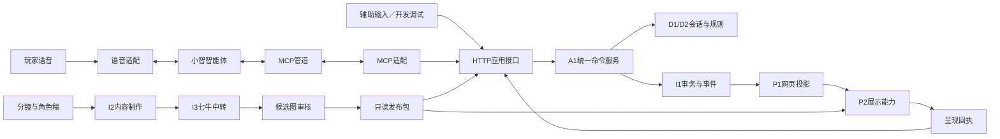

# 时空博物馆开发手册

版本：1.2｜更新日期：2026-10-24｜状态：保留工程拆分；产品玩法已更新为长廊式语音参观

> **最新产品入口：[长廊式语音游玩开发手册 v2.1](./时空博物馆-长廊式语音游玩开发手册.md)。** 玩家先进入有纵深的文物长廊，用语音前进、定位、转动和进入故事；走近文物自动加载真实模型。人物与故事插画只在请求故事后出现。本文原有展品列表、点击闭环与详情页设想不再作为玩家主路径；相关实施任务以[AI开发任务卡](./时空博物馆-AI开发任务卡.md)为准，用户亲自检查按[H0—H8清单](./时空博物馆-用户检查与交付清单.md)进行。
>
> 本文继续提供工程模块边界、既有文件职责、内容制作、生图中转、存档与提交规范。实现进度以代码、合并记录和新手册第10节快照为准，不使用初始“尚未实现”的文字推断当前状态。

本手册回答四个问题：每个模块负责什么；具体文件放什么；完成哪些功能才提交PR；怎样把点击、语音、MCP、剧情和美术制作接成可验收的产品。

配套依据：[架构设计](./时空博物馆-架构设计.md)、[作者稿逐件与逐章导入任务](./时空博物馆-AI开发任务卡.md)、[素材盘点](./时空博物馆-唐朝全馆素材盘点与下载.md)、[手动补充模型验收](./时空博物馆-手动补充模型验收.md)。本分支未保存旧文物总纲与十章原稿文档，现有作者卡片、timeline与主线副本在 `D:/7/History/generated/2026-10-24-tang-r02/content/`，按CW13a先整理映射和出处。架构文档规定长期约束，本手册规定文件归属与实施顺序；修改约束时同步更新两份文档。

阅读顺序：先读第2节模块边界，再按第3节查文件，第6/8节查生图与小智接入，新AI任务卡领取本轮PR工作项，第11节执行提交。第12节用于判断一次修改会影响哪里。

**本文保留初始工程计划。表中“首建PR”是工作项编号，不证明功能已经完成或尚未完成；新增长廊体验按v2.1手册实现和验收。**

## 1. 本轮确定的交付目标

产品叫《时空博物馆》。首版以真实文物三维观察、二维漫画、讲解、开放追问和角色体验组成唐朝展览，贯穿618—907年的建立、兴盛、转折、重建与衰亡。故事可以提前编排，玩家的观察顺序、追问、情境选择与角色回应保持开放。

首个产品闭环按v2.1改为三个真实文物组成的短长廊：造像碑、开元通宝与鎏金卧牛。玩家用语音前进、指名定位，走近后自动加载模型，再请求进入故事、打断、恢复并原位返回。A04三片段观察故事仍可作为内容夹具；它不等于完整T03章节。先验收这条语音参观旅程，再扩完整唐朝。

下表更新为2026-10-24工程快照；实际测试、合并与用户检查状态见[进度台账](./acceptance/开发进度.md)，不能仅凭文件存在判断完成。

| 基线 | 当前情况 | 开发处理 |
| --- | --- | --- |
| 工作仓库 | `Xiean730829/HistoryPlay`；本地目录拼写为`HistroyPlay` | 不在任务中擅自改本地目录名 |
| Git | 当前已见walk分支及契约、内容、查询、导航提交，HEAD快照ca05fc4 | 跳过第11节无历史仓库的首次建基线步骤，按实际默认分支拆PR |
| 现有工程 | 已有React会话/目录界面、Python核心/接口、三物draft作者包 | 长廊、真实语音与全馆内容仍需任务卡和用户验收；不重建已有模块 |
| 三维素材 | 19个模型文件：18个唐代中国资源、1个伊拉克比较器 | 16件已检查显示与旋转，手动补充3件已检查结构及4K贴图，显示待验收 |
| 素材位置 | `D:/7/History`，约1.655 GB模型原件，另有ZIP及衍生版 | 原件不进入普通Git，生产资产用清单及外部存储 |
| 现有小智网页 | `C:/Users/21711/Documents/Xiaozhi_Web_Test/xiaozhi_web_test` | 复用已工作的采音、编解码、播放、打断与设备连接，不整体复制旧页面 |
| 图像生成 | 七牛中转已产出58个选用候选图ID，Key仅本机配置 | 先审核导入；离线制作不成为玩家运行依赖 |

### 1.1 交付里程碑

| 里程碑 | 玩家或开发者实际能得到什么 | 不通过时的处理 |
| --- | --- | --- |
| M0 接入可行性 | 专用小智智能体实际发现并调用诊断MCP工具；语音打断、来源和旧任务隔离有证据 | 保留开发输入工具；按第8节选择可证明关联的编排方案，不能跳过问题批量制作内容 |
| M1 长廊观察闭环 | 三个真文物展位、远近透视、靠近自动加载、故事返回与存档恢复；开发输入不等于语音验收 | 先修核心及状态同步，不以语音提示词绕过错误 |
| M2 语音闭环 | 与点击共用命令服务；打断、追问、继续、换展品真实有效 | 不把工具Online或能聊天计为完成 |
| M3 制作闭环 | 分镜→七牛出图→原图留存→审核→发布→游戏加载；无需Key也可玩已发布内容 | Key未配置只阻塞真实生图验证，不阻塞引擎、契约和离线流程 |
| M4 唐朝首版 | 十章主线可玩，九个主体文物主题、鸟纹碗照片及必要支线；角色和年代连续性通过审核 | 一章一章发布，不把未完成章节伪装成已开放 |
| M5 扩展及发布 | 另一地区的微型内容包通过同引擎；目标设备与发布配置通过验收 | 扩包需要改核心的，先修抽象再继续堆内容 |

## 2. 模块边界：谁负责，谁不能越界

模块沿用架构中的D1、D2、A1、A2、A3、P1、P2、V1、X1、I1、I2、I3。它们是逻辑边界，首版不拆微服务集群。

| 模块 | 负责的完整职责 | 输出 | 不得依赖或修改 |
| --- | --- | --- | --- |
| D1 会话核心 | 焦点、当前位置、剧情模式、返回栈、修订号、探索记录 | 新会话状态和领域事件 | 小智、MCP、数据库、React、HTTP |
| D2 剧情规则 | 合法动作、条件、有限规则效果、分支合流、假设隔离 | 可解释的规则决策 | 唐朝硬编码、任意脚本、浏览器DOM |
| A1 命令服务 | 绑定校验、票据、幂等、修订号比较、事务与提交 | 命令回执、有序事件 | 直接播放声音、直接生成漫画 |
| A2 内容查询 | 已发布内容、别名、当前可见顺序、出处、关联、分页 | 只读资料投影 | 私自推进节点、现场将网文写入事实卡 |
| A3 对话协调 | 本地输入生命周期、打断、问答返回点、音频所有权 | 生命周期命令、播放许可 | 第二套剧情进度、臆造云端轮次身份 |
| P1 网页 | 展厅、时间轴、故事、字幕、操作反馈、无障碍 | 命令请求、展示回执 | 本地判定剧情下一节点、保存权威状态 |
| P2 展示能力 | 三维、漫画、地图、关系图、比较视图、取消与释放 | 成功、失败或降级回执 | 自行推断历史意义、改变故事分支 |
| V1 语音适配 | 浏览器采音和播放、音频桥、小智设备协议、事件归一化 | VoiceEvent及音频 | 根据字幕关键词直接切展厅 |
| X1 MCP适配 | 工具发现、参数与结果处理、向应用接口转交 | 小体积工具结果 | 直接写SQLite、传GLB、额外维护故事规则 |
| I1 存储和事件 | 状态、命令回执、outbox原子保存；事件重放 | Repository及事件端口实现 | 修改分支规则、凭连接先后给玩家选结局 |
| I2 内容制作 | 事实审核、资产整理、分镜、构建、版本和发布 | 可校验、不可变内容包 | 让运行时AI直接发布事实或覆盖旧包 |
| I3 生图适配 | 七牛认证、请求、下载、响应及错误归一化 | 候选图片和供应商记录 | 游戏会话、小智凭证、故事规则、前端收费调用 |

依赖方向：外部适配器→应用层→领域核心。`ports`由内部需要驱动定义，外部实现。组装文件可以认识全部具体实现，其他模块不能借组装入口互相偷读状态。



### 2.1 首版部署与语言

前端使用React、TypeScript、Vite，三维先封装`model-viewer`。后端使用Python、aiohttp，SQLite负责本地事务；MCP服务、语音桥与制作工具使用独立Python包。它们可以由一个本地启动器管理，不要求分别上云。

依赖在PR01确定准确版本并提交锁文件：Node选择兼容建项时Vite要求的受支持LTS，Python优先3.12并验证`av`安装；不把本机恰好存在的Python版本当作所有开发者都支持的版本。MCP SDK与官方管道的兼容组合在PR04锁定，不能只写“安装最新版”。[Vite环境要求](https://vite.dev/guide/)、[model-viewer官方说明](https://modelviewer.dev/)。

Python工作区只登记已经存在且有`pyproject.toml`的成员，不能用未经排除的`packages/*`把TypeScript包误当Python包。项目分发名固定为`museum-game`、`museum-voice-bridge`、`museum-mcp-gateway`、`museum-content-pipeline`和`museum-contracts`，与Python导入包名分别管理。npm只登记网页与TS契约包。uv工作区共享锁文件，不自动提供导入隔离，仍要执行边界检查；声明依赖也必须逐包正确。[uv工作区说明](https://docs.astral.sh/uv/concepts/projects/workspaces/)

### 2.2 边界自动检查

`tools/dev/check_boundaries.py`维护允许的Python导入方向；前端lint限制跨层导入。D1/D2不能导入`aiohttp`、SQLite、MCP及任何供应商包。X1只能使用契约和应用HTTP客户端，不能导入`museum.domain`或存储实现。网页展示能力不能导入语音供应商适配。新增依赖方向必须在PR描述中解释并更新规则。

规则不靠“文件超过多少行”判断高内聚。单文件有多个变化原因、适配器反向调用另一个适配器的内部函数、为新增朝代改`if dynasty`，都需要重新拆边界。

## 3. 目录与文件职责总表

以下是规范路径，实施时按对应PR创建，不能先生成全部空文件。表中的“首建PR”对应第10节；`Cxx`是第10.3节的章节系列。Python包中必要的`__init__.py`只导出公开类型，不执行业务或建立连接；不在下表重复列出。

```text
HistoryPlay/
  docs/                         设计、开发、验收与运维说明
  contracts/                    唯一公共Schema及协议示例
  packages/contracts-ts/        生成的TypeScript契约包
  packages/contracts-python/    生成的Python传输契约包
  apps/museum-web/              玩家网页
  services/museum/              权威游戏应用
  services/voice-bridge/        小智音频连接适配
  services/mcp-gateway/         MCP工具与传输
  content-src/packs/            作者源稿，不等于已发布内容
  content-src/art/              分镜、角色、提示词与审核记录
  tools/content-pipeline/      内容构建、生图、资产加工和发布
  tools/dev/                   本地开发与检查命令
  tests/                       跨模块契约及闭环验证
  research/                    来源研究和阶段记录，非运行时内容
```

### 3.1 仓库与构建

| 文件 | 只负责什么 | 首建PR |
| --- | --- | --- |
| `README.md` | 产品入口、环境、启动方式、文档入口、当前完成状态 | 01 |
| `.gitignore` | 排除密钥、运行数据、生成临时文件、模型原件、构建产物 | 01 |
| `.gitattributes` | 文本换行、UTF-8相关约定；不在此悄悄启用全量大文件上传 | 01 |
| `.env.example` | 所有服务的空值配置模板；生图、MCP和设备凭证分开 | 01 |
| `pyproject.toml`、`uv.lock` | Python工作区、开发工具、已解析依赖版本 | 01，后续按模块更新 |
| `package.json`、`package-lock.json` | npm工作区和根脚本；首版只保留这一种JS锁文件 | 01 |
| `apps/museum-web/package.json`、`vite.config.ts`、`tsconfig.json` | 前端依赖、构建、类型检查和开发代理 | 01 |
| `services/*/pyproject.toml` | 各Python分发包的依赖；按需要逐个创建 | 01/04/22 |
| `tools/content-pipeline/pyproject.toml` | 制作工具依赖，和在线游戏依赖分开 | 06/25 |
| `tools/dev/run_local.py` | 按启用项启动本地进程、等待健康检查、统一关闭；不得把密钥放命令行 | 01起逐步扩展 |
| `tools/dev/check_boundaries.py` | 导入边界检查，不承载通用业务函数 | 01起逐步启用规则 |
| `tools/dev/check_pr_scope.py` | 检查本PR涉及模块、变更规模及声明；超出阈值提示拆分 | 01 |
| `.github/workflows/ci.yml` | 无密钥的构建、校验、关键测试与PR标题检查 | 01起逐步启用 |
| `.github/PULL_REQUEST_TEMPLATE.md` | 第11节中文评审模板 | 01 |
| `tools/dev/check_commit_titles.py` | 检查PR内普通提交和PR标题符合中文`feat`规则 | 01 |

不把尚未建立的前端、契约包或测试命令写成已经会通过的CI步骤。每个新增模块在自己的PR里启用对应检查。

### 3.2 公共契约

所有下面的Schema放在`contracts/schemas/v1/`。采用已验证工具链支持的JSON Schema版本，并记录在`contracts/README.md`。文件名与顶层`$id`稳定；跨语言从同一来源生成。

| 文件 | 定义什么 | 首建PR |
| --- | --- | --- |
| `content-pack.schema.json` | 包ID、地域、语言、历史时间范围、版本、依赖能力、发布清单 | 02 |
| `artifact.schema.json` | 真实物件身份、年代区间、馆藏号、模型引用和故事入口 | 02 |
| `asset.schema.json` | 逻辑ID、哈希、字节数、格式、衍生关系、授权、LOD、镜头和降级项 | 02 |
| `source.schema.json`、`fact-card.schema.json` | 来源定位及“哪条主张由哪条证据支持”；F/R/C/H/U标记 | 02 |
| `story.schema.json`、`story-node.schema.json` | 节点、合法动作、画面、讲解、条件、规则效果及返回语义 | 02 |
| `historical-event.schema.json`、`relation.schema.json` | 事件与实体多对多关系；解释性关联不冒充物件亲历 | 02 |
| `session.schema.json` | 公共状态投影、固定包版本、焦点、显示顺序、模式与修订号 | 03 |
| `command.schema.json` | 命令信封、有限动作、目标及各动作参数；指令去重ID | 03 |
| `event.schema.json`、`receipt.schema.json` | 有序事件、命令提交回执、呈现回执及超时状态 | 03 |
| `voice-event.schema.json` | 本地可信语音生命周期；供应商ID可空且注明来源 | 03 |
| `mcp-tools.schema.json` | 五个工具的公共输入；能否直接转为小智工具Schema由兼容层决定 | 03 |
| `image-job.schema.json` | 生图输入、产物、用量未知值、任务状态和审核引用；不得包含Key | 25 |
| `contracts/examples/v1/*.json` | 可公开、无凭证的成功及失败协议样例；按契约逐个新增 | 02/03/25 |
| `contracts/README.md` | Schema版本、生成命令、兼容政策和字段来源 | 02 |
| `tools/dev/generate_contracts.py` | 生成跨语言传输类型，检查生成结果是否过期 | 03 |
| `packages/contracts-ts/src/generated.ts` | Schema生成的网页/MCP客户端传输类型，不手工编辑 | 03 |
| `packages/contracts-python/src/museum_contracts/models.py` | Schema生成的Python DTO，不放领域规则 | 03 |
| `tests/contracts/test_examples.py` | 正常样例可用，缺字段、错误动作及越界参数被拒绝 | 02/03 |

类型生成不能替代运行时校验。HTTP入口校验DTO，应用映射成领域对象；领域核心仍用自己的值对象，不依赖某个生成器运行时。更改Schema的PR要同时提交受影响样例和生成文件。

### 3.3 游戏领域与应用

下列文件相对`services/museum/src/museum/`。

| 文件 | 具体职责 | 首建PR |
| --- | --- | --- |
| `domain/session/models.py` | 纯状态值对象、历史时间、焦点、版本、返回点；不读取系统配置 | 09 |
| `domain/session/transitions.py` | 打开展品、改变焦点、进入/退出问答、保存返回点的纯状态转换 | 09 |
| `domain/session/events.py` | 领域事件类型，与WebSocket消息分离 | 09 |
| `domain/story/models.py` | 故事与节点的领域表达、规则输入输出 | 10 |
| `domain/story/conditions.py` | 有限条件解释器；支持已声明条件，不使用`eval` | 10 |
| `domain/story/effects.py` | 受限变量变化、发现记录和关系反馈；不执行外部脚本 | 10 |
| `domain/story/engine.py` | 当前状态下可做什么、选择分支、推进和返回、H分支隔离 | 10 |
| `application/command_service.py` | 命令唯一写入口；校验、调用纯核心、在事务中提交状态和回执 | 13 |
| `application/query_service.py` | 会话投影、内容目录、资料卡查询及有界分页 | 12 |
| `application/render_service.py` | 记录当前命令的显示/降级回执；旧回执不改当前场景 | 14 |
| `application/binding_service.py` | 展台、可信语音连接和可信工具连接的配对及撤销 | 14 |
| `application/control_tickets.py` | 签发、校验、撤销有限时效控制票据；不声称能辨认未知云端旧任务 | 13 |
| `application/mappers.py` | DTO、领域类型和对外投影之间的转换 | 12/13 |
| `application/errors.py` | 统一错误码、可重试性质和用户可理解的失败原因 | 12 |
| `conversation/coordinator.py` | 管理问答与主线切换、输入生命周期和打断请求，调用A1写状态 | 23 |
| `conversation/audio_focus.py` | `game_narration/provider_reply/none`唯一所有者及播放许可 | 18/23 |
| `conversation/turn_guard.py` | 接入可信的轮次/取消屏障证据，拒绝过期执行；未知来源显式未知 | 23 |
| `ports/session_store.py` | 会话读取、事务单元和修订号比较接口 | 11 |
| `ports/command_receipts.py` | 命令幂等回执及请求内容摘要接口 | 11 |
| `ports/event_log.py` | 事件写入、序号重放和outbox接口 | 11 |
| `ports/content_catalog.py` | 读取固定版本的发布包和实体接口 | 06 |
| `ports/asset_catalog.py` | 从逻辑资产ID解析已发布元数据，不接受任意文件路径 | 07 |
| `ports/voice.py`、`ports/narration.py` | 语音生命周期、停止与播讲接口，核心不认识音频格式 | 18/23 |

首版变量允许布尔、受限数字、枚举和有限集合。自由文本作为玩家表达保存时不能直接变成可执行条件。自然语言角色行动先映射到已声明的行动意图，不能映射时允许角色解释、追问或提供相关行动，不把一切都强行变成固定选项题。

### 3.4 数据、API、配置与组装

下列文件仍相对`services/museum/src/museum/`。

| 文件 | 具体职责 | 首建PR |
| --- | --- | --- |
| `adapters/sqlite/database.py` | 连接与事务单元、迁移执行；不在各Repository中单独提交 | 11 |
| `adapters/sqlite/session_repository.py` | 状态读取和带修订号比较的写入 | 11 |
| `adapters/sqlite/receipt_repository.py` | 同一会话内请求去重、相同ID不同载荷冲突检测 | 11 |
| `adapters/sqlite/event_repository.py` | 事件序号、outbox提交与已分发位置 | 11 |
| `adapters/content/published_catalog.py` | 读取不可变发布包并按包版本建立索引 | 06 |
| `adapters/content/search_index.py` | 中文别名、人工关键词和有界检索；不先引入向量库 | 12 |
| `adapters/assets/local_asset_resolver.py` | 将发布清单资产ID映射到允许的素材根目录 | 07 |
| `adapters/http/auth.py` | 网页会话凭证、Origin、内部服务身份的校验 | 14 |
| `adapters/http/session_routes.py` | 创建会话、读取快照/上下文、配对流程 | 14 |
| `adapters/http/command_routes.py` | 校验HTTP命令后转交A1；不在路由写剧情判断 | 14 |
| `adapters/http/content_routes.py` | 展品、事实卡及故事投影查询，固定包版本 | 14 |
| `adapters/http/render_routes.py` | 提交呈现回执，转交render_service | 14 |
| `adapters/http/lifecycle_routes.py` | 经认证的语音生命周期输入；页面不能伪造其他连接 | 23 |
| `adapters/http/asset_routes.py` | 允许清单内的资产服务；缓存和Content-Type，不开放任意磁盘读取 | 14 |
| `adapters/events/websocket_channel.py` | 带认证的事件连接、缺口恢复与快照重同步 | 14 |
| `bootstrap/config.py` | 读取并验证本服务配置，不主动加载其他服务的凭据 | 01/14 |
| `bootstrap/container.py` | 唯一依赖组装入口，装配ports与adapters | 14 |
| `bootstrap/main.py` | 启动、健康检查、停止服务及资源释放 | 01/14 |
| `services/museum/migrations/0001_initial.sql` | 会话、命令回执、绑定、事件及outbox初始表 | 11 |
| `services/museum/migrations/README.md` | 数据库迁移、备份与回滚规则；内容迁移单独处理 | 11 |

### 3.5 网页文件

本节为原工程拆分。玩家首屏改用v2.1的 `gallery/` 长廊模块；`ExhibitList` 仅适用于编辑与开发辅助，`ArtifactPanel` 改为展台内自动观察组合。不得照旧做“列表→详情→点击加载”的玩家入口。新文件表与验收见[新手册第12节](./时空博物馆-长廊式语音游玩开发手册.md#12-逐文件实施职责)。

下列文件相对`apps/museum-web/src/`。

| 文件 | 具体职责 | 首建PR |
| --- | --- | --- |
| `main.tsx`、`App.tsx` | 挂载应用、页面壳及依赖组装；不放剧情规则 | 01/15 |
| `api/museumClient.ts` | 会话、查询、命令和呈现回执HTTP客户端 | 15 |
| `api/eventChannel.ts` | WebSocket订阅、序号检查、重连和补快照 | 15 |
| `state/sessionProjection.ts` | 只保存服务端投影和事件游标；不自行推进权威状态 | 15 |
| `state/commandDispatcher.ts` | 统一命令ID、修订号、请求过程反馈；不自动重发业务新命令 | 15 |
| `presentation/MuseumShell.tsx` | 展厅布局、当前年代、展品和故事区域 | 15 |
| `presentation/ExhibitList.tsx` | 按服务端顺序显示可用展品，保证“第二个”一致 | 15 |
| `presentation/ArtifactPanel.tsx` | 文物标题、断代、实物身份与模型展示组合 | 16 |
| `presentation/StoryPanel.tsx` | 漫画、角色对话、允许行动和开放表达入口 | 17 |
| `presentation/Timeline.tsx` | 地域/时代/事件时间视图；不内置仅中国朝代的数据结构 | 17 |
| `presentation/EvidenceDrawer.tsx` | 事实卡、出处、F/R/C/H/U说明和争议 | 17 |
| `presentation/ObservationBook.tsx` | 展示已提交观察记录和历史回访关系，不强制答题 | 17-c |
| `presentation/StatusNotice.tsx` | 加载、失败、降级、断线和真实完成状态 | 15 |
| `capabilities/CapabilityRegistry.ts` | 以能力ID和版本选择展示组件，不按朝代写分支 | 16 |
| `capabilities/Artifact3D.tsx` | model-viewer封装、旋转/缩放/热点/镜头、事件回报和卸载清理 | 16 |
| `capabilities/ComicScene.tsx` | 已发布静态分镜、过渡和文字叠层 | 17 |
| `capabilities/MapScene.tsx`、`RelationshipScene.tsx` | 声明式地图和关系图，不执行内容包脚本 | 17 |
| `capabilities/CompareScene.tsx` | 两件文物或证据的比较，分别保留身份 | 17-c |
| `capabilities/RenderReceiptReporter.ts` | 关联命令、修订号、资产ID；旧加载结果丢弃，发送可重试的回执 | 16 |
| `capabilities/assetLoader.ts` | 当前与邻近片段预取、取消、缓存引用和资源释放 | 16 |
| `narration/NarrationPlayer.ts` | 播放已审定主线音频，报告片段开始、结束和检查点 | 18 |
| `narration/BrowserNarrationAdapter.ts` | 浏览器音频播放实现；按平台要求首次授权或解锁音频，之后参观不依赖点击 | 18 |
| `voice-ui/VoiceControls.tsx` | 麦克风开关、连接、打断状态和输入反馈 | 21 |
| `voice-ui/SubtitlePanel.tsx` | 用户及供应商字幕；不把字幕完成作为剧情完成 | 21 |
| `voice/capture-worklet.js` | 复用旧工程的音频采集能力，不放UI、HTTP和MCP | 21 |
| `voice/VoiceClient.ts` | 与本地语音桥连接、归一化语音事件和连接生命周期 | 21 |
| `voice/PlaybackQueue.ts` | 音频队列、立刻停止、旧回复丢弃和真实排空事件 | 21 |
| `voice/VadController.ts` | 本地发声/结束/插话检测和参数；不判定玩家说了哪个故事 | 21 |
| `styles/tokens.css`、`styles/app.css` | 主题、字号、响应式、减少动态效果和无障碍样式 | 15 |

React对model-viewer的事件和属性兼容封装只在Artifact3D里处理。未来换Three.js时，保留能力输入与回执契约，网页其他组件及故事规则不应变化。

### 3.6 语音桥与MCP

| 文件 | 具体职责 | 首建PR |
| --- | --- | --- |
| `services/voice-bridge/src/voice_bridge/main.py` | 音频桥启动、健康检查、连接关闭 | 22 |
| `.../config.py` | 设备配置、供应商地址允许项和本地凭据；不读取IMAGEGEN_API_KEY | 22 |
| `.../xiaozhi_client.py` | hello、音频、STT/TTS、abort、连接重建及协议版本适配 | 22 |
| `.../opus_codec.py` | PCM/Opus编码解码、声道和采样率检查 | 22 |
| `.../browser_routes.py` | 网页音频WebSocket、单连接身份与访问校验 | 22 |
| `.../lifecycle.py` | 来源明确的VoiceEvent、本地connection_id及输入轮次；不能伪装为供应商轮次 | 22/23 |
| `.../persistence.py` | 本机设备身份的显式保存/恢复，沿用固定设备；日志脱敏 | 22 |
| `services/mcp-gateway/src/museum_mcp/server.py` | 注册五个MCP工具、stdio运行；stdout只允许协议 | 19/20 |
| `.../tools/connect.py` | museum_connect；只完成可信连接范围内的展台绑定 | 19 |
| `.../tools/context.py` | museum_get_context；查询当前状态与既有回执 | 19 |
| `.../tools/search.py` | museum_search；少量已发布结果和游标 | 19 |
| `.../tools/read_content.py` | museum_read_content；事实与出处的有界分页 | 19 |
| `.../tools/act.py` | museum_act；翻译受限动作，所有写入经过A1 | 20 |
| `.../application_client.py` | 经认证调用游戏HTTP接口，不直接访问数据库或domain | 19 |
| `.../compatibility.py` | 实际协商版本、工具Schema兼容、最终UTF-8响应预算 | 04/19 |
| `.../binding_context.py` | 在受信管道/进程范围保存绑定句柄，撤销旧连接；不凭AI自报设备ID路由 | 19 |
| `.../config.py` | MCP_ENDPOINT、本地应用地址及服务身份；不复用设备Token | 04/19 |
| `services/mcp-gateway/vendor/xiaozhi_pipe/` | 按上游许可固定版本的官方管道；只在验证需要时纳入 | 04 |
| `services/mcp-gateway/vendor/UPSTREAM.md` | 上游URL、commit、许可和本地补丁；第三方文件名保持原样 | 04 |
| `tools/integration/mcp_probe.py` | 独立诊断工具，验证工具调用和大小；不修改生产剧情 | 04 |
| `tools/integration/voice_probe.py` | 测试现有语音桥和打断生命周期，记录脱敏证据 | 05 |
| `docs/integration/xiaozhi-capabilities.md` | 本账号实测工具限制、版本、取消/轮次证据及选路结论 | 04/05/23 |
| `docs/adr/0001-voice-control-routing.md` | 记录采用哪条语音控制路径、证据与局限，不能只填“兼容” | 05/23 |

省略号`.../`分别指该组Python包目录，只是表格缩写；不创建名为`...`的目录。兼容实现引用上游时先查许可证和实际commit；不把下载的整个上游仓库塞进业务源码。

### 3.7 作者内容、素材与生图制作文件

| 文件 | 具体职责 | 首建PR |
| --- | --- | --- |
| `content-src/packs/cn/tang/manifest.yaml` | 唐朝作者包ID、语言、历史区间、能力及对外章节入口 | 08 |
| `.../artifacts/A04-stele.yaml` | 造像碑真实身份、断代、来源、逻辑资产和故事关联 | 08 |
| `.../stories/stele-observation.yaml` | 第一条三片段观察故事，仅用于首个闭环；与T03完整主线ID不同 | 08 |
| `.../stories/T01.yaml`至`T10.yaml` | 各章节点、行动、条件、合流、讲解和返访；见第10.3节 | C01—C10 |
| `.../facts/<事实ID>.yaml` | 每条主张的事实等级、来源定位和不确定性 | 08/Cxx |
| `.../sources/<来源ID>.yaml` | 馆方/古籍/研究来源、获取日期、引用位置和许可 | 08/Cxx |
| `.../events/<事件ID>.yaml` | 事件时间、地域、人物与故事入口 | Cxx |
| `.../relations.yaml` | 有出处的实物/解释/创作关联，不暗示所有物件都亲历事件 | 08/Cxx |
| `.../locales/zh-CN.yaml` | 展签、界面内容名及中文别名，不塞按钮实现逻辑 | 08/Cxx |
| `content-src/assets/catalog.yaml` | 将已验收物件与数字资产版本分开建档，原始19件逐件有记录 | 07 |
| `content-src/assets/import-manifest.local.yaml` | 本机盘符映射和取材位置，忽略不提交 | 07 |
| `content-src/assets/import-manifest.example.yaml` | 空值/示例映射，其他开发者可改自己的素材根目录 | 07 |
| `content-src/art/style-guide.yaml` | 漫画风格、构图、色彩及禁止混用的年代元素 | 27 |
| `content-src/art/characters/<角色ID>.yaml` | 创作人物身份、年代、服饰依据、参考设定版本 | 27/Cxx |
| `content-src/art/storyboards/<章节ID>.yaml` | 哪个节点用哪幅漫画、动作、镜头、史实边界和复用关系 | 27/Cxx |
| `content-src/art/prompts/<任务ID>.yaml` | 提示词、参考图ID、目标节点及参数，不包含Key与临时签名URL | 25/27/Cxx |
| `content-src/art/reviews/<任务ID>.yaml` | 历史、美术、角色一致性审核和批准产物哈希 | 27/Cxx |
| `content-src/release/<包版本>.yaml` | 具体发布版本、审核记录、资产清单哈希和可开放章节 | 27/Cxx |

`content-src/packs/cn/tang/`下的省略路径属于作者数据，不是一个文件容纳整个唐朝。新增国际内容另建地区包，年代使用可比较的时间区间和地域标签，不强制绑定中国年号。

下列制作工具文件相对`tools/content-pipeline/src/content_pipeline/`。

| 文件 | 具体职责 | 首建PR |
| --- | --- | --- |
| `cli.py` | `validate/build/assets/imagegen/review/publish`子命令分发，不在此实现全部业务 | 06起分步加入 |
| `validation/schema_validator.py` | YAML解析为规范数据后执行公共Schema | 06 |
| `validation/reference_validator.py` | ID唯一性、引用完整、实体与包版本关系 | 06 |
| `validation/story_graph.py` | 节点可达、出口、循环限制、分支合流和返回点 | 28 |
| `validation/history_review.py` | 事实来源、F/R/C/H/U及必需审核字段；不自动判定历史真伪 | 28 |
| `validation/license_review.py` | 授权、署名、衍生关系、必填许可证据 | 07 |
| `build/compiler.py` | 作者源稿转成运行时JSON，不读取未审核网文补情节 | 06 |
| `build/pack_writer.py` | 可复现构建、清单及哈希、不可变版本目录 | 06/27 |
| `assets/importer.py` | 核对来源和校验和、保留原件、记录归档来源 | 07 |
| `assets/inspect_glb.py` | GLB结构、贴图解码、资源依赖和面数报告 | 07 |
| `assets/optimize_model.py` | 制作LOD、材质兼容及展示方向的衍生版本，记录处理工具 | 30 |
| `assets/image_variants.py` | 已批准图片的网页尺寸、裁切、缩略图与编码版本 | 27 |
| `ports/image_generation.py` | I2定义ImageGenerationPort，不含供应商HTTP字段 | 25 |
| `imagegen/models.py` | Job、Artifact、Usage和错误的内部表达；用量未知保留null | 25 |
| `imagegen/job_store.py` | 独立制作SQLite：任务、尝试记录、状态与审核关联 | 25 |
| `imagegen/worker.py` | 有界并发、复用、恢复和人工重试；不运行在游戏命令事件循环 | 25 |
| `imagegen/fingerprint.py` | 按提示词/角色/风格/参考哈希/模型/参数/适配版本生成复用键 | 25 |
| `imagegen/output_store.py` | 候选原图落盘、哈希和任务目录；不自动发布 | 25 |
| `adapters/imagegen/qiniu_config.py` | 读取IMAGEGEN配置，规范化base URL，Key只在此进入适配器 | 26 |
| `adapters/imagegen/qiniu_client.py` | 认证、生成/编辑HTTP请求，超时/限流/拒绝归一化 | 26 |
| `adapters/imagegen/qiniu_response.py` | 解析经验证的base64/URL/任务响应形状，不凭猜测兼容所有格式 | 26 |
| `adapters/imagegen/qiniu_capabilities.py` | 已验证模型ID、认证、尺寸、质量、编辑字段及响应能力 | 26 |
| `review/review_service.py` | 审核签署与拒绝原因；未批准产物不得进入发布包 | 27 |
| `publish/publisher.py` | 原子生成发布清单、验证资产存在、拒绝覆盖已发布版本 | 27 |
| `publish/storage.py` | 本地发布目录实现；后续可换对象存储，不改内容源稿 | 27 |

### 3.8 关键测试文件

测试按真实风险建立，不要求每个文件有一份镜像测试。文档、纯样式、简单文案和可逆整理不专门增加单元测试。

| 文件 | 必须证明什么 | 首建/扩展PR |
| --- | --- | --- |
| `tests/domain/test_session_transitions.py` | 焦点、返回点和修订号一致；查询不改状态 | 09 |
| `tests/domain/test_story_rules.py` | 条件/效果、合流、H分支隔离，非法行动不推进 | 10 |
| `tests/integration/test_command_transactions.py` | 同请求只执行一次、并发继续不跳两段、状态/回执/事件同事务 | 13 |
| `tests/integration/test_bindings.py` | 换展台/重连撤销旧票据，跨绑定请求失败 | 14/23 |
| `tests/integration/test_event_replay.py` | 丢事件、断线、刷新后与服务端快照一致 | 14 |
| `tests/integration/test_mcp_contract.py` | 五个工具真实Schema、权限拒绝、UTF-8完整响应预算 | 19/20 |
| `tests/integration/test_voice_interruptions.py` | 延迟旧调用、旧任务重新读上下文、旧TTS等竞态；模拟不替代真实账号证据 | 23 |
| `tests/content/test_pack_validation.py` | 错身份、缺引用、未审核图、错误许可、无出口图不能发布 | 06/28 |
| `tests/content/test_imagegen_lifecycle.py` | 复用、未知结果不重复收费提交、审核前不得发布、缺Key不影响游戏 | 25—27 |
| `apps/museum-web/src/capabilities/Artifact3D.test.tsx` | 延迟旧模型不覆盖新场景、卸载释放、回执关联 | 16 |
| `apps/museum-web/src/voice/PlaybackQueue.test.ts` | 本地立即停止、旧音频丢弃、排空事件准确 | 21 |
| `tests/e2e/museum-flow.spec.ts` | 文物→故事→追问→继续→换目标→刷新恢复 | 24 |
| `tests/e2e/content-expansion.spec.ts` | 另一地区同能力包不改引擎及工具列表可装载 | 29 |

## 4. 内容、状态和动作的统一约定

### 4.1 ID与历史时间

运行时ID采用命名空间，例如`cn.tang.artifact.stele`、`cn.tang.story.t03`、`cn.tang.node.t03.01`；A04/T03等作者编号作为人可读索引保留。真实物件ID、数字资产ID、故事ID分开，换模型不换真实物件身份。新地区包可以使用`iq.abbasid.*`等独立前缀。

时间至少表达开始、结束、精度、历法/纪年说明和不确定性。621年始铸开元通宝不等于本件718—732年馆藏钱币铸于621；“870年之前”不能改成“870年制作”。精确月日没有核对就不显示。

### 4.2 权威状态及顺序

`revision`管剧情和指代相关变更，`view_revision`管语义镜头操作，`event_seq`管事件投递，`interaction_epoch`管本地新输入/打断。拖动模型每一帧不写剧情数据库；点击或语音请求的最终聚焦/视角变更按展示契约确认，不抢占故事修订号。

“它”依据服务端当前焦点；“第二个”依据服务端保存并实际下发的显示顺序。前端不能本地重新排序后仍让语音用旧顺序解释。正文搜索、翻页、加载回执都不能顺便继续剧情。

### 4.3 命令提交顺序

验证可信绑定→参数Schema→查幂等回执→检验控制票据及修订号→读取固定包版本→D1/D2纯计算→一个事务写状态、回执与outbox→投递事件→网页返回呈现结果。

同一`request_id`和相同载荷重试返回原回执；同一ID载荷不同必须冲突。已经完成的旧请求可以只读取自己的旧回执，不再取得执行权限；查回执也要先验证绑定。若已提交但渲染超时，查回执不能再次执行“继续”。

`committed`表示已持久化，`rendered`表示指定前端已呈现，`degraded`表示按清单展示了真实降级项，`render_pending`表示仍等画面。AI的确认必须符合实际回执。

### 4.4 规则保持开放，但不允许任意执行

故事通过可组合的条件和有限效果表达“先问谁、看哪条证据、怎样安排资源、是否进入假设”。角色可以对不同办法作即时反应，分支能合流和回访，允许玩家离开、追问和返回。

开放空间来自内容和机制组合，不是让LLM执行代码。新故事能被现有机制表达时只改作者文件；确需新机制时，另提“规则能力PR”，同时更新Schema、D2、前端能力和验收，再让内容引用。

### 4.5 包版本和未完成内容

作者源稿有draft/reviewed等制作状态；运行时只索引已发布版本。会话固定包版本，已发布目录不覆盖写。更改节点ID或变量语义要提供显式迁移映射和备份，或保留旧包供旧存档继续使用。

尚无漫画或讲解音频的章节可以进入作者稿PR，不能因此自动成为已发布章节。开发演示占位图需明确标“制作中”，不能以它通过正式历史和美术验收。

## 5. 资产接入及现有19个模型怎样使用

首次导入读取研究总账，逐件核对真实物件、来源页、逐件许可、本地文件与哈希，生成`content-src/assets/catalog.yaml`。研究记录不是运行时Schema，不能直接把整份研究JSON读进游戏。

本机取材根目录可配置为`D:/7/History`；运行时只出现逻辑资产ID和资产服务URL，不能把开发者盘符写进内容包。网页不从任意绝对路径加载文件。

| 原始资料 | 生产处理 | 变更影响 |
| --- | --- | --- |
| `original.glb` | 保留不覆盖；校验、LOD和材质衍生另存 | I2和资产清单；不改剧情 |
| `web-compatible.glb` | 先核处理说明，作为候选展示版；不等于已经减面 | I2/P2镜头和热点 |
| `source-download.zip` | 取材备份，不与解压原件重复计数 | 仅制作流程 |
| `ATTRIBUTION.txt`、`provenance.json` | 转为可审计许可和网页来源展签 | I2/A2/P1出处展示 |
| 检查JSON | 提取结构、贴图、尺寸及问题，不当作正式展示通过证据 | I2与验收记录 |

首个模型使用约4.9 MB造像碑；女俑、钱币、骑马俑等大模型先做生产衍生版，不能把约260 MB钱币或约330 MB骑马俑原件当首屏默认资源。预算在目标设备上测量：按模型字节、面数、贴图、首显时间、交互帧率和内存记录，不能只说“已压缩”。具体上线阈值在PR30记录，未达标则降级或不发布。

铜镜、卧牛、敦煌菩萨三个手动模型在PR07补网页正反面、旋转和纹样检查。其余16件的研究验收可作参考，生产LOD、镜头、热点与手机性能仍需重新验收。伊拉克陶碗单列海外比较身份，不能换名当长沙窑碗。

九个主体主题先发布；后备造像和新增模型在有不同故事问题时再进入支线。王冠/冠饰、仪刀、真实骆驼俑与长沙窑碗三维仍待合格资源，不以其他年代或现代创作替代真品。

模型、生成图片和音频原件放外部素材库或对象存储。普通Git只放源稿、许可、清单、小型必要测试样例及哈希；大文件不通过“换扩展名”塞入仓库。必要的展示小样须声明用途和大小，正式资产以后可单独确定LFS或发布存储策略。

## 6. 七牛图像生成中转：配置与开发闭环

### 6.1 固定入口与空Key配置

用户指定地址为`https://llmapi.qiniu.io`，模型为`gpt-image-2`。本轮再次读取[网关OpenAPI](https://llmapi.qiniu.io/openapi.json)，确认列有`/v1/models`、`/v1/images/generations`和`/v1/images/edits`；这不证明账号已具备该模型权限。网关生图请求体描述不完整，参数必须用Key联调后锁定，不照搬其他供应商的全部选项。

未来提交到`.env.example`的空值模板如下；真实Key由用户放本机`.env.local`或服务端环境，不提交仓库。

```dotenv
IMAGEGEN_ENABLED=false
IMAGEGEN_PROVIDER=qiniu_xhub
IMAGEGEN_BASE_URL=https://llmapi.qiniu.io/v1
IMAGEGEN_API_KEY=
IMAGEGEN_MODEL=gpt-image-2
IMAGEGEN_AUTH_HEADER=Authorization
IMAGEGEN_AUTH_SCHEME=Bearer
IMAGEGEN_GENERATIONS_PATH=/images/generations
IMAGEGEN_EDITS_PATH=/images/edits
IMAGEGEN_OUTPUT_ROOT=D:/7/History/generated
IMAGEGEN_TIMEOUT_SECONDS=300
IMAGEGEN_MAX_CONCURRENCY=2
IMAGEGEN_MAX_AUTOMATIC_SUBMIT_RETRIES=0
```

最终生成地址为`https://llmapi.qiniu.io/v1/images/generations`，不得拼成`/v1/v1`，不得静默替换成七牛其他产品地址。默认Bearer来源于该网关编辑示例；OpenAPI安全定义又列`x-litellm-api-key`，因此认证可配置，PR26要实际确认本Key适用的方式。若使用无前缀的自定义头，`IMAGEGEN_AUTH_SCHEME`可为空。

这些超时和并发值是项目初始值，不是平台承诺。Key不进入`VITE_*`、浏览器、MCP结果、提示词、内容包、PR附件或日志。不把小智设备Token、MCP_ENDPOINT、生图Key或游戏服务凭证混用。

“独立生图”表示通过自己的中转Key调用和记录，不消耗当前开发助手的生图调用额度；七牛账号仍按自身规则计费、限流，用量未知必须显示未知，不能描述成免费或无限。

### 6.2 PR26的真实联调步骤

1. 配置检查：Key为空或`ENABLED=false`时返回“未配置”，不发出付费请求。
2. 用户本机填Key后，确认模型列表或控制台实际部署ID；保留`gpt-image-2`为指定值，若需别名则记录映射，不能悄悄换模型。
3. 最小请求只带已验证的`model/prompt/n=1`，成功出一张候选图并可解码打开。尺寸、质量、编辑字段逐项验证后才开放。
4. 记录认证类型、实际模型、参数、供应商request_id和响应形式；日志移除密钥与临时签名URL。
5. 只有故事需要角色参考图时，再验证`/images/edits`的multipart字段、格式和限制；未知能力保持禁用。
6. 生成图片校验格式、字节大小和尺寸，保存原件及哈希。返回URL时仅按已验证响应处理，HTTPS、允许的供应商存储来源、下载大小及超时受限，禁止任意内网地址和无限下载。
7. 对失败、限流及超时运行无付费的模拟验证；真实收费联调不进入每次CI。未填Key时PR可以提交适配代码，但真实接通状态保持“未验证”，M3与批量生产不得标完成。

### 6.3 制作任务状态

```text
draft → ready → running → generated → in_review → approved → published
                  ├─ failed
                  └─ result_unknown → 核对供应商结果 → generated / failed
in_review → rejected → 修改提示词/设定，形成新任务版本
```

任务状态存于制作工具自己的SQLite及产物目录，不写进玩家存档。每次尝试有独立attempt_id；同一复用键已有批准产物就复用。修改故事节点、角色版本、风格版本、参考图哈希、模型、参数或适配版本都要重新计算复用键。

请求超时或连接中断不能证明没有扣费或没有生成。标`result_unknown`，保留已取得request_id；只有供应商确实支持查询才查询，不能臆造任务查询接口。没有查证路径就人工核对；默认不自动重发可能已收费的生成请求。429等也不能在未确认提交语义时无限重试。

每件候选产物记录：任务ID、节点、提示词及版本、角色/风格版本、参考图来源与哈希、实际模型参数、原图哈希、生成时间、可取得的用量/费用、审核记录及发布资产ID。Key不属于记录。

### 6.4 从故事到图片的操作顺序

审核节点史实→确定本节点是否真的需要漫画→建立人物和风格参考→写分镜→生成候选→检查年代、服饰、建筑、人物连续性和儿童观感→批准→制作网页版本→引用资产→发布包。

首版主要使用提前生成的静态图。玩家说“继续”只加载已发布图片，不实时发收费请求。字幕、展签、年份、按钮由网页绘制，漫画画面不负责提供准确文字。生成图带R/C/H性质，不能冒充文物照片或扫描。

每章起始预算2—3幅核心漫画，节点允许复用和局部变化；这是美术规划，不是限制开放交互，也不是承诺所有40个节点只用固定数量图片。根据实际分镜决定新增。

## 7. 讲解、语音和图像的分工

主线讲解是预写审稿文本及已审定音频，由NarrationPlayer按片段播放。自由问答和角色即时回应通过语音供应商，并读取对应事实卡、角色边界与当前上下文。

生图中转只提供图像能力，不暗含TTS能力。主线音频可先人工录制，或后续接入独立TTS生产适配，产物审核后发布；如增加TTS服务，另开适配PR及空Key配置，不能把生图Key默认用于语音。开发期可无声运行并显示字幕，但M2/M4的有声验收必须使用真实音频；浏览器系统朗读若作为调试能力须明确标记，不冒充已审定音色。

同时只有一个音频所有者。玩家发声时先本地停止，再更新A3生命周期并发送供应商abort；不能等待识别文本后才停。`tts.stop`不是播放队列排空，也不是继续剧情的信号。

问答保存返回点，不自动跳主线。返回按片段重播，不承诺逐音素恢复。未审核的自由回答不能被自动保存为新事实卡。

## 8. MCP连接小智的实施方法与技术门槛

### 8.1 默认链路

```text
浏览器麦克风
  → 本地voice-bridge → 小智设备语音连接 → 专用智能体
                                              ↓ 工具调用
本地MCP服务 ← stdio ← 官方管道 ← 智能体MCP接入点
      ↓ 经认证的本地HTTP
游戏应用A1/A2 → SQLite及有序事件 → 网页 → 呈现回执
```

音频和MCP是两条链路，在游戏会话绑定处汇合。网页不能直接使用MCP_ENDPOINT；MCP不传音频、模型或大段剧本。首版一个专用智能体、一个活跃语音设备连接、一个受控网页展台，后续多人需要真实路由及权限方案。

获取接入点按[小智接入文档](https://my.feishu.cn/wiki/HiPEwZ37XiitnwktX13cEM5KnSb)，管道参考[官方示例](https://github.com/78/mcp-calculator)。上游当前说明支持通过`MCP_ENDPOINT`和`python mcp_pipe.py calculator.py`运行示例；本项目会固定并审查兼容版本，换为自己的server入口，不把示例启动成功当作游戏联调成功。

现有`server.py`的hello是`features: {}`，归一化并转发STT/TTS等事件，没有现成游戏MCP分发。独立接入点方案不靠“在hello加mcp=true”完成。设备通道MCP是备选传输，只有完整实现并通过[设备协议](https://github.com/78/xiaozhi-esp32/blob/main/docs/mcp-protocol.md)验证后才能替换；两条传输不能同时注册同一组写工具。

### 8.2 五个工具的稳定职责

| 工具 | 什么时候调用 | 成功标准 |
| --- | --- | --- |
| `museum_connect` | 首次配对或重连后 | 可信工具范围、语音连接和展台确实对应，旧绑定撤销 |
| `museum_get_context` | 处理“它、第二个、继续、换视角”前或查询回执 | 返回实际当前焦点、顺序、节点、修订号与允许动作 |
| `museum_search` | 找文物、事件、主题 | 只返回已发布实体ID、短说明和分页游标 |
| `museum_read_content` | 回答事实或角色背景前 | 有事实等级、适用时间及来源ID，资料不足明确未知 |
| `museum_act` | 需要改变游戏状态或视图时 | 通过A1并返回真实提交/展示状态，不能只口头说完成 |

工具动作使用有限枚举，如`open_artifact/enter_story/continue_story/pause_story/return_to_story/focus_detail/set_view/choose_action`，最终枚举由PR03冻结并逐步开放已实现项。新文物和新朝代不新增工具；新机制才扩动作契约。

初始按完整序列化响应不超过1024 UTF-8字节设计，正文目标约700字节只是预留预算；PR04须按本账号实测确认。长度统计包括最终包装和请求ID，不能按中文字符数或业务JSON单独估算。Schema复杂度也以实际工具发现验证，必要时由兼容层投影成可支持形状，应用层仍执行完整验证。

### 8.3 P0必须测试的失败情况

- 调用开始后玩家插话，旧写命令延迟到达。
- 玩家已经换展品，旧命令仍使用原焦点。
- 旧云端任务在插话后重新查询上下文，尝试取得新票据。
- 断线重连后重发原请求，不能再推进一次。
- 两个语音/点击“继续”并发，不能跳两段。
- 控制回合的云端TTS和主线音频同时到达。
- 工具结果变长、中文超预算、工具报错与取消。

本地`_response`、自增turn_id、时间接近、单智能体约束和“提示词让它别执行”都不能单独证明旧任务隔离。`epoch+ticket+revision`拒绝携带旧上下文的任务，却不能自动识别打断后重新读取上下文的旧任务。

### 8.4 接入选路的通过条件

| 结果 | 允许交付什么 | 后续动作 |
| --- | --- | --- |
| 官方链路可提供可信关联或可验证取消屏障，且竞态测试通过 | 小智直接MCP语音写入剧情 | 按默认路径实现，保留脱敏实测证据 |
| 只有设备连接ID，没有逐轮/取消证据 | 可继续诊断与只读问答；尚不满足本版语音参观验收 | 评估设备通道是否改善证据；连接ID本身不算通过 |
| 官方链路不能满足隔离 | 切换到带可信本地输入轮次的自有控制编排；点击确认不作为本版玩法完成条件 | 增开PR23-R，接入可验证轮次的编排适配，独立配置所需模型/ASR凭据；生图Key不能自动充当这些凭据 |

选路结果写进ADR。第23项若无法通过，不合并“完全语音控制已完成”的宣称，不在生产默认开放不可靠写工具；引擎、点击、内容查询、生图制作仍可继续。替换V1/A3/X1的适配不应改D1/D2、内容ID和存档。

## 9. 开发日常操作与验收证据

### 9.1 PR01以后提供的稳定命令入口

下列命令是未来脚本契约，实施对应PR时建立；当前不能直接执行。每个命令都需有帮助信息、非零失败码、清晰中文失败原因，并在README记录。

| 命令 | 行为 | 何时建立 |
| --- | --- | --- |
| `npm ci` | 按锁文件安装JS依赖 | PR01后锁文件存在时 |
| `uv sync --all-packages --dev` | 按工作区锁文件安装Python依赖 | PR01 |
| `uv run python tools/dev/run_local.py` | 启动游戏与网页；未启用语音不要求设备凭证 | PR01起逐步完成 |
| `npm run check` | 前端类型和lint，按已建立包运行 | PR01/15 |
| `uv run python tools/dev/check_boundaries.py` | 模块导入边界 | PR01 |
| `uv run --package museum-game pytest tests/domain` | 领域规则验证 | PR09后 |
| `uv run --package museum-content-pipeline content-pipeline validate --pack content-src/packs/cn/tang` | 校验作者包和引用；草稿/发布检查显式区分 | PR06/08 |
| `uv run --package museum-content-pipeline content-pipeline build --pack content-src/packs/cn/tang` | 构建候选包，不发布未审核内容 | PR06/08 |
| `uv run --package museum-content-pipeline content-pipeline assets inspect --manifest content-src/assets/catalog.yaml` | 检查实际资产及声明 | PR07 |
| `uv run --package museum-content-pipeline content-pipeline imagegen preflight` | 缺Key检查、认证方式和已验证能力；不自动收费出图 | PR26 |
| `uv run --package museum-content-pipeline content-pipeline imagegen run --job <任务源稿>` | 提交一个明确任务，保存记录和候选图 | PR26 |
| `uv run --package museum-content-pipeline content-pipeline review --job-id <任务ID>` | 记录审核及批准哈希；不是跳过人工判断 | PR27 |
| `uv run --package museum-content-pipeline content-pipeline publish --release <发布源稿>` | 检查审核/资产/版本，写不可变清单 | PR27 |
| `npm run test:e2e` | 本地真实服务上的关键闭环 | PR24 |

启动器默认端口规划为网页5173、游戏8780、语音8781；均可配置，监听loopback，正式部署另行配置HTTPS与反向代理。旧测试台8765可独立保留，不被本项目启动器修改。旧设备身份仍需按官方允许的单活连接使用。

### 9.2 什么叫一个功能完成

有输入、能拒绝非法输入、产生可见结果、失败可解释、结果能恢复，才叫完成。涉及存档、并发和打断的功能必须验证其失败分支；纯文案及样式用人工检查即可，不为达到覆盖率写镜像测试。

每个功能PR记录：模块、入口、影响文件、契约版本、实际检查命令/步骤、结果、局限。截图不能替代事务或旧任务隔离证据；纯后台功能用脱敏请求/回执和必要测试结果即可。UI变更提供真实截图或短录屏，不拿设计稿当实现截图。

手工联调记录放`docs/verification/PR<编号>-<主题>.md`，包含版本、环境、步骤、期望与实际、结论及证据引用。MCP_ENDPOINT、设备Token、Key、儿童原始音频和完整私人对话不进入证据文件。CI默认使用固定小样与模拟供应商，不调用付费生图、不依赖私人小智账号。

## 10. 细粒度PR路线图

### 10.1 拆分标准

一份PR只有一个可以清楚描述的交付结果，能独立审查和回退。通常改一个模块，跨层闭环最多围绕一个动作；契约更新可带必要调用方和测试。建议业务改动约200—500行、3—8个手写文件，超过约800行或12个手写文件需说明并优先拆分。自动生成契约、锁文件、规范数据不按手写规模计算，但仍要审核其必要性。这是审查尺度，不是让完整事务或契约被机械切断的硬阈值。

基础工程、公共Schema和内容主线规模可能超限，必须按可校验单元继续拆；表中编号是工作项而非GitHub实际PR编号，可加`-a/-b`。**编号相同不代表允许把所有子项塞进一份PR。** 代码实现、批量内容、模型加工和美术替换不混成“完成整个唐朝”PR。

原工程依赖顺序：`01→02/03→04/05`先验证接入；`06—18`的既有组件按CW路线组成长廊观察闭环；`19—24`完成真实语音闭环；`25—27`完成独立生图制作；`28—30`验证内容质量、异地扩包和生产资产。新版验收顺序以CW路线为准，语音链路及朗读能力尽早验证；生图制作可独立推进。

### 10.2 引擎、接入、制作与扩展工作项

本表保留工程历史编号。网页15—18及后续语音验收的产品表现改按[长廊手册CW工作项](./时空博物馆-长廊式语音游玩开发手册.md#15-细粒度pr实施顺序)，不继续以点击闭环作为交付目标。已有服务与契约复用，不推倒重写。

表内标题是提交PR时可直接使用的标题。实际变更较小时可以缩短，必须保留中文`feat(范围): 描述`格式。

| 计划号 | PR中文标题 | 本次只交付什么；主要文件 | 依赖 | 可以提交PR的验收条件 |
| --- | --- | --- | --- | --- |
| 00-a | `feat(文档): 建立架构与开发执行基线` | 本手册、架构及文档入口；既有剧情/研究可按00-b/00-c另交 | 初始main | 文件路径、职责、版本和链接正确，不声称已实现 |
| 00-b | `feat(文档): 整理唐朝主线与文物故事依据` | 主线、文物与事实边界 | 00-a | 年代衔接、真实/创作/假设、引用可核 |
| 00-c | `feat(文档): 归档唐朝素材盘点与验收记录` | 研究元数据及素材验收文档，不含大模型 | 00-a | 19件、来源、许可和未验收项一致；排除敏感及机器临时数据 |
| 01 | `feat(仓库): 建立前后端工作区与检查入口` | 根配置、锁文件、启动器、CI和中文PR模板 | 00-a | 干净环境可安装并运行空壳健康检查；不要求私人Key |
| 02-a | `feat(契约): 定义内容与证据数据结构` | 包、物件、资产、来源、事实Schema及样例 | 01 | 同物件不同模型可表达；国际地域、年代区间与许可可校验 |
| 02-b | `feat(契约): 定义故事节点与规则数据结构` | 故事、事件、关系Schema及样例 | 02-a | 可表达条件、效果、退出、合流、F/R/C/H/U，无任意脚本 |
| 03-a | `feat(契约): 定义会话命令与回执协议` | 状态、命令、事件、回执Schema及生成器 | 02 | TS/Python同源生成；缺字段及错误载荷拒绝 |
| 03-b | `feat(契约): 定义语音生命周期与工具输入` | VoiceEvent、五工具输入和协议样例 | 03-a | 来源未知可表达，不伪造云端轮次；未实现动作不可宣称可用 |
| 04 | `feat(接入): 验证小智MCP工具发现与调用` | 诊断server、固定上游管道、兼容记录 | 03-b | 实际账号initialize/tools/list/tools/call成功；结果大小和版本有记录 |
| 05 | `feat(接入): 验证语音打断与工具轮次边界` | voice_probe、竞态证据、选路ADR | 04 | 明确可信关联/取消能力；不通过时标出待替代路径，M0不标完成 |
| 06-a | `feat(内容): 建立作者源稿校验与包编译` | Schema与引用校验、compiler、CLI | 02 | 草稿可编译；缺引用拒绝；无运行时联网补史实 |
| 06-b | `feat(内容): 加载固定版本的已发布目录` | published_catalog、pack_writer和ContentCatalog端口 | 06-a | 同时加载两个版本；会话查询指定版本；未发布稿不可被搜索 |
| 07-a | `feat(素材): 建立原始文物资产导入与署名清单` | importer、许可校验、资产catalog和本机映射模板 | 06 | 19件身份与原件哈希记录；不复制大文件进Git |
| 07-b | `feat(素材): 验收铜镜卧牛与敦煌模型显示` | inspect_glb及三件显示证据、展签映射 | 07-a | 正反面、纹理、旋转实测；原件保留；问题如实记录 |
| 08 | `feat(剧情): 编排造像碑三片段观察故事` | A04、三节点观察故事、事实及来源源稿 | 06/07-a | 独立ID、完整入口出口、678/690身份区别清楚；文本审稿通过 |
| 09 | `feat(会话): 实现焦点返回点与状态转换` | D1 models/transitions/events | 03 | 纯计算可测，问答返回点不丢失，读操作不推进 |
| 10 | `feat(剧情): 实现可组合条件与分支规则` | D2条件、效果、引擎 | 08/09 | 分支、合流、返回、退出和假设隔离通过；无唐朝硬编码 |
| 11 | `feat(存档): 原子保存会话回执与有序事件` | SQLite四实现、端口和迁移 | 09 | 同事务回滚、修订号比较、事件序号与重放正确 |
| 12 | `feat(查询): 提供带出处的展品与剧情上下文` | query_service、search_index、mappers | 06-b/09 | 焦点、顺序、包版本正确，中文别名可查，查询不写状态 |
| 13 | `feat(命令): 统一剧情操作与重复请求处理` | command_service、tickets及事务集成 | 10—12 | 并发继续不跳两段、同请求只执行一次、相同ID不同载荷冲突 |
| 14-a | `feat(接口): 提供会话配对与统一命令入口` | HTTP/auth/binding/bootstrap | 13 | 创建、配对、查询和命令真实可调；越权及旧绑定被拒绝 |
| 14-b | `feat(同步): 提供事件重放与呈现回执` | 事件WebSocket、render_service/routes | 14-a | 断线补齐或取快照，晚到回执不覆盖当前状态 |
| 15 | `feat(展厅): 建立网页目录与权威状态投影` | 网页client/state/MuseumShell/ExhibitList | 14 | 显示实际目录与顺序，刷新恢复，失败反馈正确 |
| 16 | `feat(文物): 实现造像碑旋转观察与加载回执` | Artifact3D、registry、assetLoader、receipt | 15/07/08 | 真模型可转动缩放，失败有声明降级，旧加载不覆盖新场景 |
| 17-a | `feat(故事): 展示漫画片段与证据资料卡` | StoryPanel、ComicScene、EvidenceDrawer | 16 | 按服务端节点显示，来源及事实等级可看，继续经过A1 |
| 17-b | `feat(展示): 增加时间轴地图与关系视图` | Timeline、MapScene、RelationshipScene | 17-a | 声明式数据驱动，国际时间能显示；无唐朝写死逻辑 |
| 17-c | `feat(展示): 增加证据比较与观察记录` | CompareScene、ObservationBook及已声明发现记录的展示 | 17-a/12 | 比较双方各自身份可见，观察记录只显示服务端已保存内容，不暗中增加剧情机制 |
| 18 | `feat(讲解): 播放审定片段并保存恢复位置` | NarrationPlayer、narration端口、audio_focus | 17-a | 至少一份真实已审音频播放、停止和片段恢复；自动播放限制有交互提示 |
| 19-a | `feat(工具): 接入展台绑定与上下文查询` | MCP server、connect/context/client/binding | 04/14 | 连接范围与会话对应，旧绑定撤销，stdout无业务日志 |
| 19-b | `feat(工具): 提供有出处的搜索与资料分页` | search/read_content/compatibility | 19-a/12 | 实际完整中文协议响应符合预算，分页无缺字/非法JSON |
| 20 | `feat(工具): 通过统一命令入口控制展厅` | act.py、动作映射、工具回执 | 19/13/16 | 工具打开文物并获真实回执，非法动作、旧修订号失败；默认写入是否开放受第8节门槛约束 |
| 21-a | `feat(语音): 提取网页采音与插话检测能力` | capture-worklet、VadController、VoiceControls | 05/15 | 麦克风显式开启、帧率正确；发声立即产生中断事件 |
| 21-b | `feat(语音): 管理播放队列与过期回复` | VoiceClient、PlaybackQueue、字幕 | 21-a | 停止及时、旧回复不播、排空事件准确，不按字幕推剧情 |
| 22-a | `feat(语音): 接入小智设备连接与音频桥` | voice-bridge连接/编解码/路由 | 05/21 | 固定设备身份连接、音频双向、参数校验、无凭证日志 |
| 22-b | `feat(语音): 恢复设备配置并报告连接生命周期` | persistence/lifecycle与服务身份联接 | 22-a | 用户明确保存后可恢复；同账号不等于同设备；断连不丢游戏进度 |
| 23-a | `feat(对话): 协调主线问答与唯一音频所有权` | coordinator/audio_focus/lifecycle_routes | 18/20—22 | 追问停主线，继续回原点，云端回复与主线不重叠 |
| 23-b | `feat(对话): 隔离打断后的过期控制任务` | turn_guard、票据失效及真实竞态证据 | 23-a/05 | 包含“旧任务重新读上下文”的实测通过，或落实PR23-R；仅旧票据测试不算完成 |
| 23-R | `feat(接入): 接入可关联轮次的控制编排适配` | 条件工作项：自有编排/经验证设备通道、独立配置、契约验证 | 05选路结论 | 新关联从真实输入贯穿动作，仍使用A1；配置和能力实测完成，不能只加空turn_id |
| 24 | `feat(验收): 打通文物故事与语音探索闭环` | 跨模块必要修整、e2e和脱敏验收报告 | 23通过 | 七步闭环、重复继续、改目标、断线及刷新恢复全部有证据 |
| 25-a | `feat(制作): 定义生图任务与独立产物存储` | image-job Schema、port、models、output_store | 03/M0 | 无Key可创建/校验任务，产物与玩家存档隔离 |
| 25-b | `feat(制作): 实现生图复用与未知结果恢复` | job_store/worker/fingerprint | 25-a | 批次有界、复用正确、结果未知不自动二次提交 |
| 26-a | `feat(生图): 接入七牛图像生成中转` | qiniu_config/client/response、最小能力文件 | 25 | 模拟适配通过；用户填Key后单张真实生成落盘，未联调如实标记 |
| 26-b | `feat(生图): 验证角色参考图与编辑能力` | edits和能力记录；仅故事需要时 | 26-a | 实际账号参考图请求成功、产物解码、参数和限制有记录；不支持则禁用，不伪造通过 |
| 27-a | `feat(美术): 建立人物设定分镜与图片审核` | style-guide、角色/分镜模板、review_service | 26 | 同一角色版本可追踪，历史与美术审核分开记录 |
| 27-b | `feat(发布): 将已审核图片编入版本化内容包` | image_variants、publisher/storage、release | 27-a | 未审核产物拒绝发布；关闭生图和无Key时已发布游戏照常运行 |
| 28 | `feat(校验): 检查剧情图证据及版本兼容` | story_graph/history_review/兼容检查 | 10/27 | 无出口、错引用、缺出处、未审资源拒绝发布；旧存档不被静默改写 |
| 29 | `feat(扩展): 验证异地内容包无需修改核心` | 伊拉克比较微型测试包、扩包验收 | 28 | 使用已有能力装包；D1/D2和MCP工具列表零改动，非唐身份始终可见 |
| 30-a起 | `feat(素材): 发布某件文物的网页展示版本` | 一件文物的生产LOD/镜头/热点及清单 | 07/16 | 一件一PR，真实渲染和性能记录、署名、降级与原件关系齐全 |

PR24不承包所有之前没实现的功能，它只补必要跨模块接缝并完成验收；出现新机制或大量修复时另拆PR。PR30为按物件重复的系列，不能一次处理19个大模型。

### 10.3 十章剧情的提交方式

每章按四类PR推进。`C01`对应T01，不是GitHub实际PR号；同一章图片多时拆成`C01-02a/02b`，每次2—3幅相关分镜或一个角色设定，不把几十张产物凑一份PR。图片本体放外部存储，PR审清单、提示词、授权和预览证据。

| 子项 | PR标题格式 | 只包含什么 | 完成条件 |
| --- | --- | --- | --- |
| `Cxx-01` | `feat(剧情): 编排第某章某某故事` | 一章约四节点、分支、事实/来源、角色行动和返访关系，仍为作者稿 | 可达、有退出、自然追问边界清楚、史实审稿通过；不要求此PR交齐漫画 |
| `Cxx-02[a/b]` | `feat(美术): 完成第某章某场景分镜` | 一个角色设定或2—3幅相关场景的提示词、审核和资产清单 | 图可实际预览，人物一致、时代正确、文字由UI提供；不是只交待生成提示词 |
| `Cxx-03` | `feat(讲解): 完成第某章片段音频与字幕` | 已审文本对应音频、字幕、哈希和片段映射；长章可再拆 | 音画映射正确，可打断、恢复，朗读与文字一致 |
| `Cxx-04` | `feat(展览): 发布第某章并接通主线回访` | 章入口、解锁/访问规则、发布清单及必要跨章关联 | 真资产可加载，F/R/C/H/U可见，旧存档处理明确，点击和语音都能继续 |

| 章节系列 | 剧情PR标题 | 必须说清的历史与物件边界 | 前章回访 |
| --- | --- | --- | --- |
| C01 / T01 | `feat(剧情): 编排第一章新钱新日子` | 618建立与621始铸；模型个体是718—732年实例 | 建立交易、约定和观察册入口 |
| C02 / T02 | `feat(剧情): 编排第二章门内与门外` | 626冲突、即位与627治理；暴力非血腥展示；反事实标H | 回应第一章“谁让约定被相信” |
| C03 / T03 | `feat(剧情): 编排第三章刻进石头的名字` | 678与690身份不同；保留705恢复唐国号转场 | 复用造像碑观察故事和证据卡，不复制一套不一致史实 |
| C04 / T04 | `feat(剧情): 编排第四章热闹不是全部` | 故事取736；女俑身份不明，许阿禾等明确创作 | 前章记录、乐舞合作与工坊选择 |
| C05 / T05 | `feat(剧情): 编排第五章没有按时到的信` | 755、756和763过程；不认定骑马俑亲历战争 | 返访核实消息的选择，守护主题 |
| C06 / T06 | `feat(剧情): 编排第六章日子要重新算` | 780两税法及不同群体影响，创作账目明确标记 | 回看第一章交易和生活愿望 |
| C07 / T07 | `feat(剧情): 编排第七章鸟纹碗要去远方` | 约830年代，826纪年证据不等于沉船确定年份；本碗非黑石号本件 | 伊拉克比较碗保留自身身份，不编造同船关系 |
| C08 / T08 | `feat(剧情): 编排第八章一只器物几种用途` | 845政策；净水瓶仅宽断代，不冒称实际被处置 | 问多方用途和生活影响，避免单一结论 |
| C09 / T09 | `feat(剧情): 编排第九章把故事留在砖上` | 880—884事件、883收复长安；舞者砖为870年前而非事件遗物 | 保存消息、技艺及关系，回访合作问题 |
| C10 / T10 | `feat(剧情): 编排第十章最后一个唐字` | 904迁都、昭宗遇害与哀帝，907唐亡；不把安史之乱与唐亡剪成同一次战争 | 比较十封信及玩家观察，不给单因果标准答案 |

章节数据必须携带自己的直接依赖，允许有审稿后跳章体验，但正式贯穿主线发布时检查转场、回访与时间顺序。十章使用不同代际角色，不能让同一个普通人活过289年。

女俑人生、乐舞合作、双龙耳瓶工坊、镇墓兽守护、铜镜照面等支线也按“文本→相关图→音频→发布”拆分；一条支线围绕一个不同问题，不因下载了同类佛像就复制一个重复故事。自由追问覆盖不等于必须预写无限漫画，允许用已有细节、地图、资料卡与角色回应组合承接。

### 10.4 首版发布与后续方向

十章发布后另提`feat(发布): 完成唐朝展馆性能与发布配置`，只处理目标设备、部署、发布清单、回滚和完整走查，不夹带新玩法。部署到公共网络、多人房间、账户、多人协作、实时生图、完整三维城市、国际大包和付费系统都作为后续独立项目项；不在首版目录预建空实现。

后续优先顺序：扩展日常生活与文物支线→新增朝代/国际内容包→更完整的观察与回访机制→多人及远程服务。只有出现明确瓶颈时才拆音频/会话服务或换数据库；已有端口契约和版本政策必须保留。

## 11. Git、commit与PR提交规则

### 11.1 标题和提交消息必须中文feat

项目按用户要求统一采用下列格式，这是本仓库约定，不是声称所有项目都应把修复或文档称作feat。

```text
feat(中文范围): 中文动作和具体结果
```

范围建议：仓库、文档、契约、内容、会话、剧情、存档、查询、命令、接口、同步、展厅、文物、展示、故事、讲解、工具、语音、对话、接入、制作、生图、美术、校验、扩展、素材、展览、验收、发布。

有效例子：

```text
feat(会话): 保存展品焦点与故事返回位置
feat(命令): 拒绝重复继续和过期上下文
feat(生图): 接入七牛图像生成中转
feat(剧情): 补齐第三章武周与复唐转场
feat(文档): 明确模块边界与细粒度提交规则
```

不用`update/fix bug/wip/完成第一版/新增所有功能`等模糊标题，不用英文句子替代中文描述。必要协议名、ID和供应商名可保留原文。PR标题、普通commit和最终squash commit都按此格式；多行commit正文也用中文，说明原因与验证。

每个commit只含一个可解释变化，一份PR通常1—3个commit。修正本PR问题时仍用具体中文feat消息；不要制造十几个“修复一下”提交。默认squash合并，最终标题取审核后的中文PR标题，保持主线历史可读。

### 11.2 空仓库的首次基线

当前无首次提交，因此还没有PR可比较的基础分支。正式开始提交时，先确认远端仍为空；若他人已初始化，直接基于其默认分支，不覆盖。

只有确实为空时创建一次**不包含功能的空初始提交**，标题`feat(仓库): 建立主分支基线`，并建立远端`main`。这是首次建立PR比较基础的唯一直接主分支步骤；不借此把架构、全部剧情或功能代码绕过PR。之后00-a及所有工作项均从功能分支发PR。

本手册不执行这个初始化，也不自动设置远端保护或合并策略。首个功能PR中建议记录main保护、通过检查后合并和禁止强推的设置需求。

### 11.3 正常工作流程

1. 检查未提交改动及当前工作项，读取适用仓库说明。与当前PR无关的已有文件保留，不能整体暂存。
2. 从最新已合并main建立`codex/pr<计划号>-<英文短名>`分支，例如`codex/pr13-command-idempotency`。分支名可英文；标题和提交消息中文。
3. 实现一个交付结果，按本手册目录归属修改，先完成相关验证和文档证据。
4. 检查diff，只暂存本PR文件，不使用不加判断的`git add .`，不提交`.env.local`、数据库、Token、完整私有对话或大素材。
5. 使用中文feat commit；推送功能分支，创建面向main的PR。依赖PR未合并时通常等待；确需叠加则明确base、依赖及待调整，不伪装为独立可合并。
6. PR正文说明问题和结果、文件职责、影响模块、验证、局限和回滚。未完成项标草稿；不要把待联调说成已完成。
7. 检查通过且按团队约定审核后squash合并。创建PR不等于自动批准合并；自动化不得自行绕过检查或保护。
8. 合并后确认远端结果，更新验收记录和后续依赖；下一项基于新的main。不要重置未提交用户文件，不覆盖已有分支历史。

有main基线、依赖PR已合并、工作区改动已妥善安排后，下面是PR13的PowerShell操作示例。路径按实际变更补齐，不能因为示例只列两项就漏提交必要文件；本手册不执行这些命令。

```powershell
git fetch origin
git switch main
git pull --ff-only
git switch -c codex/pr13-command-idempotency
# 完成功能与必要验证后，只暂存当前PR相关文件
git add -- services/museum/src/museum/application/command_service.py tests/integration/test_command_transactions.py
git diff --cached --check
git diff --cached --stat
git diff --cached
git commit -m "feat(命令): 统一剧情操作与重复请求处理"
git push --set-upstream origin codex/pr13-command-idempotency
# 提前将完整中文PR正文写入被忽略的.local/pr/PR13.md
gh pr create --repo Xiean730829/HistoryPlay --base main --head codex/pr13-command-idempotency --title "feat(命令): 统一剧情操作与重复请求处理" --body-file .local/pr/PR13.md
```

PR01把`.local/`列入忽略项。`gh`示例以前置安装及登录完成为条件；也可在GitHub网页按相同标题和正文提交，不把账号凭据放进命令。多行正文用UTF-8文件，避免命令行转义破坏内容。由Codex创建PR时，创建成功后还应把PR附加到当前任务，便于用户查看与继续评审。

### 11.4 PR正文模板

```markdown
## 问题与结果

当……时，原来……；现在……。

## 本次范围

- 计划号：PR13。
- 主要模块：A1；涉及D2、I1的公开接口。
- `具体文件路径`：为什么由它负责，增加了什么行为。

## 修改影响

- 契约：是否变更及版本。
- 调用方：网页 / MCP / 语音 / 制作工具中实际受影响者。
- 内容与存档：兼容方式、迁移或无需迁移的理由。
- 凭据与资产：是否新增配置，Key保持空值，大文件位置。

## 验证

- 实际执行的命令或手工步骤：……。
- 观察到的结果和证据：……。
- 尚未验证的部分：……。

## 回滚与局限

- 回滚对象和数据处理：……。
- 已知局限及后续独立工作项：……。
```

标题含feat，正文按自然中文写，不在每行机械添加feat。没有相关迁移或配置时写具体“不涉及”理由，不能复制一份无信息的检查清单。

### 11.5 提交PR前的最低检查

代码与内容是否只有一个目标；目录和导入边界是否正确；Schema及样例是否同步；实际结果是否符合回执；必要并发/打断/恢复检查是否通过；来源、许可与历史边界是否保留；是否误带大文件或凭据；PR标题、commit和最终合并标题是否为中文feat。

文档PR只检查文档一致性、链接和措辞，不运行不存在的游戏测试。生图联调没有Key时明确列待验证，不因模拟通过宣布七牛账号接通。模型归档不等于生产展示合格。

## 12. 以后修改某处，会影响什么

| 修改 | 应主要修改的文件 | 需要复核的调用方 | 通常不应改动 |
| --- | --- | --- | --- |
| 改一句讲解或历史出处 | `content-src/.../stories`、`facts`、`sources`，对应音频版本 | 字幕、事实投影、包版本和审核 | D1/D2、MCP工具列表 |
| 新增文物及同类故事 | artifact源稿、catalog、来源、节点和发布清单 | 资产验收、目录索引、热点 | 会话核心、语音桥 |
| 换同件文物模型或做LOD | `assets/optimize_model.py`、asset清单和镜头配置 | Artifact3D、热点、性能、许可衍生说明 | 真实物件ID、主线规则 |
| 七牛换认证/地址/模型 | `qiniu_config/client/capabilities` | 真实兼容探测、新产物审核、任务复用键 | 游戏核心、小智Token、MCP |
| 改角色风格或漫画 | art角色/风格/分镜/任务/审核 | 复用键、引用图、跨章人物连续性、发布版本 | 命令服务和语音协议 |
| 改继续/返回的含义 | D2、D1返回点、command_schema及mappers | UI、MCP动作、问答协调、旧存档 | 生图HTTP客户端 |
| 新增规则能力 | story Schema、D2条件/效果、内容校验 | 前端能力、MCP枚举、旧包兼容 | 供应商音频编解码 |
| 换三维引擎 | Artifact3D及相关适配，必要时单独实现新renderer | 镜头/热点单位、加载取消、资源释放、回执 | 故事与存档业务 |
| 换语音供应商 | voice-bridge、VoiceClient、turn_guard和选路ADR | 音频、字幕、绑定、取消、工具来源和同一闭环 | D1/D2、事实卡、模型身份 |
| 新增朝代/国际包 | 新pack、事实、资产、语言与发布清单 | 时间与地区显示、已有能力、内容校验 | D1/D2、五工具数量 |
| SQLite换共享数据库 | 新存储适配、迁移和container组装 | 乐观锁、同事务、outbox、事件序号、幂等 | 纯规则与内容源稿 |
| 本地素材改CDN | 资产resolver/发布storage与部署配置 | 缓存、跨域、哈希、降级和下载性能 | 命令语义与会话版本 |

一次常规内容变化如果要求同时修改domain、MCP、语音桥和三维引擎，先检查是否存在越界，不把“改得动”当成设计合理。

## 13. 手册的执行与维护

首次开发从00-a/01及接入验证开始，不按文件表批量生成空实现。每完成一个计划项，记录实际PR链接、分支、合并commit和验收状态；计划号不提前冒充GitHub PR号。遇到接口或账号事实与手册不符，先更新接入证据与必要ADR，再调整相应模块和依赖。

本手册只列确有用途的首版文件。新增文件需要说明归属、公开接口和修改原因；临时脚本和验收页不自动进入产品代码。新的交互机制、供应商、数据库或多人能力各自提独立PR，不能借“后续扩展”在当前PR塞入大量空框架。

最终以实际游玩判断：玩家能够看见真实文物，从它进入有出处、有想象空间的故事，提出自己的问题，随时打断或改变去向，并且画面、声音和进度始终对应。源码、PR和素材流程都服务于这条体验。
