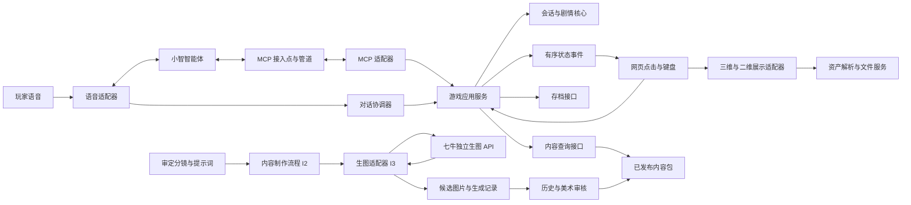
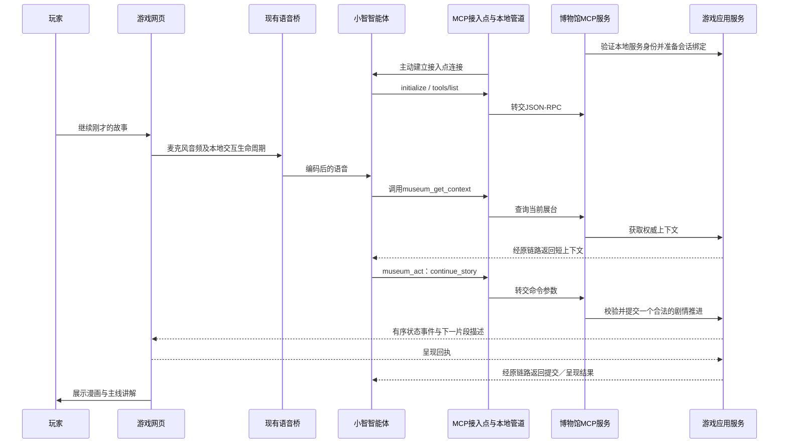

# 时空博物馆：架构设计

版本：0.4｜日期：2026-10-23｜阶段：实施前设计

配套文档：唐朝文物与支线总纲、《大唐来信》贯穿主线目前见[待合并的剧情文档PR #6](https://github.com/Xiean730829/HistoryPlay/pull/6)；已入主线的素材阶段记录见[新增素材验收](./时空博物馆-新增文物与素材验收.md)。本文定义模块、契约、修改影响与验收条件；不表示游戏或小智控制链路已经开发完成。

实施入口：[开发手册](./时空博物馆-开发手册.md)，包含逐文件职责、模块边界、生图中转、小智接入、细粒度PR及中文feat提交规则。

## 1. 产品边界与当前证据

玩家通过交谈和点击，选择时代、查看真实文物、进入二维漫画故事、追问人物生活，也可以在历史事件的关键片段中扮演角色。文物使用可旋转的三维模型；故事主要使用漫画、地图、关系图、字幕与讲解。

首版以唐朝为内容范围，架构面向其他朝代、并存文明和国际历史。目前九个主体主题已有三维入口：人物陶俑、骑马俑组合、镇墓兽、纪年造像碑、钱币、净水瓶、建筑浮雕砖、乐舞合奏、三彩器形与工艺；另有九世纪鸟纹碗的实物照片及单列的伊拉克比较器。冠饰和兵器仍为待补齐目标，不计入已取得三维模型。贯穿主线为618—907年的十章四十节点，独立展台支线可复用其中内容。

| 项目 | 已确认的事实 | 尚未确认的部分 |
| --- | --- | --- |
| 三维资产 | 19个模型文件已下载：18个唐代中国资源、1个海外比较器；之前16件已检查显示与旋转，手动补充的铜镜、卧牛和敦煌菩萨已通过结构及贴图解码检查、待网页显示验收；主体按九个主题组织，其余列后备；另有鸟纹碗两张照片 | 生产减面、朝向与取景、关键细节、手机性能；照片不算三维；组合模型不冒充单件实物计数 |
| 现有语音工程 | 网页采音、桥接小智、播放回复、打断、字幕、设备配置已有实现 | 与本游戏的会话、剧情、工具调用尚未联调 |
| 小智 MCP 接入点 | 官方说明和示例支持本地 MCP 服务通过主动建立的连接接入智能体 | 本账号的实时限制、工具调用行为、与音频轮次的关联能力 |
| 灵矽／七牛实时语音 | 预留供应商适配位置 | 本轮未验证其接入协议；不将“小智兼容”视为已经兼容本方案 |
| 七牛独立生图 | 用户指定 `https://llmapi.qiniu.io`、模型 `gpt-image-2`，API Key后续自行填写；公开网关文档列有生图与图片编辑入口 | 已核接口存在；本轮未提供Key，尚未验证账号模型权限、具体参数、出图及计费 |
| 本文接口 | 本项目拟采用的设计契约 | 均需实现；其中自定义字段不是小智现成协议字段 |

现有工程位置：`C:/Users/21711/Documents/Xiaozhi_Web_Test/xiaozhi_web_test`。模型与下载证据位置：`D:/7/History/models`、`D:/7/History/research/3d-all-file-verification.json`；当前盘点见[唐朝全馆素材盘点与下载](./时空博物馆-唐朝全馆素材盘点与下载.md)，早期验收稿作为阶段快照保留。这些绝对路径仅用于本机取材，运行时内容不得依赖开发者的盘符。

## 2. 玩家体验如何闭环

1. 玩家进入展厅，选择唐朝或直接问“有什么可以看”。游戏返回当前真实可用的展品。
2. 玩家说“看看镇墓兽”。系统解析意图，查询已发布内容，提交打开展品的命令。
3. 游戏更新会话状态，前端加载模型；成功或降级结果回传后，讲解员才描述实际展示结果。
4. 玩家说“带我进入它的故事”。系统选择预写故事的入口节点，展示漫画并播放已审稿的主线讲解。
5. 玩家中途问“为什么要做成这样”。主线暂停，回答取自该展品的资料卡，追问可以继续展开。
6. 玩家说“继续刚才的故事”。系统恢复保存的返回点，推进一个片段；不会因为回答了一次问题就自动跳过剧情。
7. 玩家可以随时查看细节、换一个人物视角、跳往相关事件或离开展厅。探索记录保存已经看过的证据和内容，不强制做题。

“有趣”的交互空间由可组合的展示动作、角色对话、证据观察、规则变量和跨展品关联提供。历史事实由内容包固定，玩家体验的顺序和情境反应可以变化。

## 3. 架构原则与不可破坏的约束

### 3.1 高内聚、低耦合的具体含义

- **同一种变化放在同一个模块。** 音频格式变化由语音适配器处理；故事改写放在内容包；模型材质适配放在资产流程；它们都不能修改剧情状态存储。
- **状态只有一个写入入口。** 语音、点击、键盘、未来外部设备都提交同一类游戏命令，由应用服务校验和提交。
- **核心不认识供应商与界面。** 剧情规则不能导入 MCP、WebSocket、浏览器、三维查看器、数据库或小智 SDK。
- **接入层做翻译。** MCP 工具把参数翻译为游戏命令；前端把状态翻译为画面。两者不各自维护一套剧情进度。
- **扩内容通过数据。** 新展品、新时代、已有能力能承载的新故事，只发布内容包；新增交互机制才修改能力实现。
- **逻辑边界先建立，按需拆服务。** 首版不引入微服务集群。模块独立不等于每个模块都单独部署。

### 3.2 必须长期成立的约束

1. AI 可以提出动作，不能直接修改事实、存档、场景树或浏览器 DOM。
2. 只有持久化成功的状态可以向玩家确认“已切换／已继续”；模型加载成功须另有展示回执。
3. 主线剧情、自由问答、历史假设使用不同状态；假设不能覆盖史实。
4. 打断停止声音与待执行展示，但不会自动撤销已经提交的选择。
5. 模型缺失、资源未授权或资料不足，必须呈现真实状态；不能用生成图片冒充真实文物照片或扫描。
6. 内容包版本在一次游玩中固定；更新不能悄悄改写旧存档所指向的故事。

## 4. 总体结构与依赖方向



图中的箭头包含运行时调用。源码依赖遵循以下方向：

```text
展示 / MCP / 语音 / 数据库等外部适配器
                  ↓
           应用接口与稳定契约
                  ↓
        会话模型、剧情规则、纯计算
```

应用层定义所需端口，存储、内容目录、语音供应商等在外层实现端口。组装入口完成依赖注入。核心模块不存在反向导入；外部适配器之间通过契约协作，不相互读取内部变量。

## 5. 模块职责、接口和修改边界

下表中的标识用于后面的修改影响矩阵。

| 模块 | 内部负责什么 | 输入与输出 | 可以依赖 | 不允许承担的职责 |
| --- | --- | --- | --- | --- |
| D1 会话核心 | 当前内容、焦点、模式、返回点、已提交选择、版本与修订号 | 旧状态 + 已验证操作 → 新状态／领域事件 | 核心值对象 | 播音、加载模型、调用 AI、读写数据库 |
| D2 剧情与规则核心 | 节点进入退出、允许动作、条件判断、分支合流、假设分支 | 故事定义 + 会话状态 + 操作 → 合法状态变化 | D1 的稳定类型、规则值对象 | 硬编码唐朝人物或直接发送界面命令 |
| A1 游戏命令服务 | 鉴权、会话路由、幂等、版本校验、事务、调用 D1/D2 | 游戏命令 → 提交回执 + 状态事件 | D1/D2、存储与内容端口 | 识别语音、决定史料真假、解析三维文件 |
| A2 内容查询服务 | 目录、别名、关联关系、资料分页、事实证据查询 | 查询条件／内容 ID → 有出处的内容投影 | 内容目录端口 | 通过一次查询推进剧情 |
| A3 对话协调器 | 用户轮次、打断、当前音频所有者、问答返回点、过期动作屏障 | 语音生命周期／本地事件 → 控制租约、暂停／恢复请求 | 应用契约、VoicePort、NarrationPort | 将自然语言当成可信状态变更、编造供应商轮次字段 |
| P1 网页展示层 | 页面、展台、漫画、时间轴、地图、字幕、无障碍提示 | 状态投影 → 画面；点击 → 命令 | 对外契约、展示能力接口 | 私自决定下一剧情节点、直写后端存档 |
| P2 展示能力适配器 | 三维查看、镜头、热点、图片／地图等能力实现和资源回执 | 语义展示描述 → 加载／呈现回执 | AssetPort、浏览器渲染库 | 解释历史动机、直接查询小智账户 |
| V1 语音适配器 | 采音、VAD、编码、设备连接、上行与下行音频、供应商事件归一化 | PCM／供应商消息 ↔ VoicePort 事件与音频 | 供应商协议、音频库 | 保存剧情、根据某个 TTS 文本偷偷切场景 |
| X1 MCP 适配器 | 工具注册、参数约束、结果压缩／分页、游戏命令翻译 | MCP JSON-RPC ↔ 应用接口 | MCP SDK、应用契约 | 实现第二套剧情规则、传送 GLB 和漫画文件 |
| I1 状态持久化与事件通道 | 会话存储、命令回执、有序事件、断线重放 | 存储端口与事件端口 | 数据库、网络库 | 改写领域判断、决定故事结局 |
| I2 内容与资产发布流程 | Schema 校验、资料与授权检查、模型加工、清单生成、内容版本发布 | 作者源稿／原资产 → 只读发布包 | 文件处理工具、内容 Schema | 运行时接受 AI 写入正式内容 |
| I3 图像生成适配器 | 七牛生图认证、参数转换、调用、结果归一化与错误处理 | `ImageGenerationPort`请求 → 候选图／供应商任务状态 | HTTP客户端、服务端密钥配置、供应商协议 | 决定情节、修改正式内容、持有小智凭证、让浏览器直接调用收费API |

高内聚的验收方式不是检查文件夹数量，而是检查一次变化是否只经过它所属的模块和公开接口。任何模块需要读取别的模块的私有状态，都视为边界缺口。

## 6. 首版技术选择与建议目录

### 6.1 技术选择

网页使用 TypeScript 和组件化界面，React + Vite启动页已随PR #7合入main；三维计划封装已在素材验收中使用的 `<model-viewer>`，保留以后换 Three.js 的位置。当前网页仅显示后端健康状态，尚无游戏展厅或三维能力实现；开发进度见手册第1.2节。

后端优先使用 Python，复用现有 aiohttp 音频桥的经验。游戏应用、内容查询、会话存档先放在一个应用服务中，领域核心保持纯 Python。MCP 使用官方示例采用的 FastMCP／stdio 接入方式；音频编解码作为独立适配组件运行，避免慢任务阻塞游戏事件循环。

首版本地单机用 SQLite 事务保存会话和事件；发布内容用版本化 JSON 清单，作者可以用 YAML 写稿后编译。跨语言公共契约以 JSON Schema 为准，生成或校验 Python 与 TypeScript 的对应类型，避免手写两份语义不同的状态结构。

这几个逻辑组件可以由同一个启动入口管理。官方 MCP 管道会启动 MCP 子进程；stdio 标准输出只写协议，日志写标准错误。首版不要求 Redis、消息队列、Kubernetes 或单独的向量数据库。

### 6.2 建议目录

```text
HistoryPlay/
  docs/                         架构、情节、验收约定
  contracts/                    API、命令、事件、内容包 Schema
  apps/museum-web/
    presentation/               展台、漫画、地图、时间轴
    capabilities/               三维查看等能力适配
    voice-ui/                   麦克风、字幕、音频焦点界面
  services/museum/
    domain/session/             D1
    domain/story/               D2
    application/                A1、A2
    conversation/               A3
    ports/                      存储、内容、资产、语音等接口
    adapters/                   SQLite、HTTP、事件流等实现
    bootstrap/                  依赖组装与配置
  services/voice-bridge/        V1；复用现有工程的能力
  services/mcp-gateway/         X1；不导入 domain 内部实现
  content-src/packs/            分地区、时期与主题的作者源稿
  tools/content-pipeline/      I2；校验、构建、素材加工
    ports/                     内容制作端口，含 ImageGenerationPort
    adapters/imagegen/         I3；七牛等图像供应商适配
  tests/                       核心规则、契约与关键联调验证
```

以上为目标目录规划，不能当作已存在文件清单。基础工程已建立，当前服务入口是`services/museum/src/museum/main.py`，其余领域、存档、展示和供应商适配仍待对应PR实现。大型原始模型不放进普通 Git 历史；本地通过资产清单映射素材目录，发布时映射对象存储／CDN。

## 7. 数据、状态与一致性契约

### 7.1 最小内容模型

| 对象 | 必须表达的内容 | 扩展时保持稳定的边界 |
| --- | --- | --- |
| ContentPack | 包 ID、版本、Schema 版本、语言、地域、时间范围、依赖能力、发布状态 | 不假定所有历史都属于中国朝代 |
| Artifact | 稳定 ID、馆藏身份、年代区间、材质、类别、资产引用、资料、故事入口 | 真实物件与数字模型版本分别管理 |
| HistoricalEvent | 时间与地点、参与者、事实卡、关联物件、讲述模式与角色模式入口 | 事件与展品为多对多关联，不表示物件亲历事件 |
| Story / Node | 入口、片段、画面、讲解、允许动作、条件、返回点、来源与事实等级 | 展示方式与情节规则分离 |
| FactCard / Source | 主张、适用时间、证据位置、可信状态、争议、审稿人及引用许可 | 来源不是一串没有对应主张的网页链接 |
| Asset | 格式、哈希、大小、LOD、取景、热点、授权、署名、衍生关系、降级资源 | 运行时只接收逻辑资产 ID，不接收 AI 提供的任意路径 |
| Relation | 两端实体、关联类型、证据、说明 | 区分“实物关联”“同年代”“解释性联系”“创作联系” |

### 7.2 会话是唯一事实状态

会话至少包含：`session_id`、固定的 `pack_versions`、`world_time`、`current_location_id`、`focused_entity_id`、`visible_entities`、`display_order`、`story_id`、`node_id`、`mode`、`story_variables`、`return_stack`、`revision`、`interaction_epoch`、发现记录和播放检查点。

- `revision`：会影响情节、指代或场景的已提交变更序号。
- `interaction_epoch`：新一轮用户交互／打断时提升，用于使旧控制许可失效。
- `view_revision`：镜头旋转等展示变化单独编号，避免每一帧拖动都冲撞剧情修订号。
- `event_seq`：向前端发送的事件序号。前端可发现缺口并请求完整快照。

“它／这个人”优先绑定当前焦点；“第二个”依据服务端保存的当前展示顺序解析；多个对象都符合时返回明确的候选，让 AI 做一次自然澄清。不能拿 AI 对话中记住的旧顺序代替当前界面顺序。

### 7.3 命令与回执

以下是本项目设计示例，字段不是小智协议自带字段：

```json
{
  "schema_version": "1",
  "request_id": "req_001",
  "expected_revision": 12,
  "interaction_epoch": 7,
  "control_ticket": "opaque_short_lived_ticket",
  "action": "continue_story",
  "target_id": "cn.tang.guardian.story"
}
```

会话、角色与权限从已经验证的绑定中取得，不能仅凭 AI 传入一个 `session_id` 就决定它可控制哪个展台。`request_id` 用于重试幂等，不赋予权限。控制票据由应用签发，限会话、轮次、修订号、允许动作和时效；不得由模型自己编造。

处理顺序：验证绑定 → 校验参数 → 检查幂等回执及载荷摘要 → 校验新执行所需票据与修订号 → 加载固定版本的故事定义 → 执行核心规则 → 同一事务写状态、回执和待发送事件 → 发布事件。已验证绑定的相同请求重试可以只返回原回执，不因原票据失效而再次执行；相同请求ID但载荷不同须拒绝。两个“继续”并发时，只有符合当前状态的一次可以提交。

回执区分三种状态：

- `committed`：游戏状态已经持久化；尚不保证资产加载成功。
- `rendered`：目标前端确认已呈现该修订号。
- `degraded`：已展示声明过的图片／文字降级形式，并附原因。

渲染超时可以返回 `render_pending` 和回执 ID，不冒充成功，也不盲目重新推进剧情。前端渲染回执按会话、修订号、资产 ID 和命令 ID 去重。

### 7.4 问答与主线分离

自由提问保存一个包含故事、节点、已提交变量和播放检查点的返回点。查询资料不改变主线节点。用户说“继续”时先判断是继续当前讲述、回到主线，还是推进下一片段；有歧义才澄清。

主线讲解结束只标记“这一段已播放”，**不自动等价于玩家选择下一段**。同样，收到小智的 `tts.stop` 只说明该次语音发送结束，不能拿它作为推进剧情的业务条件；播放队列是否排空还需由本地播放器确认。

播放检查点记录最后开始和最后完整播放的片段。第一版按片段重播，不承诺跨供应商的逐字、逐音素恢复。

### 7.5 对外应用接口与端口

以下为计划中的 HTTP／事件契约，实施时以 `contracts` 为准；不是现有服务已经提供的接口。

| 接口 | 所属模块 | 行为 |
| --- | --- | --- |
| `POST /api/v1/sessions` | A1 | 创建固定内容版本的会话；返回会话与配对流程信息 |
| `GET /api/v1/sessions/{id}/context` | A2、A3 | 在验证绑定后返回当前投影、可用动作和所需控制上下文 |
| `POST /api/v1/sessions/{id}/commands` | A1 | 点击与 MCP 共用命令入口，执行第7.3节的事务流程 |
| `GET /api/v1/sessions/{id}/events?after_seq=...` | I1 | 升级为有认证的 WebSocket，补发事件或返回重新获取快照的要求 |
| `POST /api/v1/sessions/{id}/render-receipts` | A1、I1 | 接收目标前端对指定命令、修订号和资产的呈现回执，不推进故事 |
| `GET /api/v1/content/{id}?version=...&cursor=...` | A2 | 读取已发布目录、事实、故事展示投影及出处 |
| `GET /api/v1/assets/{id}?version=...` | AssetPort 适配 | 按受控逻辑 ID 解析具体资源，不接受外部任意路径 |
| `POST /api/v1/voice-lifecycle` | A3 | 接收可信语音适配器的本地交互事件，经应用入口提交暂停／新轮次等变化 |

路径中的会话 ID 仅用于定位，每次仍需认证和权限检查。网页收到的是 `SceneProjection`：可显示实体、允许动作、资产与字幕等投影；不暴露数据库模型、令牌或供应商内部上下文。MCP 从同一投影压缩结果，不另外创造状态。

核心端口包括：`SessionRepository`（读取、修订号比较及原子提交）、`ContentRepository`（按固定版本取定义）、`FactQueryPort`（检索证据卡）、`AssetPort`（解析资产与降级）、`EventChannel`（有序投影事件）、`VoicePort`（语音生命周期）、`NarrationPort`（已审稿主线播放）。适配器只能通过这些边界工作。

角色自由话语作为不可信 `input_text` 处理。AI 将其映射成当前节点声明的行动模板和有限参数后，D2 才能决定变量效果；无法映射的提问可以回答和展示资料，但不能把一段自由文本直接当规则执行。需要自有编排时增加意图规划端口实现，不把模型调用塞进纯规则函数。

镜头操作使用 `view_revision` 的检查与展示回执，不因每次旋转增加剧情 `revision`。切换焦点则会影响指代，必须经过应用服务更新会话。玩家改变浏览年代也不会修改文物自己的年代或出处。

## 8. 内容包与“活规则”的扩展设计

### 8.1 内容包不是一份大提示词

一个包包含目录、文物、事件、事实卡、故事图、角色设定、场景描述、素材清单、语言资源、署名与发布检查结果。AI 每轮只拿当前需要的短上下文和证据卡，不能把整段唐史塞进一次工具返回。

建议包命名采用稳定且无歧义的命名空间，例如 `cn.tang.core`、`cn.song.trade`、`mediterranean.rome.daily-life`。ID 不从中文标题自动生成。标题可改，实体 ID 保持稳定；退役内容通过重定向或存档兼容处理，不能复用旧 ID 表示另一个物件。

时间数据同时保存可排序的时间范围和显示纪年，允许近似、争议、区间和地区标签。公元前使用明确的天文年编号约定，并由显示层转换；不同地区的时期可以重叠。唐与武周的政治标签必须如实显示，不能为了界面方便抹平 690—705 年的政权变化。

### 8.2 规则如何既灵活又可验证

故事图允许玩家从当前节点：观察、提问、切换视角、提出行动、选择路线、比较证据、进入假设或返回展台。规则通过节点支持的动作和变量反应，不把玩家锁在固定答案中。

条件与效果使用受控的声明式结构，例如 `all / any / equals / greater_or_equal / has_discovery` 和有限变量更新。禁止把内容包中的字符串当 Python／JavaScript 执行。新增一条“多观察一个纹样后能询问用途”的规则只改故事数据；新增“多人投票影响集体路线”这种机制才扩展规则核心。

自由语言按以下顺序承接：已有动作与已写分支 → 当前事实支持的角色回应 → 无状态的解释性展示 → 明确说明未提供该场景，并给相关方向。临时生成的角色回应不自动变成正式史料或永久内容。

历史模式保留真实结果；用户改变重大历史选择时，创建标有“历史假设”的独立分支。假设变量与正式事件事实分离，结束时对照真实历史，并允许返回原节点。

### 8.3 能力注册而不是按朝代写条件

场景只声明所需能力，例如 `artifact3d`、`comic`、`map`、`timeline`、`relationship_graph`、`compare`。前端按注册表选择实现。内容包声明最低能力版本与降级形式。

新增朝代不应出现 `if dynasty == ...` 的核心代码。未来新增有独特交互的展览，先判断现有能力能否组合；只有组合无法表达时才增加有版本的能力插件。插件须声明输入 Schema、回执、资源释放和取消行为，并经过测试后安装；AI 不能上传任意脚本成为插件。

### 8.4 内容版本与存档迁移

发布包不可变，内容版本与引擎版本分别编号。存档固定使用创建时的包版本。兼容更新可保留旧版本继续玩；不兼容更新必须提供节点、变量和实体映射的迁移器，并保留迁移前备份。没有映射时提示从安全章节重新开始，不能把旧节点随意对应到新节点。

包构建须检查：ID 唯一、引用完整、入口与退出可达、循环有退出／限制、条件可解释、资源授权齐全、事实卡可溯源、章节标明事实等级、能力版本兼容。新增内容的测试重点放在这些边界，不重复为每段文案写实现镜像测试。

## 9. MCP 怎样连接小智并推进情节

### 9.1 第一选择：智能体 MCP 接入点

按[小智官方接入说明](https://my.feishu.cn/wiki/HiPEwZ37XiitnwktX13cEM5KnSb)，在 `xiaozhi.me` 智能体的角色配置页面获取专属 MCP 接入点。本地使用[官方示例](https://github.com/78/mcp-calculator)中的管道连接该地址，管道把远端消息转成对本地 MCP Server 的 stdio 调用。



小智云端是工具调用方；博物馆 MCP 服务是工具提供方；网页通过游戏接口操作和展示。MCP 不承载实时音频，也不传三维文件。音频和工具是两条链路，最终在游戏会话上汇合。

首版只把工具发现与调用作为接入前提，不假定小智支持 MCP 的全部资源、提示、采样或主动通知功能。initialize 中实际协商的协议版本、SDK 版本及工具 Schema 形态需要在 P0 捕获并锁定；不能把最新 MCP 规范的默认行为直接套到小智现有服务。

本地 MCP 服务主动向外建立连接，首版本地部署通常不需要把游戏端口公开到互联网。MCP 服务通过经过验证的本地应用接口调用游戏，不直接导入或修改存档表。接入点和设备语音连接分别使用自己的配置；MCP Endpoint、设备令牌和网页登录身份不能互相替代。

### 9.2 从现有语音工程复用什么

| 现有位置 | 复用能力 | 接入游戏时需要做什么 | 不在此处加入什么 |
| --- | --- | --- | --- |
| `core.js` | VAD、轮次记录与时延计算 | 包装为可订阅的本地语音生命周期 | 剧情节点和唐朝展品 ID |
| `app.js` 的采音与播放器 | 麦克风、播放队列、打断、字幕、旧回复屏蔽 | 提取 VoicePort，输出开始发言、识别结果、播放排空和中断事件 | 通过匹配字幕猜测剧情已推进 |
| `server.py` | aiohttp WebSocket、Opus、设备身份、供应商消息转发 | 给对话协调器提供连接身份、断开与必要的生命周期钩子 | 直接写故事变量和替玩家作选择 |
| `capture-worklet.js` | 浏览器音频采集 | 保持独立，按契约提供 PCM | MCP 注册与内容查询 |

当前 `server.py` 的 hello 使用 `features: {}`，只向网页转发若干语音事件，没有完成设备通道 MCP 分发。因此选择独立 MCP 接入点时，不能误以为在 hello 中填一个 `mcp: true` 就完成接入；该字段无需为这条独立路径强行打开。

现有网页把 `type=llm` 用作供应商事件接收范围，而[官方 WebSocket 文档](https://github.com/78/xiaozhi-esp32/blob/main/docs/websocket.md)中的 LLM 消息也可能只是情绪／表情。不能把它当作可靠的完整模型文字输出或隐藏的工具调用通道。

### 9.3 备选：设备语音连接内承载 MCP

[官方设备 MCP 协议](https://github.com/78/xiaozhi-esp32/blob/main/docs/mcp-protocol.md)支持在音频连接内以 `type: mcp` 包装 JSON-RPC。若未来选择该路径，需要语音适配器完整实现能力声明、initialize、工具发现、调用转交、响应和断线取消，再把调用送到同一个 X1 适配器。

此路径可以获得设备连接的 `session_id`，但仍不能仅凭连接 ID 假定具有可靠的逐轮调用 ID。两种路径不同时注册同一套游戏工具，以免同一意图被执行两次。切换传输方式只替换 X1/V1 的适配与会话绑定，不改 D1/D2 和内容包。

### 9.4 展台、语音设备与智能体怎样绑定

首版约束为：**一个专用智能体、一个活跃语音设备连接、一个受控展台**。不是所有家庭成员共用一个智能体后就能自动隔离。

1. 网页向游戏应用创建会话，拿到短时、一次性的展台配对码。
2. 语音桥以本地可信连接登记自己的 `voice_connection_id`；应用将其与当前网页绑定。
3. MCP 管道连接配置中指定的智能体接入点；应用将该受信的 MCP 连接范围与展台配对。
4. 调用 `museum_connect` 完成工具侧绑定，随后工具从绑定范围取得会话，不让 AI 自行选择其他人的会话。
5. 连接断开、换展台、重新配对时撤销旧绑定及所有控制票据。重连后先恢复快照，再重新取得控制许可。

配对码仅辅助把本地可信连接指向目标展台，不是公共部署的账户鉴权方案。未来多人版本需要认证的用户／设备／会话路由；如果供应商不提供可信的调用来源，必须分别配置智能体接入点或使用自有路由层。不能按模型回答中的名字分配权限。

### 9.5 首版工具面：五个稳定工具

以下均为待实现的项目接口。

| 工具 | 主要参数 | 用途与返回 | 对游戏的影响 |
| --- | --- | --- | --- |
| `museum_connect` | `pair_code` | 绑定当前受信工具连接与展台，返回简短状态 | 改变连接绑定，不推进故事 |
| `museum_get_context` | 可选 `cursor`、`receipt_id` | 返回当前焦点、节点、模式、修订号、可用动作、必要票据或指定动作回执状态 | 只读；票据签发受本地生命周期约束，回执仅限已绑定会话 |
| `museum_search` | `query`、可选 `kind`、`cursor` | 查找已发布的文物／事件／资料，返回少量 ID、短标题和后续游标 | 只读，不搜索未审核网文来作现场史实 |
| `museum_read_content` | `content_id`、可选 `cursor` | 分页读取事实卡、角色背景和出处，带事实等级 | 只读；长讲解与图片由游戏加载 |
| `museum_act` | `action`、`target_id`、动作所需的有限参数、`expected_revision`、镜头动作的 `expected_view_revision`、`control_ticket`、`request_id` | 请求打开文物、进入故事、继续、暂停、返回、聚焦细节、旋转／缩放或提交角色行动 | 统一进入 A1，由核心判断是否合法 |

`museum_act` 使用清晰、有限的 action 枚举，按动作校验目标类型及参数；不是任意代码执行器。新增展品不会新增一个工具。新增动作须同步更新能力声明、核心校验和工具契约，不能只改工具说明。

对话基本规则：涉及“它／第二个／继续／换视角”先读上下文；需要事实先读资料；需要画面变化必须调用动作工具；只按工具回执描述结果；工具失败时说明原因，不把失败说成已完成。用户的自由提问不强制先变成选择题。

### 9.6 处理返回大小与平台限制

官方飞书文档写明：工具结果通常限制在 1024 字节内；工具列表报文及连接数也有上限。该描述不是所有部署永久相同的协议常量，必须在本账号实测。

项目设置 `XiaozhiCompatibilityProfile`：默认把完整序列化工具响应控制在 1024 UTF-8 字节内，正文在预留 JSON-RPC／MCP 包装和请求 ID 后动态分页。初始正文目标不超过约 700 字节，具体预算以最终序列化结果为准；中文按字节计算，不能按字符数估算。过大时减少条数或按句分页，不能截断 JSON 或 UTF-8 字符。

工具只返回：短状态、回执 ID、修订号、必要的当前节点／动作、少量事实正文、来源 ID 和分页游标。完整资料及可点击出处在游戏界面中展示。三维模型、漫画、音频、长剧本均走资产服务和内容查询，不经过 MCP 字符串。

示例是工具结果中的业务对象，不包含外层协议包装：

```json
{
  "status": "rendered",
  "receipt_id": "rc_42",
  "revision": 13,
  "node_id": "guardian.02",
  "mode": "story",
  "narration_owner": "game",
  "message": "已进入第二幅漫画。"
}
```

### 9.7 部署与联调步骤

1. 准备专用小智智能体，现有网页设备绑定到同一智能体，先验证语音收发和打断。
2. 在游戏应用启动一个会话，先用点击验证打开展品、故事推进和存档。
3. 本地启动博物馆 MCP Server，用 MCP 协议检查 initialize、tools/list、tools/call 和参数拒绝行为。
4. 在本机受保护配置中设置 `MCP_ENDPOINT`，按官方方式执行 `python mcp_pipe.py <museum_mcp_server.py>`。这是未来启动方式示意，本项目尚无此脚本。
5. 验证智能体能看到工具，然后完成展台绑定。不要把接入点、令牌或配对秘密写进仓库、截图或日志。
6. 说“打开镇墓兽”，核对真实工具调用、提交回执、浏览器呈现回执以及回答是否一致。
7. 再验证“进入故事 → 追问 → 继续 → 打断改去女俑 → 刷新后恢复”。
8. 实测长度、超时、工具列表、连接上限、异常重连和来源关联。以通过记录代替“控制台显示 Online 就代表游戏已接入”。

## 10. 打断、同步和讲解音频的边界

### 10.1 打断必须同时处理两条链路

检测到玩家开始新一轮发言时，本地播放器立即静音／停止，随后对话协调器通过 A1 提交交互生命周期变更，提升 `interaction_epoch`，撤销旧票据，停止主线音频和旧回复播放，取消尚未提交的展示任务；同时向供应商发送其支持的 abort。对话协调器不绕过 A1 私写会话。已经提交的节点保留，恢复点记录在哪一段被打断。

旧命令若带着已经失效的票据到达，A1 拒绝；旧资产加载完成若对应的场景修订号已过期，前端丢弃并释放资源。重复命令按幂等回执处理。网络重试不能让“继续一次”变成连续跳过两段。

### 10.2 不能用本地编号假装解决所有云端竞态

独立 MCP 接入点的公开文档没有承诺每次工具调用都携带可验证的设备身份、用户发言 ID 或供应商轮次 ID。现有桥的 `_response` 是本地产生的回复序号，不是天然附在远端 MCP 调用上的关联标识。

因此，`epoch + ticket + revision` 能拒绝携带旧上下文的延迟动作，但**不能单独证明：一个在打断后才重新查询上下文的云端旧任务，不会取得新票据**。这项限制必须明确保留，不以“加一个 turn_id”掩盖。

接入 P0 必须检查供应商能否提供可信调用关联、明确取消屏障或足够可靠的调用生命周期。若无法通过旧任务隔离验证：

- 不宣称已经获得严格的全自动多轮控制。
- 剧情写入交给自有的、能把输入轮次贯穿到工具执行的编排层／语音适配器；小智可以继续承担问答或通过受限入口提供能力。
- 演示期间保留点击推进和本地已关联输入的控制路径；不得用放宽会话校验换取表面顺畅。

这个替换发生在 A3、V1、X1 和供应商编排适配处，故事规则、展品与存档不因此重写。该技术验证应在大量生产漫画和音频之前完成。

### 10.3 主线讲解和 AI 问答分工

主线故事使用预写、审稿后的文字与音频，由游戏的 NarrationPort 播放；音频可以预先人工录制或经独立 TTS 服务生成并审核。首版不依赖“小智必须支持将任意长剧本原样转语音”这一未验证能力。

自由问答和角色回应使用小智对话，查询对应的事实卡和角色边界。回答中涉及创作或假设时，画面持续显示其性质。提示词与资料约束能降低跑偏，但不能视为已经对任意 AI 口头回答做了形式化事实保证；上线前要审测典型问题和错误诱导问题。

对话协调器维护唯一音频所有者：`game_narration / provider_reply / none`。进入问答先停主线；回到故事先排空或抑制该控制回合的云端回复，再播放主线，不能两路同时讲话。控制工具返回 `narration_owner=game`，智能体配置要求简短确认，不重复主线。

能否可靠识别和处理控制回合的云端 TTS 也属于 P0。若供应商不能稳定配合，必须明确选择单一路径播讲或采用自有编排；不能仅靠“应该不会同时播放”的提示词。音频所有权是应用规则，不由 MCP 工具私自播放文件来决定。

画面首版按片段同步：进入一个片段就显示对应漫画；不是逐字口型同步。用户开始发声立即中断本地播放，不等待最终识别文本。

## 11. 三维、二维资产、生图生产和降级

### 11.1 文物模型与展示资产

原始扫描是取材母版；线上使用加工后的展示版。资产流程保存原文件、来源、作者、许可、哈希、衍生关系、处理说明，再产出 LOD、预览图、热点、取景和降级资源。授权与处理记录随每个发布版本保留。

目前19个模型文件约为5.7万至1046万三角面，原件合计约1.655 GB（含1个海外比较器，不含ZIP和衍生版）；14个使用1024×1024贴图，舞者浮雕砖及手动补充的铜镜、卧牛、敦煌菩萨使用4096×4096、双龙耳瓶使用4000×4000贴图。手动补充三件已通过结构和贴图解码检查，网页显示及旋转待验收。镇墓兽、坐佛、浮雕砖和新增头像已另存材质兼容版；双龙耳瓶另存展示朝向修正版，原件均保留。新增材质转换采用glTF Transform并保存记录，说明“文件能打开”与“展示合格”应分开验收。首版还需调整扫描朝向、减少高面数模型的负载并审查关键纹样。

初始资产预算可设为：普通展示优先 5～30 万三角面、单件首屏资源目标约 5～15 MB，细节资源按需加载。这些是加工目标，不是对现有文件的测量结果；复杂对象允许经过专项测试后放宽。客户端同时保留的高负载模型数量默认一个，离开时释放 GPU 和音频资源。

优先降级顺序：合格三维展示版 → 明确有授权的实物图片／预渲染多角度图 → 基础展签。故事的复原漫画是另一类资产，不能替代实物身份核验。缺少授权的照片不因“网上能看到”而成为可发布资产。

游戏状态不因模型加载失败回滚到乱序章节；展示层回报失败或降级，应用保存当前内容的真实呈现状态。模型查看器更换后需重新验证热点坐标、单位、朝向和镜头，不能假设 GLB 相同就完全兼容。

### 11.2 已确定的生图供应商与配置

**美术制作默认使用用户提供的七牛独立API，模型指定 `gpt-image-2`。** 用户已有API Key，后续自行填入本机服务端配置。本项目通过该API生产人物设定、漫画、复原场景与装饰背景，生图请求使用独立凭证、独立调用记录；开发工具和小智语音不承担批量出图。素材数量按剧情与分镜需要安排，不因担心消耗当前编程助手额度而预先压缩必要场景。

这里的“独立”指调用渠道与凭证分开：图像生成仍由该Key所属服务账户按其规则计费、限流；不能将其写成免费或无限额度。若该账户还承载其他七牛业务，是否共享余额以账户配置为准，不能仅靠换环境变量名称认定账单已隔离。

2026-10-23已读取用户地址的[公开Swagger页面](https://llmapi.qiniu.io/)与[OpenAPI描述](https://llmapi.qiniu.io/openapi.json)：服务标题为XHub API，列有 `GET /v1/models`、`POST /v1/images/generations`、`POST /v1/images/edits`。这些证明网关入口存在；`gpt-image-2`为用户指定的模型ID，账号可用性与部署别名须用其Key确认。不得将七牛其他产品的 `api.qnaigc.com` 地址静默替换进本配置。

未来本机 `.env.local` 或受保护服务端环境变量示例，**仅为配置设计，本轮未创建真实密钥文件或发出生图请求**：

```dotenv
# 用户填Key后启用；此文件不得提交仓库
IMAGEGEN_ENABLED=false
IMAGEGEN_PROVIDER=qiniu_xhub
IMAGEGEN_BASE_URL=https://llmapi.qiniu.io/v1
IMAGEGEN_API_KEY=
IMAGEGEN_MODEL=gpt-image-2
IMAGEGEN_AUTH_HEADER=Authorization
IMAGEGEN_AUTH_SCHEME=Bearer
IMAGEGEN_GENERATIONS_PATH=/images/generations
IMAGEGEN_EDITS_PATH=/images/edits
IMAGEGEN_OUTPUT_ROOT=D:/7/History/generated
IMAGEGEN_TIMEOUT_SECONDS=300
IMAGEGEN_MAX_CONCURRENCY=2
IMAGEGEN_MAX_AUTOMATIC_SUBMIT_RETRIES=0
```

`BASE_URL`已含 `/v1`，路径按后缀拼接，不能重复为 `/v1/v1`；最终生图URL为 `https://llmapi.qiniu.io/v1/images/generations`。`OUTPUT_ROOT`是本机制作目录，可换盘符或对象存储，发布内容只引用逻辑资产ID。超时、并发和重试值均为项目初始配置，不是平台服务承诺。

网关编辑接口的公开示例使用 `Authorization: Bearer ...`，因此配置默认采用这一方式；OpenAPI安全定义同时标注 `x-litellm-api-key`。I3保留认证头配置，联调时确认此Key的实际接入方式；若需后者，仅调整I3配置及其协议验证，不把同一密钥散落到多处。Key仅由制作工具服务端读取，不进入前端构建变量、MCP结果、提示词、内容包、截图或日志。后续仓库忽略本机密钥文件，版本库只保留空值模板。

### 11.3 生图契约与内容生产闭环

I2定义制作端口 `ImageGenerationPort`，I3实现供应商协议。它是内容制作端口，游戏会话核心、MCP和实时语音不导入它。输入至少包含 `job_id`、`story_node_id`、提示词及版本、角色／风格设定版本、合法参考图及哈希、输出要求；结果统一为制作任务状态、候选图文件引用、供应商请求ID、实际模型与参数、可取得的用量记录和错误信息。用户密钥不属于任务数据。

文生图首个联调请求只采用最小兼容形状，例如：

```json
{
  "model": "gpt-image-2",
  "prompt": "以已审定的T04.01分镜和角色设定绘制静态二维漫画；具体提示词由制作稿提供",
  "n": 1
}
```

这是请求设计示例，尚未执行。网关的生图OpenAPI未完整列出请求体，因此尺寸、质量、透明背景、输出格式、参考图数量和种子等不能仅因其他平台支持就当作本账号已支持。联调后将已验证选项保存为供应商能力配置。图片编辑入口按其公开协议使用 `multipart/form-data`；角色参考图和局部修改在验证后使用，不以纯文字提示保证人物绝对一致。

生产流程为：**审定故事节点 → 分镜与角色／风格设定 → 提示词任务 → 七牛出图 → 保存候选原图及记录 → 历史与美术审核 → 压缩／裁切 → 发布资产清单 → 游戏按ID加载。** 首版以预制图片为主，玩家“继续故事”直接读取已发布资源，不等待一次新的生图请求。未来若增加实时生图，只新增制作任务入口和临时展示能力，不自动写入正式史料与主线包。

人物先制作统一参考设定，再按同一角色和风格版本生成分镜；提示词包含时间、地点、身份、动作、构图与史实／复原／创作标记。字幕、按钮、精确年号和展签由界面绘制，减少把生成图片中的文字当成准确资料的风险。真实文物照片与三维扫描沿用已取得资源；生成图明确归于复原／创作，不能换成“实物照片”。

每个任务保留提示词版本、参考图来源与哈希、模型ID、参数、生成时间、原图哈希和审核结果。按节点、模型、参数、提示词与参考图版本计算复用键，已有合格图片直接复用；同一个请求重试不等于必然得到同一张图。供应商返回Base64时解码落盘，返回临时URL时在有效期内保存，若实际返回异步任务ID则按已验证协议查询。长请求超时后标为“结果待确认”，保留请求ID，不盲目自动重复提交可能收费的任务。

Key为空或生图未启用时，只将内容制作入口标记为“未配置”；游戏仍可使用已发布图片正常运行。401／403、模型不可用或额度限制由I3归一化返回制作工具，保留已完成产物及任务进度，不影响玩家存档。

联调完成条件：用户本机填Key；确认模型列表／部署ID；单张文生图成功保存并可打开；认证与参数被记录；若需要参考图则另验证图片编辑；同任务复用、超时恢复与密钥不外泄通过检查。批量漫画生产在这些条件通过后启动，本轮不声称已接通账号。

## 12. 哪些修改影响哪些模块

| 修改 | 主要修改位置 | 连带检查／修改 | 核心状态与规则是否应改 |
| --- | --- | --- | --- |
| 改展签、讲解措辞或增加出处 | 内容包、I2 | 引用映射、审稿、字幕与音频版本 | 否 |
| 新增同能力的文物 | 内容包、I2 | 资产、热点、目录、故事入口与重复主题检查 | 否 |
| 替换同一文物的模型 | I2、资产清单、P2 取景配置 | 授权、哈希、热点、回归截图、加载预算 | 否；实体 ID 保持 |
| 更换生图地址、模型、认证或供应商 | I3、供应商能力配置 | 接口、参考图、响应格式、用量与错误处理；必要时重审新产物 | 否；不改D1/D2、MCP或小智语音 |
| 改漫画风格、角色设定或重新出图 | I2制作稿、I3任务输入、对应资产版本 | 角色一致性、历史复原、分镜、缓存失效及发布审核 | 否；若情节语义改变则按故事变更评审 |
| 新增一个已有机制能表达的故事分支 | 内容包 | 条件、退出路径、合流、历史／假设标记、存档兼容 | 通常否 |
| 新增朝代或国际内容 | 新内容包 | 语言、地区与时间展示、来源及能力版本 | 否；若需改核心才可装包，说明抽象有缺口 |
| 修改“继续／返回”的语义 | D2、A1 与契约 | X1、P1、存档迁移、关键路径测试 | 是，属于游戏规则变化 |
| 新增交互机制 | D2、契约、相应能力实现 | A1 校验、P1/P2、X1 工具动作、内容校验器 | 是；内容只引用新能力 |
| 换小智为其他语音平台 | V1、A3、绑定与配置适配 | 音频、工具来源、取消、字幕、权限与同一契约测试 | 不应改 D1/D2 或内容 |
| 保持小智但更换 MCP 传输 | X1、V1（若走设备通道）、绑定 | initialize、发现、分发、重连及双注册检查 | 否 |
| 改麦克风 VAD 或编码 | V1 | 延迟、误打断、回声、输入丢失、A3 生命周期契约 | 否 |
| 换三维查看器 | P2 | 资产兼容、热点、镜头、内存与取消 | 否 |
| SQLite 换 PostgreSQL | I1 | 事务、乐观锁、幂等、事件 outbox、迁移与并发测试 | 否 |
| 从本地文件换 CDN | AssetPort 实现、I2 发布配置 | 权限、缓存、跨域、哈希与降级 | 否 |
| 增加多人协作展台 | 会话路由、鉴权、A1 并发规则、A3 | 来源身份、角色权限、同步与存档 | 会话规则需要显式扩展；不能只改 UI |
| 更改内容 Schema | contracts、I2 | 内容迁移、客户端兼容、存档版本与所有相关适配 | 按语义决定，须列迁移计划 |

修改评审必须写明：变更契约、受影响模块、旧存档处理、必要验证。不得以“公共工具类”为由把内容、声音、网络、状态全部塞进一个公共模块。

## 13. 部署和规模扩展

### 13.1 首版

一个网页、一个应用服务、一个受控语音连接和一个 MCP 接入范围。游戏应用负责保存状态并发送 WebSocket 事件；本地路径映射供资产服务使用。CPU 密集的模型加工不在在线命令请求里执行。

前端提交命令时带当前修订号；事件连接断开后可重连，携带最后 `event_seq`。服务器能重放缺失事件则重放，否则返回完整快照。客户端呈现属于可恢复的投影，不能成为唯一存档。

状态、命令回执与待发送事件同事务保存，避免“存档已更新但事件永远没发”的双写缺口。首版单进程分发即可，设计保留 outbox 接口；不要承诺跨进程消息天然恰好一次。

### 13.2 内容从几十件增加到几千件

目录与事实卡按包索引，支持中文别名和人工关键词。首版可以使用轻量倒排检索，不假定默认英文分词适用于中文。需要语义检索时在内容查询端口后增加检索实现，返回仍必须指向已审核事实卡。

模型、漫画和音频独立缓存；只预取当前和邻近片段。CDN 缓存按内容版本与哈希失效，避免更新一个模型导致整馆失去缓存。资产清单不随每轮对话重复传输。

### 13.3 并发展台与远程服务

先验证供应商的智能体／设备隔离能力，再开放多人。应用实例可以横向扩容，但每次状态写入必须由数据库修订号比较与事务保护。会话可按 ID 分片，多个实例之间用持久化事件和 outbox 协同。

SQLite 替换为共享数据库时，保留同样的 Repository 行为：修订号冲突、幂等回执、原子写入和事件序号。不能让两个进程各自保存一个同名会话并定时覆盖。

只有音频处理、会话负载或内容分发出现独立瓶颈时才拆部署单元。可扩展性主要来自稳定边界、可迁移契约和独立内容包，不来自预先堆服务。

## 14. 访问边界、错误和可观测性

本地服务默认绑定 loopback；部署到网络时增加 TLS、用户认证、精确 Origin 校验和会话权限。接口不能仅凭“来自 localhost”或一个公开会话 ID 认为可信。Endpoint 和设备令牌只在受保护服务端配置中出现。

MCP 的展示动作只能访问已发布实体和资产 ID，不接受任意文件路径、脚本、网页地址或数据库查询。故事材料与玩家话语都是数据，不得被当成修改权限、系统配置或运行代码的指令。

默认不长期保存儿童原始音频。调试日志使用会话化标识，记录命令、版本、回执、来源 ID、耗时和失败原因；录音与完整对话的留存须作为独立产品选择处理，不能在开发调试中默认开启。

| 错误 | 游戏行为 | AI／界面的解释 |
| --- | --- | --- |
| `NOT_BOUND` | 不执行，提示配对 | 尚未连接到当前展台 |
| `STALE_CONTEXT` | 不提交，返回需刷新上下文 | 画面已变化，重新读取后判断 |
| `INTERRUPTED` | 拒绝旧轮次未提交动作 | 旧任务已取消，不重复推进 |
| `ACTION_NOT_ALLOWED` | 保留当前节点 | 当前能做什么，并接受自由提问 |
| `CONTENT_UNAVAILABLE` | 显示资料或资源实际状态 | 不编造展品和未审核情节 |
| `RENDER_PENDING` | 保存已提交状态，等回执 | 正在加载，不能再次执行“继续” |
| `ASSET_FAILED` | 声明降级或保留展签 | 如实说明当前展示形式 |
| `PROVIDER_DISCONNECTED` | 暂停语音，点击仍可用 | 展台与进度保留，可重新连接 |

观测链路至少贯穿：本地输入轮次 → 工具调用标识（能取得时）→ 应用命令 → 状态修订号 → 呈现回执 → 播放检查点。缺少可信关联的环节明确标未知，不靠时间相近来冒充一条确定链路。

## 15. 实施顺序和必须通过的验收

### 15.1 先处理不可后移的技术验证

| 阶段 | 产出 | 完成条件 |
| --- | --- | --- |
| P0 接入验证 | 专用智能体、最小 MCP 工具、单展台绑定、工具大小与取消记录 | 实际语音触发工具、准确控制目标展台；明确轮次关联能力及限制，旧任务隔离方案可验收 |
| P1 核心闭环 | 一个文物、一个三片段故事、状态和存档、点击与语音共用入口 | 查看 → 进入 → 追问 → 返回 → 继续 → 打断改目标 → 恢复完成 |
| P2 唐朝内容基线 | 《大唐来信》十章四十节点完整覆盖618—907；九个主体三维主题与鸟纹碗照片，其他模型作后备或海外比较；冠饰、兵器后补 | 建立、兴盛、转折、重建、衰亡均有可玩情节；支线复用；事实与创作明确，发布资产授权及质量过关 |
| P3 扩展检验 | 一个不同地区或时代的微型测试内容包 | 不修改 D1/D2 和 MCP 工具列表即可装载同能力内容 |
| P4 产品化 | 内容生产流程、性能、移动端、监测与发布配置 | 按目标设备测量通过，未完成能力不作为已交付宣传 |

P0 要早于大规模漫画和配音生产。文件已下载不替代剧情质量验收，MCP 已 Online 不替代端到端控制验收。

### 15.2 关键验收矩阵

| 场景 | 必须观察的结果 | 主要模块 |
| --- | --- | --- |
| 两次并发“继续” | 不跳过两个片段；重复回执或一次冲突 | A1、D2、I1 |
| 玩家点击换展品后，旧语音动作到达 | 不把新展台切回旧目标 | A1、A3、X1 |
| 用户打断后，旧任务重新请求上下文 | 能证明隔离；不能证明时触发第10.2节替代方案 | A3、V1、X1 |
| 旧模型加载晚于新模型 | 旧结果不覆盖新场景，资源释放 | P1、P2 |
| 主线播放中自由追问，再说继续 | 问答未偷跳主线，恢复正确返回点 | A3、D1/D2 |
| 三维失败但图片可用 | 显式降级，不能报三维已展示 | P2、A1 |
| 所有中文工具结果 | 最终完整协议响应满足实测字节限制 | X1 |
| MCP 断线重连与调用重发 | 不重复执行、不跨会话复用旧票据 | X1、A1、I1 |
| 游戏刷新或状态事件丢失 | 从快照／事件序号恢复一致进度 | P1、I1 |
| 云端回复和主线音频争用 | 同时只有一个音频所有者，打断及时停止 | A3、V1、NarrationPort |
| 装载另一个时代／地区的同能力内容包 | 不改唐朝条件分支和工具列表 | I2、A2、P1/P2 |
| 史料缺失、身份不明或假设结局 | 保留“不详／创作／假设”标识，不写成史实 | 内容包、D2、A2 |
| 修改旧包后恢复存档 | 使用固定旧版或经过声明的迁移 | I1、I2 |
| 更换语音或三维实现 | 通过同一组端口与场景契约验证 | V1、P2、A3 |
| 生图未配置或不可用 | 只影响制作任务；已发布图片可用，玩家剧情和存档不受影响 | I2、I3 |
| 生图任务超时或重复提交 | 记录结果待确认、复用已保存产物；不盲目重发、不自动发布候选图 | I2、I3 |

这些是设计验收项，本轮没有运行游戏端到端测试。后续实现后逐项保留记录，不将文档中的示例请求当作成功联调证据。

## 16. 参考与待核实清单

技术事实依据核查于 2026-10-23：

- [小智官方 MCP 接入点说明](https://my.feishu.cn/wiki/HiPEwZ37XiitnwktX13cEM5KnSb)：接入点归属、工具命名、stdio 日志、返回及连接限制。该文档显示的修改时间为 2025-09-02，具体账号限制仍需实测。
- [官方 MCP 示例与启动说明](https://github.com/78/mcp-calculator)、[mcp_pipe.py](https://github.com/78/mcp-calculator/blob/main/mcp_pipe.py)：出站连接、stdio 转发与进程管理。
- [小智 WebSocket 协议](https://github.com/78/xiaozhi-esp32/blob/main/docs/websocket.md)、[设备 MCP 协议](https://github.com/78/xiaozhi-esp32/blob/main/docs/mcp-protocol.md)：音频、STT、TTS、abort、设备通道 MCP；官方也提示实现须对照代码。
- [MCP 架构说明](https://modelcontextprotocol.io/docs/learn/architecture)：Host／Client／Server 的边界；不据此推断小智已经实现所有 MCP 能力。
- [model-viewer](https://modelviewer.dev/)：三维展示能力；本机素材验收使用 4.4.0，正式工程应锁定依赖并重新验证。
- [React](https://react.dev/)、[Vite](https://vite.dev/guide/)、[aiohttp](https://docs.aiohttp.org/en/stable/)：建议实现工具，正式依赖版本待建项时锁定。
- [用户指定生图网关Swagger](https://llmapi.qiniu.io/)、[OpenAPI描述](https://llmapi.qiniu.io/openapi.json)：已核实图像生成、编辑及模型列表路由；认证、Key权限与实际模型能力按第11.2—11.3节联调，不套用其他七牛产品的地址。
- 本机现有语音工程及三维实际验收记录，见第1节路径。

优先待核实事项：可信工具轮次来源与取消；智能体／设备隔离；当前账号响应大小及超时；控制回合云端播音行为；冠饰与兵器可发布素材；手机上的模型与音频表现。每项都已有所属模块和验收路径，不应等到故事制作完后再处理。
