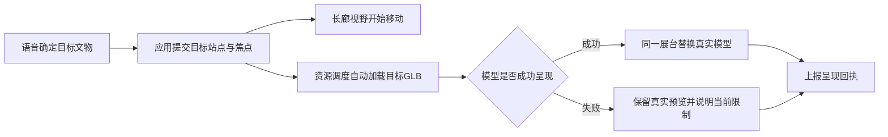
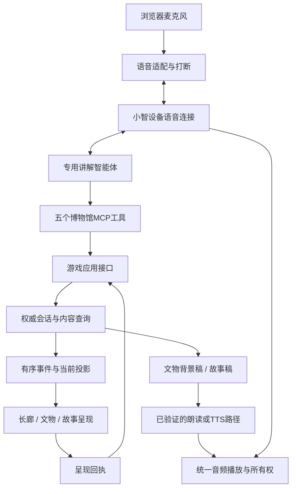

# 时空博物馆：长廊式语音游玩开发手册

版本：2.1｜日期：2026-10-24｜状态：产品基线与执行任务已细化；长廊语音体验待联调验收

本文根据最新确认的游玩方式制定。与旧[开发手册](./时空博物馆-开发手册.md)在首屏、导航、模型加载、故事入口和验收路线上的描述冲突时，以本文为准。旧手册的模块依赖、事务、内容校验、生图配置和提交规范继续适用。

**直接交给AI开发请使用：[逐项开发任务卡与PR规范](./时空博物馆-AI开发任务卡.md)。你亲自看画面、试语音的时间点和操作脚本见：[用户检查与交付清单](./时空博物馆-用户检查与交付清单.md)。实际完成状态登记在[开发进度](./acceptance/开发进度.md)。** 本文的文件表是职责设计，任务卡会复用当前已有同职责实现；路径或动作名称有差异时，以当前契约、ADR和已更新任务卡为准，不创建平行模块。

**玩家打开页面，看见一条深邃的博物馆长廊。真实文物沿时间线陈列，近处大、远处小。玩家通过说话向前参观、寻找文物；走近哪件，就自动呈现那件的三维模型。想听它的故事时，人物和插画才出现。**

这是二维透视长廊与单件真实三维文物的组合。首版不建设可自由行走的完整三维建筑世界，也不把素材管理页当作游戏首页。

## 1. 玩家实际怎样玩

### 1.1 打开页面

屏幕先显示博物馆内部：暗色墙面、向远处收束的地面、展台、克制的聚光灯，以及文物本身。参考实体历史博物馆的空间秩序与灯光感；用户所说“北京博物馆”在本轮不擅自对应某一座具体馆，不声称复刻某馆建筑。

地面的时间线指向更晚的历史，展台下用小字显示年代。首屏不用文章标题、故事封面、人物卡、展品列表或大面积说明文字占据空间。页面打开就已经在展馆内，不先要求选择章节。

首版默认进入唐朝长廊。讲解员可以简短欢迎：“欢迎来到时空博物馆。你可以说‘往前走’，也可以告诉我想看哪件文物。”

### 1.2 往前参观

玩家说“往前走一点”，视野沿长廊推进一站。近处的展台移出，里面的文物逐渐变大，地面年代随位置变化。不是整页向下滚动，也不是跳到一张新的目录卡。

首版采用**离散展台位置＋连续的过渡动画**。一句“往前走一点”默认前进一站，不让玩家控制真实米数。玩家仍可以自由改变顺序、后退、指名跳转。

### 1.3 找到某件文物

玩家说“我不要看铜钱了，去看里面那头牛”。系统结束当前讲解，查询唐朝已开放文物，找到真实的**鎏金卧牛**，把视野移动到对应展台。

视野移动期间自动准备模型。抵达后在展台原位置显示可旋转的真实模型，其他展台与长廊仍提供空间背景。**不出现“加载模型”按钮，不再要求点击进入详情页。**

### 1.4 观察文物

玩家可以说“转过来”“看看背面”“近一点”“恢复原来的角度”。变化的是当前文物的观察视角，不是整条长廊的朝向。

当前文物下方只保留简短名称、真实断代和一行故事引子，例如“这么小的一头牛，为什么会出现在书桌上？”完整资料存在内容层，按需讲解，不默认铺满屏幕。

### 1.5 进入故事

玩家说“我想看看它背后的故事”。这时才从文物观察过渡到故事层，展示准备好的人物背景、人物卡、静态漫画与简短字幕，播放对应文稿。

故事可以覆盖日常生活、人物的一生片段、技艺与交流，或有关联的历史事件。真文物身份与创作人物经历各自保留；不能把虚构人物说成已经证实的原物主人。

### 1.6 追问与回来

玩家中途提问，正在播放的讲解立即停下。普通追问以语音回答为主，画面保留当前文物或故事镜头；只有确有需要时才补充资料。

玩家说“继续刚才的故事”，恢复被打断的片段；说“回博物馆”“不听故事了”，回到原来的展台位置与文物观察角度。随后说“再往前走”，继续沿长廊参观。

### 1.7 换朝代

“带我看唐朝”切换到唐朝长廊。首版说“看宋朝”时，讲解员说明“宋朝展厅还没有开放，目前可以参观唐朝”，保留当前画面与进度，不显示空展厅或虚构宋代展品。

后续安装其他朝代或国际内容包后，同一指令才能进入对应展厅。更换朝代不需要更换整套页面或增加一套MCP工具。

## 2. 画面必须遵守的规则

| 场景 | 主要看见什么 | 出现什么小字 | 何时出现故事插画 |
| --- | --- | --- | --- |
| 刚进入 | 有纵深的长廊、真实文物的远近关系 | 地面时间线、极少量语音提示 | 不出现 |
| 向前／后移动 | 展台位移、文物大小与遮挡变化 | 当前年代与方向提示 | 不出现 |
| 停在文物前 | 当前真实模型，背景仍是长廊 | 文物名、真实年代、一行故事引子 | 不出现 |
| 请求背景介绍 | 当前模型与可选一行字幕 | 正在朗读的短句 | 不自动进入故事 |
| 请求背后的故事 | 人物与静态场景，文物作为故事来源标识 | 简短对白／字幕、必要的创作标识 | 此时出现 |
| 自由提问 | 保持正在看的内容 | 可选字幕 | 仅在用户意图需要时换镜头 |
| 返回长廊 | 原展台、原焦点、原文物视角 | 年代与故事引子 | 收起 |

默认页面不出现章节文章、四列展品卡、资料侧栏、PR状态、素材文件路径等开发信息。连接状态可以做成小图标；详细诊断放在开发模式。

“没有文字”理解为**画面以空间和文物为主体**。年代、文物名、故事引子与可选字幕仍保留。文字字号不能小到无法辨认；减少界面元素不等于移除可访问性。

## 3. 长廊怎样产生纵深

### 3.1 技术选择

长廊用HTML/CSS或SVG的墙面、地面、透视线和灯光层绘制；展台及远处文物按统一投影函数定位。首版不需要Three.js场景、建筑模型、碰撞、物理或自由相机。

推荐让一个纯函数将“展台深度与当前导航位置”映射成屏幕的平移、缩放、遮挡顺序和明暗。可以采用类似 `scale = focal / (focal + depth)` 的有界投影；这是渲染参数，不是历史年份的数学比例。位于视野后方或过远的展台应裁剪，而不是无限缩小或产生负比例。

若使用CSS透视，相关行为以[MDN perspective说明](https://developer.mozilla.org/en-US/docs/Web/CSS/Reference/Properties/perspective)为准。具体视觉参数只在展示模块调整，不能写进剧情或MCP。

### 3.2 同一条长廊里的模型

远处先显示**从真实模型渲染得到的文物预览形象**，无封面边框、无卡片底板。视觉上仍是展台上的文物，不是故事海报。该预览是加载优化，不能用AI重画的器物替代。

当前展台进入近景后，真实GLB在同一位置替换预览形象，可以轻量交叉淡入。首版同一时刻维持一个可交互三维查看器，其余展台保留真实文物预览；不同时启动19个高精度模型。

`Artifact3D` 保持透明背景，布置在当前展台对应的稳定视口中。长廊透视与文物自身相机分开计算，防止“转文物”变成“转展馆”。若祖先CSS变换影响画布清晰度或交互，近景查看器使用独立覆盖层对齐展台，视觉位置保持一致。

### 3.3 时间与陈列位置

地面保留年代节点，向远处总体推进到更晚时期。已明确断代的文物按年代安排；年代区间重叠时由策展数据确定稳定顺序，不声称先后制作关系已确定。

宽泛断为“唐代”的作品显示区间，不为了填满618—907年而编造某一制作年。将后出器物用于讲早期制度时，必须同时显示“故事／制度时间”和“本件断代”。有疑问的断代不混入已经核实的精确年代排序。

同一件文物可关联多个故事，但在同一长廊里只有一个主展位；重访相关事件回到同一个实体ID。伊拉克比较碗保留地域标识，长沙窑碗的照片展位不伪装成三维。

## 4. 一条首版验收旅程

首次闭环采用造像碑、开元通宝、鎏金卧牛三个真实展位；先建立连续空间感，再填入其余展品。钱币和卧牛在年代区间重叠处使用明确的策展顺序。

| 玩家说的话 | 系统应做什么 | 画面应当如何变化 |
| --- | --- | --- |
| “带我看唐朝” | 进入已发布的唐朝长廊 | 直接出现长廊和展台 |
| “往前走一点” | 前进一个展位 | 近处移出、里面文物变大，年代随动 |
| “看一下铜钱” | 定位开元通宝并设为焦点 | 靠近对应展台，自动加载真模型 |
| “转到背面” | 修改当前文物观察角度 | 铜钱转动，长廊不转动 |
| “别看铜钱了，我要看那头牛” | 搜索并定位鎏金卧牛 | 旧讲解停止、视野移动、卧牛自动加载 |
| “介绍一下” | 读取卧牛背景文字并讲解 | 保持文物近景，按需显示字幕 |
| “看它背后的故事” | 保存展台返回点，进入对应预写故事 | 此时出现人物背景与故事图 |
| “为什么要做这么小？” | 停止当前讲解，结合物件资料回答 | 保持当前画面，不擅自推进故事 |
| “继续刚才的故事” | 恢复原片段／检查点 | 恢复原镜头及讲解，不跳过一段 |
| “回博物馆” | 关闭故事，恢复原展台与视角 | 卧牛仍在眼前，长廊继续存在 |
| “再往里面走” | 向更晚的下一个展位移动 | 继续产生空间推进 |
| “看看宋朝” | 返回未开放状态，不改会话 | 唐朝画面和进度保留 |

这整段旅程除浏览器首次授权之外，不依赖点击展品、点击加载、点击故事或点击继续。

## 5. 语音指令怎样解释

| 表达 | 语义 | 需要的上下文 |
| --- | --- | --- |
| 往前、往里面、再走一点 | 向当前展厅顺序的下一站移动 | 当前展厅、站点、前进方向 |
| 往回、退一点 | 回到上一站 | 同上；到边界时说明已经到头 |
| 看那头牛、去看铜镜 | 按名称或别名查找并定位 | 当前已开放内容与目标唯一性 |
| 第二件、旁边那个 | 根据当前被报告的可见顺序解析 | 服务端 `display_order` 和对应视图修订号 |
| 这个、它 | 指向当前聚焦文物 | `focused_entity_id`；无焦点时才澄清 |
| 近一点、看背面、转过来 | 调整文物相机 | 当前文物及上次已应用的观察角度 |
| 介绍它 | 朗读／讲解背景稿 | 当前文物、背景文字、讲解检查点 |
| 看它的故事、带我进去 | 进入当前文物的故事 | 文物绑定的故事入口、展台返回点 |
| 回博物馆、退出故事 | 返回展台 | 保存的长廊站点和文物视角 |
| 停一下 | 立即停止声音，取消尚未提交的当前任务 | 当前播放与命令生命周期 |

“继续”按状态解释：故事暂停时先恢复被打断的片段；用户明确说“下一段”才跳到下一片段；在长廊中说“继续往前”就是移动一站。无法唯一解释的裸“继续”，只问一个简短问题，不默默执行两种动作。

“往前走”不等于放大文物，“近一点看看它”不等于走到下一站。方向、对象观察与故事推进必须是三种明确的意图。

首版不做持续任意坐标行走。新目标可以替换旧过渡动画；“停下”取消尚未提交的导航，已经提交的导航收束到权威目标站点，不让动画中间帧偷偷生成新的文物焦点。

## 6. 自动加载的完整生命周期

加载状态：`preview → loading → ready`，或进入 `failed/degraded`。玩家从不负责触发这个转换。

优先级固定为：当前目标模型／当前故事必需图 → 下一站真实预览 → 小范围邻近资源。播放故事时优先保留返回展台所需资源，但后台不继续抢占带宽下载所有模型。

每次目标变化都有呈现代次或关联标识。若玩家从A快速切到B，A的晚到网络结果不能覆盖B；取消加载、丢弃过期结果、卸载查看器与释放引用由资源模块处理，不推进剧情。

`model-viewer` 的配置必须保证焦点到达时主动加载、自动显示。不能沿用示例里的点击揭示路径或由遮罩按钮触发的poster逻辑。加载与压缩支持参考[官方加载示例](https://modelviewer.dev/examples/loading/)，实现时按锁定版本验证API及实际load/error事件。

失败时保留真实预览形象，自动按有限策略重试，并允许用户语音“再试一次”或“往前走”。提示“模型暂未加载，当前显示的是预览”，不能说“你现在可以旋转它”。只有照片的展品支持“换个角度的照片／放大”，不接受假三维旋转。

默认同时活跃的三维查看器为1；渲染器、网络缓存与内存缓存分别计量。原始约1.6GB模型仅用于素材归档，不能因为“自动加载”而全部推给浏览器。

初始性能预算作为工程目标：普通过渡550—900毫秒；已缓存模型力争抵达后1秒内可交互；冷加载超时有真实状态提示。目标设备上优先使用约5—10MB以内的展示版模型，超预算单独优化与验收。网络、设备与实测结果必须记录，不把目标写成已经达到的保证。

## 7. 语音、小智与MCP的分工

### 7.1 两条链路在同一会话汇合

小智负责语音对话能力；MCP负责让讲解员查询当前位置、寻找对象、发出游戏动作。MCP不传麦克风音频、GLB和整本剧本，也不直接改变浏览器DOM。

现有网页小智工程可复用采音、编解码、双向音频、播放停止、固定设备身份和连接管理。2026-10-24检查到其 `server.py` 的hello仍是 `features: {}`，已有abort处理；这不等于已经连接游戏MCP。不能只增加一个hello标志就宣称完成接入。

### 7.2 接入步骤

1. 以现有网页模拟设备连接用户的小智账号，完成首个设备绑定；沿用稳定设备身份，不为每次开页面创造新设备。
2. 给博物馆使用的专用智能体配置MCP接入点。按[小智官方管道示例](https://github.com/78/mcp-calculator)固定一个核实过的版本，在本机运行管道与本项目MCP服务。该示例当前提供 `MCP_ENDPOINT` 及 `mcp_pipe.py` 启动方式；实现时以实际账号控制台和固定版本为准。
3. 注册既有五个工具，先验证发现、查询、调用、返回长度与错误处理。首版自动绑定当前唯一展台；首次设备／账号配置属于安装流程，不把每次语音配对数字当作参观必经步骤。
4. MCP服务经本地应用接口访问已绑定会话；不让模型凭自己填写的设备名决定控制哪一个页面。
5. 先用真实账号跑“走一站→看卧牛→自动加载→进入故事→打断→返回”的小闭环，再扩完整唐朝。

官网示例证明的是管道接入方法，不证明本账号已经支持所有轮次、取消和指定文本播报能力。实测记录仍放在旧手册规定的接入证据与ADR文件中。

账号登录凭据、模拟设备身份／Token、智能体的 `MCP_ENDPOINT`、生图Key分别管理。登录小智账号不等于设备已绑定，也不等于MCP已连接。正式部署由本机启动器或服务配置装配这些值，不把端点Token放进HTML或让玩家在参观时输入。

### 7.3 五个工具继续保持稳定

| 工具 | 本产品中的工作 |
| --- | --- |
| `museum_connect` | 绑定当前语音连接与网页展台；后续相同有效连接自动恢复 |
| `museum_get_context` | 查询当前展厅、站点、聚焦文物、故事、实际呈现状态及允许动作 |
| `museum_search` | 按名称、别名、时期和主题查找已开放对象；返回ID与最少说明 |
| `museum_read_content` | 读取当前文物背景稿、故事片段及相关事实；有界分页 |
| `museum_act` | 提交进入展厅、移动、定位文物、转动、进入故事和返回等受限动作 |

“看牛”需要先把别名映射到文物ID，再定位展位。AI不能给出CSS坐标、临时编造模型URL或直接请求本机任意文件。新加宋朝或海外展厅只扩内容；不新增“唐朝工具”“宋朝工具”。

### 7.4 打断是动作生命周期的一部分

本地检测到玩家开始说话时，先停止播放，再撤销旧任务的有效控制范围，之后才处理新输入。旧音频、过期工具回复和旧模型加载结果分别拦截。

当前仓库的修订号与票据机制继续使用；但仅靠本地加一个轮次ID，不能证明云端旧任务与新任务已经隔离。仍需旧手册规定的真实取消／关联测试。

如果小智直连MCP无法提供可靠隔离，采用带可信本地输入分段与任务关联的自有控制编排，语音适配口不变。若必须使用独立ASR／模型，需要单独验证和配置。**不能把“改成点击确认”作为本版语音玩法的完成条件。** 开发测试工具可临时使用文本命令，面向玩家的闭环必须能靠语音完成。

## 8. 背景文字、故事文字和自由回答

| 内容 | 从哪里来 | 何时显示／朗读 | 是否推进剧情 |
| --- | --- | --- | --- |
| 一行故事引子 | 展品内容稿 | 走近文物时显示 | 否 |
| 文物背景稿 | 已审核的文物资料 | 用户说“介绍它” | 否 |
| 故事片段正文 | 预先编排的人物／事件故事 | 用户明确进入故事后 | 只由语音动作或既定规则推进 |
| 自由追问 | 当前文物与故事上下文交给LLM | 用户问问题时 | 回答本身不推进 |
| 资料与出处 | 文物／事实来源 | 用户追问或要求查看来源时 | 否 |

文字独立于图片保存，按片段提供，不把完整长文塞进MCP响应。默认显示精简字幕；界面可以语音关闭字幕。场景图片仅表达情境，不承担器物铭文辨认或事实校验。

背景／主线稿需要经**已验证能接收指定正文的朗读路径**播报。小智账号是否支持直接指定文本播报须先做探针；仅让LLM自行复述资料，不能承诺逐字朗读。若不支持，使用独立TTS适配或预先合成的音频，仍复用同一播放器与打断机制，不改故事数据。

同一时刻只有一位讲解者占有音频输出：固定稿朗读、自由问答和操作确认互斥。不能一边播放本地故事音频，一边又播放小智对同一段内容的回答。操作确认尽量短；模型尚在加载时只说“正在带你过去”，拿到真实呈现回执后才说“现在可以转动看看”。

自由回答由LLM发挥，不为首版建设庞大的固定问答树。但要携带当前文物、当前故事片段与返回点，避免“它”换成另一件。回答不能把创作人物经历覆盖到真实文物档案。

## 9. 会话状态与导航状态

游戏服务保存“站在哪、看哪件、故事在哪段”；网页只计算中间动画帧。小智、MCP、React和音频桥都不能各存一份互相矛盾的进度。

| 状态 | 权威归属 | 说明 |
| --- | --- | --- |
| 内容包与版本、当前展厅 | 游戏会话 | 决定哪些年代和展品真实可用 |
| 当前展位、导航方向、聚焦文物 | 游戏会话 | 移动／指名定位后原子更新 |
| 可见对象和语音序号顺序 | 服务端展厅投影 | “第二个”不使用前端另一套排序 |
| 长廊／观察表现阶段 | 呈现投影 | 均可属于现有 `explore` 模式，不重复造剧情模式 |
| 当前故事、节点、变量 | 既有剧情核心 | 继续复用已实现的规则引擎 |
| 从故事返回的展台锚点 | 游戏会话 | 保存展厅、展位、文物、观察视角及相关版本 |
| 文物观察角度目标 | 视图状态 | 与长廊导航位置分开，受 `view_revision` 管理 |
| 逐帧位置、缩放与缓动 | 网页展示模块 | 不每帧写SQLite，不每帧调MCP |
| 网络下载、模型解码与画面成功 | 资源／呈现模块 | 成功或失败以回执关联当前目标 |
| 当前播放与朗读检查点 | 对话／朗读模块 | 插话时可停止并保留准确返回点 |

进入故事前保存展台返回锚点；退出故事恢复它。当前ADR0002采用 `exhibit_return_point` 命名；CW04c落实首次从探索进入故事的根返回点和持久化，不能把必须先有story_id的问答返回点当作根展台锚点。原草案名称 `exploration_anchor` 不再平行新增。问答原有 `return_stack` 继续处理故事片段返回。

直接说远处文物时，服务端一次事务完成“确认对象在可用展厅→决定站点→更新位置、可见顺序与焦点”。不要简单删除 `focus_entity` 的可见性检查，否则只是绕过状态约束。

## 10. 现有代码能复用什么，还缺什么

以下为2026-10-24本机工作分支检查，不代表所有分支或PR已经合并。

| 部分 | 查到的状态 | 本轮所需工作 |
| --- | --- | --- |
| 网页 `main.tsx`、`presentation/MuseumShell.tsx`、`application/museumApi.ts` | 已有会话创建/恢复、查询与目录操作界面 | 改成长廊主入口，复用HTTP客户端；目录只保留开发模式 |
| `domain/session/`、`domain/story/`、`domain/gallery/navigation.py` | 会话/剧情核心已有，相邻展位、远处定位与根展台返回点已有提交 | 复核已有实现；H4画面与旧存档兼容仍待验收 |
| `application/command_service.py` | 统一命令、幂等；已见进入展厅、前后移动、locate与return提交 | Schema合法不等于网页长廊或真实语音已接通 |
| `application/query_service.py` | 已见gallery路由与可见展品投影提交 | 与实际屏幕display_order核对；搜索顺序不是游览顺序 |
| `adapters/http/` | 会话、命令、事件与呈现接口已有代码 | 暴露新投影并接入长廊呈现回执 |
| `contracts/schemas/v1/` | 已增展厅与导航动作、MCP params；ADR0002明确兼容v1 | 复核样例、生成类型、根返回点、媒体语义，不能再按旧缺口重建 |
| `content-src/packs/cn-tang/` | 已有造像碑、钱币、卧牛的draft 0.2.0作者包 | 不等于资产可访问、全馆发布或历史审核通过 |
| 网页小智旧工程 | 采音、音频连接、abort等已实现 | 提取为适配器，与游戏会话及MCP联调 |
| `services/voice-bridge/`、`services/mcp-gateway/` | 本次文件盘点未见对应服务源码 | 按计划创建，不能视为已经存在 |
| 本机配图与文物卡 | 已有58个选用候选图ID、20件展品卡及10章底稿 | 作为故事素材与作者稿导入，不充当长廊首页 |

### 10.1 契约与实现不能混为一谈

本轮复查HEAD `4d5b009`：展厅Schema、导航枚举、MCP params、远处定位与根返回点已在工作分支出现，不能继续按“尚无协议”重复开发。实际兼容方案见[ADR0002](./adr/0002-gallery-navigation-contract.md)，当前动作名如下。

| 动作 | 输入设计 | 实施与复核原则 |
| --- | --- | --- |
| `enter_gallery` | 展厅ID | 已有实现待复核；正常重复进入不清空进度的产品语义还需验收 |
| `move_next` / `move_previous` | 当前展厅／站位与版本 | 已有前后一步实现；边界、幂等、视图与轮次按CW04a复核 |
| `locate_artifact` | 已发布文物ID | 已有实现待复核；不改变旧open_artifact可见性规则 |
| `return_to_exhibit` | 会话保存的返回点 | 已有实现待复核；故事问答返回栈另管片段 |
| `set_view` | 受限yaw/pitch/zoom | params已能表达；还需存档、viewer单位映射与真呈现回执 |

这些是本项目语义，不是小智内置工具。Schema合法不代表事务、SQLite、网页或真实小智已接通。媒体用途、根返回点、指定文稿与真设备证据按任务卡补齐；严格对象的字段仍须先改Schema及生成DTO。上述快照没有替代代码测试或PR合并核验。

## 11. 高内聚、低耦合的模块划分

| 模块 | 只负责什么 | 不负责什么 |
| --- | --- | --- |
| 展厅内容 | 哪些朝代开放、展位顺序、年代与别名、故事绑定 | CSS布局、WebSocket、播放声音 |
| 导航应用 | 目标解析、前后站、跨展位定位、返回锚点 | 逐帧动画、GLB下载 |
| 会话与剧情核心 | 权威焦点、模式、故事进度与合法状态转换 | 小智协议、浏览器控件 |
| 长廊呈现 | 投影、灯光、展台远近、移动动画 | 决定年代真伪、修改故事节点 |
| 文物资源 | 真实预览、自动加载、取消、缓存、三维相机与呈现回执 | 解释玩家意图、生成剧情 |
| 故事呈现 | 显示已提交节点的人物、背景、字幕 | 自行选择下一节点或重新检索原物身份 |
| 语音适配与朗读 | 采音、编解码、插话、指定文稿播放、音频互斥 | 决定“往前”是哪一站 |
| MCP适配 | 五工具发现、输入输出兼容、调用应用接口 | 直接改DOM、SQLite或模型姿态 |
| 内容／素材制作 | 文稿校验、真实模型预览导出、故事生图、发布 | 在玩家运行时付费生图或联网补史实 |

“加一件牛”只增加文物、展位与别名数据；“长廊更深”只改投影和视觉参数；“换语音供应商”只改适配器；“改故事”只改内容稿。任何一个都不应该要求同时重写以上所有模块。

## 12. 逐文件实施职责

本节是职责设计，不是所有路径都已经存在。必要时沿用同职责文件；实际新增/修改范围见任务卡。尤其HTTP沿用已有 `application/museumApi.ts`，入口沿用 `presentation/MuseumShell.tsx`，不要照示意再建另一套API客户端和会话状态。

### 12.1 网页：相对 `apps/museum-web/src/`

| 文件 | 负责的功能 |
| --- | --- |
| `main.tsx` | 应用挂载；不再把健康检查欢迎卡作为游戏主界面 |
| `App.tsx` | 组装长廊、故事层、语音入口和统一状态订阅 |
| `api/museumClient.ts` | 应用HTTP请求与DTO校验 |
| `api/eventChannel.ts` | 事件序号、重连、快照补齐；复用后端有序事件能力 |
| `state/sessionProjection.ts` | 保存服务端投影，不自行决定焦点与顺序 |
| `state/commandDispatcher.ts` | 提交动作及请求ID、修订号，不重复执行业务动作 |
| `gallery/MuseumCorridor.tsx` | 长廊空间骨架、展位层与观察层组合 |
| `gallery/corridorProjection.ts` | 深度到屏幕位置、缩放、遮挡的纯计算，处理裁剪与边界 |
| `gallery/CorridorMotion.ts` | 当前权威目标的缓动、目标替换、减少动态效果；不保存剧情 |
| `gallery/ExhibitStation.tsx` | 单个展台、真实文物预览形象、聚焦高亮 |
| `gallery/FloorTimeline.tsx` | 跟随站点的地面时间线与年代标签 |
| `gallery/FocusedArtifact.tsx` | 当前展台自动接入三维组件；不出现加载按钮 |
| `gallery/ArtifactCaption.tsx` | 名称、真实断代、一行故事引子 |
| `capabilities/Artifact3D.tsx` | `model-viewer`唯一封装；透明背景、旋转缩放、load/error及清理 |
| `capabilities/assetLoader.ts` | 当前优先、邻近预取、去重、取消、缓存引用与释放 |
| `capabilities/RenderReceiptReporter.ts` | 将实际呈现结果关联目标、命令与修订号，丢弃过期结果 |
| `story/ArtifactStoryStage.tsx` | 用户进入故事后才挂载人物卡与场景；退出恢复长廊 |
| `story/StoryFrame.tsx` | 一个静态镜头的图片、轻转场和字幕，不自动推进权威节点 |
| `narration/NarrationPlayer.ts` | 固定稿／音频的播放、停止、恢复及检查点 |
| `narration/AudioFocus.ts` | 主线、自由回答、操作提示的单一音频所有权 |
| `voice/VoiceClient.ts` | 与语音桥连接，接收规范化语音事件 |
| `voice/PlaybackQueue.ts` | 音频队列、立即停止、旧回复丢弃与真实排空 |
| `voice/VadController.ts`、`voice/capture-worklet.js` | 从旧工程提取的采音与本地插话检测 |
| `voice-ui/VoiceEntry.tsx` | 首次授权／开始参观及简洁连接状态；不是玩法菜单 |
| `voice-ui/SubtitlePanel.tsx` | 可选字幕与识别反馈；字幕不是剧情完成信号 |
| `styles/corridor.css` | 透视空间、灯光、展台、响应式与减少动态效果 |
| `styles/tokens.css` | 色彩、对比度、字体等统一视觉参数 |

旧计划的 `ExhibitList` 可用于编辑器或开发工具，不作为玩家主界面；`ArtifactPanel` 的必需内容归入当前展台观察组合；故事层继续使用已有ComicScene能力，不平行再写一套剧情引擎。

### 12.2 游戏服务：相对 `services/museum/src/museum/`

| 文件 | 状态／职责 |
| --- | --- |
| `domain/session/models.py`、`transitions.py` | 已有；增加展厅／展位锚点、合法导航与返回转换 |
| `domain/gallery/navigation.py` | 已见相邻站点纯函数；补目标所属展位等规则，不依赖HTTP |
| `application/command_service.py`中的导航编排 | 沿用唯一写入口接入跨站目标；仅确有独立职责才拆应用服务，不创建第二写入口 |
| `application/command_service.py` | 已有；作为所有写动作的唯一入口，保持事务与幂等 |
| `application/query_service.py` | 已有；查询长廊、当前可见文物与故事背景，保持只读 |
| `application/mappers.py` | 已有；增加展厅及展位投影，不在里面写动作规则 |
| `application/render_service.py` | 已有；接收当前文物／故事实际呈现状态 |
| `ports/content_catalog.py` | 已有；增加已发布展厅布局查询需要的最小接口 |
| `adapters/content/published_catalog.py` | 已有；加载布局、别名、故事绑定，不读作者草稿作为玩家内容 |
| `adapters/sqlite/session_repository.py`及迁移 | 已有；保存新增锚点并兼容旧存档，不能每帧落库 |
| `adapters/http/` | 已有；复用会话、查询、命令和事件通路，必要时新增只读展厅路由 |

### 12.3 契约、内容和语音

| 路径 | 工作 |
| --- | --- |
| `contracts/schemas/v1/gallery.schema.json` | 已增朝代／地域展厅、开放状态、站点及陈列时间依据，先复核 |
| `contracts/schemas/v1/session.schema.json` | 兼容表达导航锚点、焦点和故事返回点，CW04c补根锚点闭环 |
| `contracts/schemas/v1/command.schema.json`、`mcp-tools.schema.json` | 已增加导航动作与受限观察参数；应用与工具实现继续同步 |
| `packages/contracts-ts/src/generated.ts`、Python生成DTO | 从Schema重新生成，不手改生成文件 |
| `content-src/packs/cn-tang/galleries/` | 唐朝长廊、展位顺序和主展位映射 |
| `content-src/packs/cn-tang/artifacts/`、`stories/`、`nodes/` | 真文物、背景稿和预写故事；适配当前编译器目录约定 |
| `content-src/packs/cn-tang/aliases/` | 可选的策展别名源稿，编译到索引；如并入文物字段则不重复维护 |
| `tools/content-pipeline/` | 在现有制作包中增加展厅校验、预览导出和故事素材导入；不要只因文档示意创建第二套制作器 |
| `services/voice-bridge/src/voice_bridge/` | 按旧手册提取小智设备适配、编解码、播放和生命周期；不复制旧页面UI |
| `services/mcp-gateway/src/museum_mcp/` | 按五工具职责接入；增加导航语义与新Schema兼容投影 |
| `docs/integration/xiaozhi-capabilities.md` | 实测工具、指定文本朗读、取消与轮次证据 |
| `docs/adr/0001-voice-control-routing.md` | 直连或自有控制编排的选路结论及理由 |

资源可访问、浏览器WS握手、分段正文读取与本机联调包分别由CW02c/e、CW03c/d补齐。协议已按ADR0002选择兼容增补v1，不再创建字面 `<协议版本>` 目录或并行v2契约。后续如需破坏性升级另写ADR。开发前检查当前分支，路径随同职责实现调整并同步任务卡。

## 13. 文物、展位与故事需要哪些数据

三个对象分开：**文物是什么、放在哪里、它能引出什么故事**。不要把展位像素坐标写进文物史实档案。

| 对象 | 最少需要的字段 | 约束 |
| --- | --- | --- |
| 展厅 | ID、标题、地域、开放状态、内容版本、默认站点 | 当前只有唐朝开放 |
| 展位 | ID、展厅ID、稳定顺序、年代标签、陈列依据、文物ID、表现侧位 | 不把帧坐标或GLB原始数据塞进来 |
| 文物 | 现有真实身份、断代、资产ID、别名、背景稿引用、故事引子、主展位ID | 宽泛／有争议断代可表达 |
| 真实文物资产 | GLB展示版、真实模型预览、默认观察角度、授权、降级照片 | 不用生成图替代实物形态 |
| 故事 | 入口、所属文物、人物、片段正文、配图ID、返回策略 | 真物归属与虚构经历分开 |
| 镜头 | 文物观察角度或漫画表现参数 | 两种镜头分别建模，前端不凭空猜热点坐标 |

当前数据导入必须处理两个实际问题：20份本机卡片是作者交接格式，不是已通过严格Schema的运行时包；人物图和58个图ID属于故事素材，不是已经具备真实文物透明预览的一整套首页资产。

新增展品前自动校验：主展位唯一、站点引用存在、别名是否冲突、真实预览及GLB是否可用、故事可退出、图片ID能找到、年代显示不隐去重要不确定性。语音找不到唯一目标时由短问题澄清，不能随机选一个。

## 14. 现有58张配图怎样使用

素材根目录：`D:/7/History/generated/2026-10-24-tang-r02/`。这是本机取材位置，不是正式运行时绝对路径。

| 现有素材 | 在新玩法中的用途 |
| --- | --- |
| 人物设定图 | 故事／角色对话层；角色表情可在审核后加工为单独资源 |
| 文物故事图 | 进入该文物故事后作为静态镜头背景 |
| 时期生活背景 | 故事发生的时代、生活或事件转场 |
| 已有现代展馆插画 | 美术参考；不能直接替代可独立陈列、导航的整个长廊 |
| 文物背景卡与朗读稿 | 用户要了解时由讲解员读取 |
| 原有 `index.html` 预览页 | 内容与素材审阅工具，不是玩家首页原型 |

当前仍需制作的首页资源以**真模型预览、展台视觉、长廊样式与灯光**为主，不继续优先扩画一批首页故事封面。已有生成图先审后用，人物设定整张拼版也不等于已经裁成透明可独立叠放的角色立绘。

七牛生图继续保留为离线制作能力：`https://llmapi.qiniu.io/v1`，模型 `gpt-image-2`。只为确有缺口的故事图、人物变体或背景制作调用；玩家进馆、移动、查看文物时不触发生图。

Key由服务端本机环境或受控配置读取，不进入网页、内容包、PR或文档。生图凭据不自动具备语音、ASR、对话或TTS权限，不能复用猜测。

## 15. 细粒度PR实施顺序

具体领取以[AI开发任务卡](./时空博物馆-AI开发任务卡.md)为准；每卡列出前置、精确文件、实施步骤、检查、提交条件和禁止混入范围。CW是工作项编号，不是GitHub PR编号。PR与commit统一中文 `feat(范围): 描述`。

| 顺序 | 任务组 | 交付结果 | 用户检查 |
| --- | --- | --- | --- |
| 尽早 | CW09p | 真账号MCP、指定稿、取消与轮次探针，确定接入路径 | H5预检 |
| 基础 | CW01a/b、CW02a、CW03a、CW04a | 复核已见提交，不重复开发 | 工程证据登记 |
| 媒体 | CW01c、CW02b/c/d/e | 真预览、受控资产URL、展示版模型 | H1/H3 |
| 状态与定位 | CW03b/c/d、CW04b/c | 真实事件同步、原子定位、相机和返回点 | H2/H4 |
| 长廊与文物 | CW05a/b、CW06、CW07a/b/c | 透视首屏、移动、自动三维、资源释放与回执 | H1/H2/H3 |
| 故事 | CW08a/b | 请求后人物场景、正文与原位返回 | H4 |
| 语音控制 | CW09a/b/c、CW10a/b、CW11a/b | 采音、固定设备、可信绑定、MCP动作、旧任务隔离 | H5/H6 |
| 固定讲解 | CW12a/b | 指定稿朗读、单音频所有权、恢复同片段 | H4/H6 |
| 全唐朝 | CW01d/e、CW13a、逐件CW13b/13d、逐章CW13c、CW13e | 19模型对应资源、20卡、10章；候选与正式开放区分 | H7 |
| 交付 | CW14a/b/c | 扩展夹具、故障性能、一次启动与全程验收 | H8 |

任务组不是一份大PR；表中的a/b/c各自提交。逐件、逐章卡也各自独立提交；已有通过的同职责实现不为凑数再建PR。约束修改与存档升级须在对应PR写清兼容和回退，不在UI PR顺带重构核心。

你亲自检查的具体话术、画面与声音要求见[用户检查与交付清单](./时空博物馆-用户检查与交付清单.md)。没有用户反馈不登记体验通过，但独立资料/后端/适配任务可以继续。

## 16. 测试与验收清单

| 类型 | 必须验证的事情 | 主要位置 |
| --- | --- | --- |
| 内容校验 | 展位引用、时间依据、别名冲突、主展位唯一、模型／故事绑定 | 现有 `tests/content/` 增补 |
| 领域测试 | 前后站、两端边界、指名跳转、原位返回、旧存档迁移 | `tests/domain/test_gallery_navigation.py`及现有会话测试 |
| 命令／接口测试 | 同一请求只执行一次、位置与焦点原子提交、过期视图拒绝 | 现有 `tests/application/` 增补 |
| 展示测试 | 近大远小、裁剪、目标替换、模型自动加载、晚到不覆盖 | 网页相应模块测试；文件随既定测试工具确定 |
| 真设备联调 | 小智工具实际调用、指定文稿、打断、新旧任务隔离 | `tools/integration/`与接入证据 |
| 端到端 | 第4节整段语音旅程，首次授权后不点玩法控件 | `tests/e2e/voice_corridor`计划目录 |

首屏截图必须看得见长廊和文物的大小层次；验收录屏必须包含视野推进、文物同位变成可转模型、语音进入故事、打断与原位返回。只展示“工具调用成功”或“模型文件下载成功”都不算闭环。

还需覆盖：快速连续换三件文物、慢网与失败、仅照片展品、无匹配目标、两个相似目标、宋朝未开放、服务断连重连、刷新恢复、拒绝麦克风、减少动态效果与窄屏。不能用隐藏的鼠标点击代替失败的语音指令来录制完成证据。

## 17. 浏览器首次授权与实际入口

用户打开的是网页入口。开发联调通过本机localhost，发布通过HTTPS；不把双击 `file://` 文件当作完整语音与接口联调环境。

浏览器要求用户授予麦克风权限，部分环境还要求一次用户手势才能播放音频。这是平台限制，不能承诺新设备打开页面后绝对零操作。网页先显示长廊，必要时仅出现一次简洁的“开始语音参观”入口；完成授权／音频解锁后，主参观流程全部可用语音完成。依据：[麦克风权限](https://developer.mozilla.org/en-US/docs/Web/API/MediaDevices/getUserMedia)、[浏览器自动播放限制](https://developer.mozilla.org/en-US/docs/Web/Media/Guides/Autoplay)。

输入权限被拒绝时明确提示原因与重新启用方法，不假装正在听。键盘与辅助操作可保留为可访问性补充，不能替代本版语音主路径的验收。

## 18. 以后改一处，会影响哪里

| 想改什么 | 主要改哪里 | 一般不应影响什么 |
| --- | --- | --- |
| 长廊颜色、灯光、更深的视觉 | CSS、投影、展台表现 | 内容事实、剧情规则、MCP工具 |
| 文物位置或年代分组 | 展厅策展数据与编译校验 | 音频采集、三维组件实现 |
| 加入一件新文物 | 文物、主展位、真实预览、别名与故事绑定 | 供应商协议、核心导航算法 |
| 让用户能说更多俗称 | 内容索引和别名映射 | GLB文件、时间线投影 |
| 修改一件物品的故事 | 内容稿与镜头绑定 | 展台导航、设备连接 |
| 替换某张配图 | 审核素材清单和故事引用 | 文物真实身份、会话动作 |
| 更换三维查看器 | Artifact3D与资源适配 | MCP动作、故事节点、内容ID |
| 加宋朝或国际馆 | 新展厅内容包与策展配置 | 不新增朝代专属页面／工具 |
| 换小智或接入灵矽 | 语音／工具传输适配与能力实测 | 长廊投影、文物与故事数据 |
| 从离散展台扩到连续漫游 | 导航契约、会话锚点、呈现与相关测试 | 已有文物事实与故事正文 |

下一阶段第一件可评审成果应是：**三个真文物组成一条有纵深的长廊，用户说话前进、指名定位，靠近即自动加载，想听故事才出现插画。** 这条体验成立后，再扩成完整唐朝展馆。
